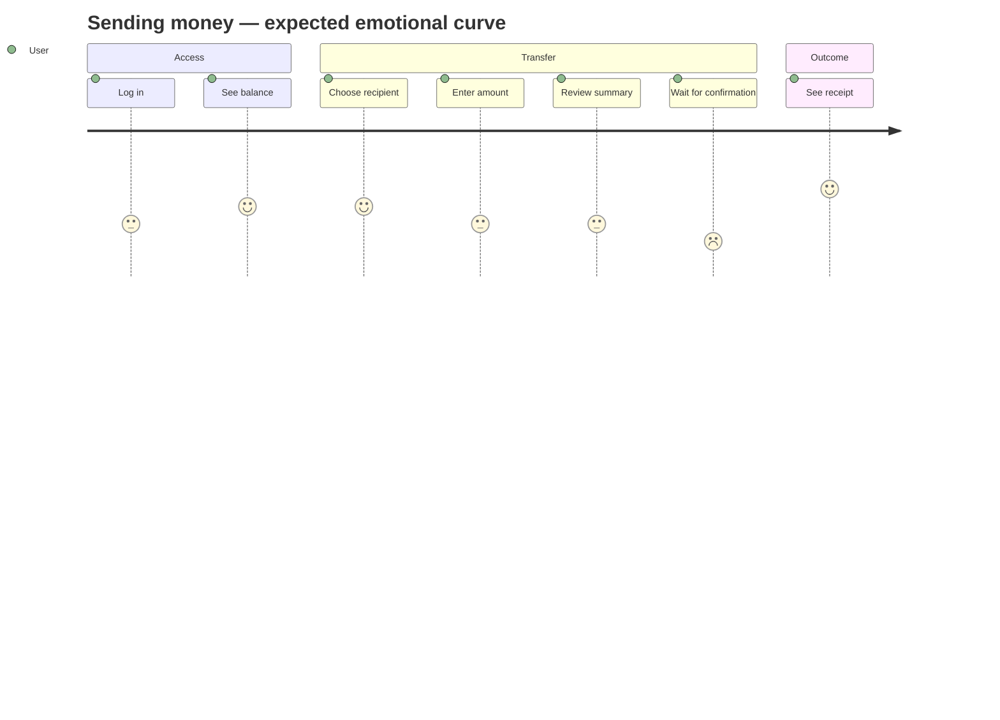

# User needs & UX analysis — Mini Wallet Web App

| Field | Value |
|---|---|
| **Status** | Approved |
| **Version** | 1.0 |
| **Author** | Claude (AI-assisted draft) |
| **Reviewer** | Project owner |
| **Last updated** | 2026-10-13 |
| **Related** | [Requirements analysis](./requirements-analysis.md) · [Accessibility](./accessibility-requirements.md) · [Assumptions & questions](./assumptions-and-questions.md) |

> The challenge defines **what** the app must do. This document defines **what users need while doing it**,
> so that the functional specs describe a product people can use with confidence, not just a set of screens.
> Personas are proto-personas (assumption-based), not research findings.

---

## 1. Usage context

| Dimension | Assumption | Design consequence |
|---|---|---|
| Device | Mostly smartphones, including mid-range devices | Mobile-first layout; light first load; large touch targets |
| Network | Variable mobile connectivity; latency spikes are normal | Every remote action shows progress, has a timeout, and is safe to retry |
| Environment | Used in public (transport, shops), often one-handed, with interruptions; day and night, bright sunlight and dark rooms | Primary actions within thumb reach; option to hide balance; input survives interruptions; light and dark themes |
| Locale | Mexico (ASM-01/ASM-02): Spanish, MXN, phone numbers of 10 digits | Locale-aware formatting of money, dates and phone numbers |
| Stakes | Real money (simulated): errors cost trust, not just time | Explicit confirmation step; unambiguous outcomes; receipt with reference |
| Scale | Millions of users with diverse ages, literacy and abilities | Plain language; accessibility as a baseline, not an add-on |

## 2. Proto-personas

### P1 — The everyday sender
- Sends small amounts several times a week (splitting bills, paying a friend back).
- **Needs:** speed, few taps, recent contacts at hand, instant confirmation.
- **Frustrations:** retyping recipients, unclear loading, extra confirmation dialogs.
- **Success looks like:** "I sent it in under 20 seconds and I'm sure it arrived."

### P2 — The cautious user
- Lower confidence with digital banking; afraid of sending to the wrong person or losing money.
- **Needs:** to see exactly who and how much before confirming; reassurance in plain language; a proof to show.
- **Frustrations:** jargon, error codes, screens that "hang", not knowing whether money left the account.
- **Success looks like:** "I checked everything, it told me clearly it worked, and I have the receipt."

### P3 — The assistive-technology user
- Uses a screen reader, screen magnification, high text size, or keyboard/switch access; may have motor or cognitive impairments.
- **Needs:** every element labeled, state changes announced, logical focus order, no time pressure, no reliance on color alone.
- **Frustrations:** unlabeled icon buttons, errors only shown in red, focus lost after navigation, content that breaks at 200 % zoom.
- **Success looks like:** "I completed the transfer independently, without guessing."

## 3. Core user needs

| ID | Need | Personas | Where it matters most |
|---|---|---|---|
| N-01 | **Know where I stand**: my balance and recent activity at a glance | P1, P2 | Home |
| N-02 | **Send quickly** to people I send to often | P1 | Recipient selection |
| N-03 | **Not make mistakes**: right person, right amount | P2, P3 | Amount, recipient, summary |
| N-04 | **Know what is happening** while the app works | All | Login, Home, Confirmation |
| N-05 | **Be certain of the outcome**: did the money leave or not? | P2 | Confirmation |
| N-06 | **Recover easily** when something fails, without starting over | All | All error states |
| N-07 | **Have proof** of the transaction | P2 | Receipt |
| N-08 | **Use it my way**: with assistive tech, zoom, keyboard, one hand | P3 | All |
| N-09 | **Keep my information private** in public spaces | P1, P2 | Home, receipt |

## 4. User journey

| Stage | User goal | Questions in the user's head | Risk / emotion | Design response |
|---|---|---|---|---|
| Login | Get in | "Do I use my phone or my email?" "Where is my code?" "Did it work?" | Friction, impatience; waiting for the code | One identifier field that accepts both (UX-03); code step that shows where it was sent and supports autofill/paste (UX-21); clear progress (UX-02); specific errors (UX-05) |
| Home | Check balance, start a transfer | "How much do I have?" "Did my last transfer arrive?" | Uncertainty if data is slow or missing | Skeletons (UX-15); independent error per section with retry; prominent "Send money" action |
| Choose recipient | Pick the right person fast | "Is this the right Ana?" | Sending to the wrong person | Name + initials + partially masked identifier (UX-13); add new contact inline |
| Enter amount | Type the amount | "Can I afford it?" "Is the format right?" | Typo with an extra zero | Available balance visible next to the field; live formatting (UX-07); rule errors inline |
| Review summary | Double-check | "Is everything correct?" | Anxiety before committing | Clear summary; action labeled with the amount; edit without losing data (UX-06, UX-08) |
| Processing | Wait | "Is it stuck?" "Should I tap again?" | Peak anxiety; double taps | Processing state; action disabled; idempotency (UX-11) |
| Outcome | Know the result | "Did the money leave?" | Highest trust risk on ambiguous outcomes | Distinct success; honest ambiguous states (UX-09); recovery paths (UX-06) |
| Receipt | Keep proof, move on | "Can I show this?" | — | Reference number, date/time, amount, recipient (UX-10); back to Home / send again |

## 5. Usability heuristics applied

Based on Nielsen's 10 usability heuristics, translated into concrete rules for this product.

| Heuristic | Application in this app |
|---|---|
| Visibility of system status | Every async action shows a state within ~100 ms; long waits change message after a threshold ("still working…"); the outcome is always explicit. |
| Match with the real world | Money in local format (`$1,234.50`); "Send", "Receipt", "Contacts", not "Transaction POST" or error codes; dates relative when recent ("Today, 14:32"). |
| User control and freedom | Back and cancel at every step of the transfer; edit from summary; cancel asks for confirmation only when entered data would be lost. |
| Consistency and standards | One term per concept (see [glossary](./glossary.md)); same money component everywhere; primary action always in the same position. |
| Error prevention | Inline rule validation before the summary; available balance shown while typing; summary step before money moves; duplicate submission blocked. |
| Recognition rather than recall | Favorites with names and initials; recently used first; summary repeats all details so the user does not have to remember them. |
| Flexibility and efficiency | Favorites for frequent recipients; keyboard-friendly forms; "Send again" from the receipt. |
| Aesthetic and minimalist design | One primary action per screen; secondary data visually de-emphasized; no decorative noise in the money flow. |
| Help users recover from errors | Messages say what happened, why, and what to do; the user's input is preserved; retry where it is safe. |
| Help and documentation | Short helper text where a rule may surprise (e.g. amount limits); no separate help needed for the core flow. |

## 6. UX requirements

| ID | Requirement | Priority | Needs | Applies to |
|---|---|---|---|---|
| UX-01 | **Mobile-first**: layouts are designed for small viewports first; primary actions are reachable with one hand. | Must | N-08 | All |
| UX-02 | **Visible status**: every asynchronous action shows progress; actions in progress are disabled; waits longer than a threshold update their message. | Must | N-04 | All |
| UX-03 | **One identifier field** for phone or email, with the right input hints (keyboard type, autofill) and the type inferred from the content. | Should | N-02, N-03 | Login, new contact |
| UX-04 | **Validation timing**: format errors appear when leaving a field or on continue, not on every keystroke; once shown, they clear as soon as the input becomes valid. | Should | N-03, N-06 | Forms |
| UX-05 | **Actionable error messages**: what happened + what to do, in plain language; technical codes only as a secondary reference. | Must | N-04, N-06 | All errors |
| UX-06 | **Input is never lost**: going back, editing from summary, or recovering from an error keeps everything the user entered. | Must | N-06 | Transfer flow |
| UX-07 | **Amount entry**: locale formatting while typing, only valid characters accepted, numeric keyboard on touch devices, available balance shown next to the field. | Should | N-03 | Amount |
| UX-08 | **Summary**: recipient name and partially masked identifier, amount as the most prominent element, resulting balance, and a primary action that states the amount ("Send $250.00"). | Should | N-03 | Summary |
| UX-09 | **Honest outcomes**: when the result is unknown (timeout, unknown error) the UI never claims success or failure; it says the result is being verified and offers a safe next step. | Must | N-05 | Confirmation |
| UX-10 | **Receipt**: clearly distinct success state with reference number (copyable), date/time, recipient, amount and resulting balance; actions to go Home or send again. | Must | N-07 | Receipt |
| UX-11 | **No accidental duplicates**: repeated taps or retries never produce two transfers or two saved contacts. | Must | N-05 | Confirm, save contact |
| UX-12 | **Exit paths**: every step of the transfer has back and cancel; cancel confirms only if data would be lost. | Should | N-06 | Transfer flow |
| UX-13 | **Recognizable recipients**: favorites show name, initials avatar and partially masked identifier; most recently used first. | Should | N-02, N-03 | Recipient |
| UX-14 | **Empty states guide**: an empty list explains why it is empty and offers the next action. | Must | N-01 | Home, favorites |
| UX-15 | **Stable loading**: loading placeholders match the final layout; content does not jump when it arrives. | Should | N-04 | Home, favorites |
| UX-16 | **Consistent language and formats**: one term per concept, one money format, one date format across the app. | Must | N-03 | All |
| UX-17 | **Privacy**: balance can be hidden; identifiers are partially masked in lists and receipts. | Could | N-09 | Home, receipt |
| UX-18 | **Session continuity**: after logging in the user returns to the page originally requested; an expired session explains what happened. | Should | N-06 | Auth |
| UX-19 | **Tone**: friendly, direct and reassuring; second person; no blame ("we couldn't…" instead of "you failed…"). | Should | N-04, N-06 | All copy |
| UX-20 | **Confirmation of secondary actions**: saving a contact gives immediate, non-blocking feedback. | Should | N-04 | New contact |
| UX-21 | **One-time code entry**: one field (not six separate boxes, or boxes that behave as one), numeric keyboard, OS code autofill and paste supported; shows the masked destination ("We sent a code to •••• 4321"); submitted with an explicit "Verify" action, not on its own; resend shows its cooldown; "change number/email" keeps the identifier. | Must | N-04, N-06, N-08 | Login |
| UX-22 | **Light and dark themes**: the app follows the operating-system preference by default; the user can override it (light / dark / system) from a control available on every screen; the choice persists across sessions; the correct theme is applied before the first paint (no flash of the wrong theme); both themes are fully designed, not an automatic inversion. | Must | N-08 | All |

## 7. Content and microcopy guidelines

**Error message formula:** *what happened* + *what it means for the user's money* (when relevant) + *what to do now*.

| Situation | ❌ Avoid | ✅ Prefer (meaning; final UI copy in Spanish es-MX per OQ-01) |
|---|---|---|
| Network error on confirm | "Error 503" | "We couldn't connect. Your money was not sent. Try again." |
| Timeout | "Request failed" | "This is taking longer than usual. We're checking whether your transfer went through." |
| Insufficient funds | "Invalid amount" | "You don't have enough balance. Available: $1,200.00." |
| Unknown error | "Something went wrong" (alone) | "We couldn't complete the transfer. If you were charged, it will be reflected in your activity. Reference: ABC123." |
| Empty activity | "No data" | "You have no transfers yet. Send money to someone to see it here." |
| Invalid identifier | "Invalid input" | "Enter a 10-digit phone number or an email like name@mail.com." |
| Wrong one-time code | "Auth failed" | "That code isn't correct. You have 2 attempts left." |
| Code expired | "Error" | "This code expired. Request a new one." |

**Rules**
- Buttons are verbs that describe the result ("Send $250.00", "Try again", "Save contact"), never "OK" or "Submit".
- Amounts always show currency symbol and two decimals.
- References and codes are shown in a monospaced, copyable format, secondary to the message.
- No exclamation marks in errors; reserved for success, sparingly.

## 8. Transfer flow structure (decided — OQ-08)

1. **Recipient** — choose a favorite or add a new contact (with "save to favorites").
2. **Amount** — with the recipient shown as context ("Sending to Ana") and the available balance visible.
3. **Summary** — everything in one place, editable.
4. **Processing → Outcome / Receipt.**

Rationale: choosing *who* first gives context to *how much*, and lets the amount step validate BR-01/BR-02 with the recipient already fixed. Alternatives considered: amount first; single form + summary.

## 9. How UX quality would be measured in production

Not implemented in the challenge; listed to show intent and to feed DECISIONS.md.

| Metric | Signal |
|---|---|
| Task success rate (transfer completed) | Flow effectiveness |
| Time to complete a transfer | Efficiency (P1) |
| Validation errors per transfer | Clarity of rules and inputs |
| Retries after ambiguous outcomes | Trust risk |
| Abandonment by step | Friction hotspots |
| Support contacts citing a reference code | Effectiveness of receipts and error references |

## 10. Change history

| Version | Date | Author | Change |
|---|---|---|---|
| 0.1 | 2026-10-13 | Claude (AI-assisted) | Created |
| 0.2 | 2026-10-13 | Claude (AI-assisted) | OTP login (UX-21), Spanish UI copy, flow order decided |
| 0.3 | 2026-10-13 | Claude (AI-assisted) | Dark mode (UX-22) |
| 1.0 | 2026-10-13 | Project owner | Approved |
