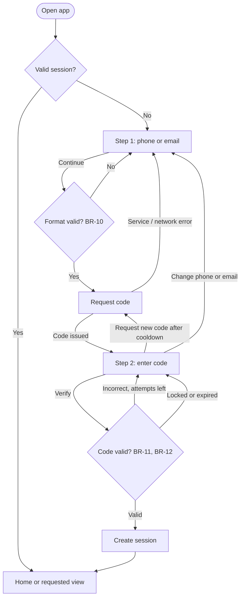

# FS-01 — Login

| Field | Value |
|---|---|
| **ID** | FS-01 |
| **Module** | AUTH |
| **Status** | Approved |
| **Version** | 1.3 |
| **Author** | Claude (AI-assisted draft) |
| **Reviewer** | Project owner |
| **Last updated** | 2026-10-13 |
| **Origin** | Challenge §1 "Login" · FR-AUTH-01…16 in [requirements analysis](../00-context/requirements-analysis.md#31-auth--login-and-session) · OQ-02 decision (one-time code) |
| **Implemented by** | [TS-01 Auth & session](../02-technical/TS-01-auth-session.md) |

---

## 1. Goal

Let a returning user get into their wallet with only their phone number or email and a one-time code, in as few steps as possible, with clear feedback at every moment. The session persists until the user logs out, and private views are never shown without one.

## 2. Scope

**In scope**
- Step 1: identifier entry (phone or email).
- Step 2: one-time code entry, resend, attempt limit, expiry.
- Session creation and persistence across reloads.
- Access control to private views and return to the originally requested view.
- Redirect of already-authenticated users away from Login.
- Logout (triggered from private views; its outcome lands on this screen).
- Handling of an invalid or expired session while navigating.

**Out of scope** (and why)
- Real code delivery by SMS or email — mocked (FR-AUTH-16, CON-08).
- Sign-up, account recovery, change of phone/email — not in the challenge.
- Biometrics, "remember this device", passkeys — not in the challenge; listed as "with more time".
- Fraud and bot controls (captcha, device fingerprinting) — real security is explicitly out of scope in the source.

## 3. Actors, preconditions and postconditions

| | Detail |
|---|---|
| **Actor** | Unauthenticated user (a registered wallet customer) |
| **Preconditions** | No valid session. |
| **Success postcondition** | A valid session exists; the user is on Home, or on the private view they originally requested. |
| **Failure postcondition** | No session is created; the user stays on the current login step with a descriptive message and everything they typed is preserved. |

## 4. Functional requirements

| ID | Description | Priority | Origin |
|---|---|---|---|
| FR-AUTH-01 | Login starts with a single identifier: phone number or email. | Must | §1 Formulario |
| FR-AUTH-02 | The identifier is required and its format is validated. | Must | §1 Validaciones |
| FR-AUTH-03 | The identifier type is inferred from the input. | Should | UX-03 |
| FR-AUTH-04 | Loading state while authenticating; no double submission. | Must | §1 Estados |
| FR-AUTH-05 | Simulated authentication error with a recoverable, descriptive message. | Must | §1 Estados |
| FR-AUTH-06 | The session persists across page reloads. | Must | §1 Sesión |
| FR-AUTH-07 | After a successful login the user lands on Home. | Must | §1 Navegación |
| FR-AUTH-08 | Private views require a session; the user returns to the requested view after logging in. | Must | Challenge "permisos" |
| FR-AUTH-09 | An authenticated user opening Login is sent to Home. | Should | Derived |
| FR-AUTH-10 | The user can log out. | Should | Derived |
| FR-AUTH-11 | An invalid or expired session is detected and explained. | Could | Derived |
| FR-AUTH-12 | Two-step login with a one-time code sent to the identifier, shown masked. | Must | OQ-02 |
| FR-AUTH-13 | The code is required and has 6 digits. | Must | OQ-02 |
| FR-AUTH-14 | Incorrect or expired code shows an error; 3 failed attempts require a new code. | Should | OQ-02 |
| FR-AUTH-15 | New code after a visible cooldown; the user can go back and change the identifier. | Should | OQ-02 |
| FR-AUTH-16 | Code delivery is mocked; the demo code is discoverable outside production. | Must | OQ-02, CON-08 |

## 5. Rules

### 5.1 Business and input validation rules

> BR-10…BR-14 originated in this FS and are registered in the [requirements analysis](../00-context/requirements-analysis.md#41-rules).
> BR-10 generalizes the identifier format so that BR-05 (recipient identifier) references it.

| ID | Type | Rule | When it is evaluated | Outcome if violated |
|---|---|---|---|---|
| BR-10 | Input validation | **Identifier format.** After normalization, an identifier is either a Mexican phone number of exactly 10 digits (spaces, dashes, parentheses and a leading `+52` / `52` are removed) or an email of at most 254 characters in the form `local@domain.tld` (trimmed and lowercased). | On blur, on continue (client) · on code request (server) | Format error; no code is requested |
| BR-11 | Input validation | **Code format.** After removing spaces and dashes, the code is exactly 6 digits. | On verify (client and server) | Format error; no verification attempt is consumed |
| BR-12 | Business | **Code validity.** A code is valid for 5 minutes and for at most 3 failed verification attempts; only the most recently issued code for an identifier is valid. | On verify (server) | Incorrect / expired / locked error |
| BR-13 | Business | **Code throttling.** A new code for the same identifier cannot be issued sooner than 30 seconds after the previous one, unless the previous one is locked by failed attempts. | On resend (server) | Request rejected with the remaining wait time |
| BR-14 | Business | **Session required.** Every private view and every private operation requires a valid session; the server rejects requests without one. | Every private request (server) | Redirect to Login / `UNAUTHENTICATED` error |

Values (5 minutes, 3 attempts, 30 seconds) come from ASM-15; codes are random per challenge and are configuration, not hard-coded behavior.

### 5.2 UI rules

| ID | Rule | Trigger | Behavior | Related |
|---|---|---|---|---|
| UIR-AUTH-01 | Identifier type inference | User types in the identifier field | Input containing `@` is treated as email; otherwise as phone. No type selector is shown. | FR-AUTH-03, UX-03 |
| UIR-AUTH-02 | Validation timing | Leaving the identifier or code field, or pressing the primary action | Format errors appear on blur or on submit, never while the user is still typing; once shown, an error disappears as soon as the value becomes valid. | UX-04, BR-10, BR-11 |
| UIR-AUTH-03 | Primary actions stay enabled | Form has invalid or empty values | "Continue" and "Verify" remain enabled; pressing them shows the errors and moves focus to the field. They are only non-interactive while a request is in progress. | A11Y-07 |
| UIR-AUTH-04 | In-progress lock | A request (code or verification) is in progress | The primary action shows a progress label, is non-interactive and exposed as busy; fields are read-only; further presses are ignored. | FR-AUTH-04, UX-02, UX-11 |
| UIR-AUTH-05 | Code step entry | Code step appears | Focus moves to the step heading/code field; instructions state the masked destination and the code length. | UX-21, A11Y-02, A11Y-08 |
| UIR-AUTH-06 | Destination masking | Code step shows where the code was sent | Phone: `•••• 5678` (last 4 digits). Email: first character + `•••` + `@domain` (e.g. `a•••@correo.com`). | UX-17, UX-21 |
| UIR-AUTH-07 | Code input behavior | User types or pastes in the code field | One single field; digits only; maximum 6; pasted values with spaces or dashes are normalized; OS one-time-code autofill is allowed. | UX-21, A11Y-14 |
| UIR-AUTH-08 | Explicit verification | Code field reaches 6 digits | Nothing is submitted automatically; the user presses "Verify". | A11Y-23 |
| UIR-AUTH-09 | Incorrect code | Server reports an incorrect code | Error under the field states remaining attempts; the field keeps focus and its content is selected so typing replaces it. | FR-AUTH-14, UX-05 |
| UIR-AUTH-10 | Locked or expired code | Server reports 3 failed attempts or expiry | The code field becomes read-only; the message tells the user to request a new code; "Request a new code" becomes available immediately and receives focus. | FR-AUTH-14, BR-12 |
| UIR-AUTH-11 | Resend cooldown | Code step appears or a new code is issued | "Request a new code" is unavailable and replaced by the text "You can request a new code in m:ss"; the countdown updates visually but is not announced every second; when it reaches zero the action appears and that change is announced once. | FR-AUTH-15, A11Y-16 |
| UIR-AUTH-12 | New code issued | User requests a new code successfully | A non-blocking confirmation "We sent you a new code" is announced; the code field is cleared and focused; the attempt counter resets. | UX-20, A11Y-08 |
| UIR-AUTH-13 | Change identifier | User chooses "Change phone or email" or browser Back from the code step | Returns to step 1 with the identifier pre-filled and focused. | FR-AUTH-15, UX-06 |
| UIR-AUTH-14 | Post-login navigation | Verification succeeds | Navigate to the originally requested private view if any, otherwise Home; Login is replaced in the history so Back does not return to it. | FR-AUTH-07, FR-AUTH-08, UX-18 |
| UIR-AUTH-15 | No flash for authenticated users | Authenticated user opens Login | Redirect to Home before the login form is ever rendered. | FR-AUTH-09 |
| UIR-AUTH-16 | Demo code hint | Environment is not production | A clearly labeled hint shows the code issued for the current challenge (it changes with every new code). Never rendered in production. | FR-AUTH-16 |
| UIR-AUTH-17 | Session-ended notice | User arrives at Login because the session expired/was invalid, or after logging out | A notice explains why ("Your session ended…" / "You have logged out"). | FR-AUTH-10, FR-AUTH-11, UX-18 |
| UIR-AUTH-18 | Theme control | Any login step | The theme switcher is available, as on every screen. | UX-22, A11Y-26 |

## 6. User stories

- **US-01** — As a customer, I want to log in with my phone number, so that I don't need to remember a username.
- **US-02** — As a customer who prefers email, I want to use my email in the same field, so that I don't have to choose a login method first.
- **US-03** — As a customer who mistyped the code, I want to know how many attempts I have left, so that I can correct it calmly.
- **US-04** — As a customer who didn't receive the code, I want to request a new one or fix my phone/email, so that I'm not stuck.
- **US-05** — As a returning customer, I want to stay logged in when I reload, so that I don't repeat the login every time.
- **US-06** — As a customer who opened a link to a private page, I want to land on that page after logging in, so that I don't have to find it again.
- **US-07** — As a customer on a shared device, I want to log out, so that nobody else sees my balance.

## 7. Flows

### 7.1 Main flow (happy path)
1. The user opens the app without a session and sees **step 1**.
2. The user enters a phone number or email and presses **Continue**.
3. The app validates the format (BR-10) and requests a code; a progress state is shown (UIR-AUTH-04).
4. **Step 2** appears: "We sent a 6-digit code to •••• 5678", the code field focused, and the resend cooldown visible.
5. The user enters the code and presses **Verify**.
6. The server validates the code (BR-11, BR-12) and creates the session.
7. The user lands on **Home** (or the originally requested view).

### 7.2 Alternate flows
- **A1 — Already authenticated:** at step 1, a valid session exists → the user is redirected to Home without seeing the form (UIR-AUTH-15).
- **A2 — Deep link to a private view:** a user without a session opens a private view → redirected to Login → after step 7, lands on that view (UIR-AUTH-14).
- **A3 — Change identifier:** at step 4, the user chooses "Change phone or email" → back to step 1 with the identifier pre-filled (UIR-AUTH-13).
- **A4 — Request a new code:** at step 4, after the cooldown, the user requests a new code → the previous code is invalidated (BR-12), the attempt counter resets (UIR-AUTH-12).
- **A5 — Paste or autofill the code:** at step 5, the code is pasted or autofilled → normalized (UIR-AUTH-07); the user still presses Verify.
- **A6 — Log out:** from a private view the user logs out → the session ends → Login shows "You have logged out" (UIR-AUTH-17).

### 7.3 Exception flows
- **E1 — Invalid identifier:** at step 3, the format is invalid → error under the field; no code is requested.
- **E2 — Unknown identifier:** at step 3, the identifier is well-formed but no account exists → behavior per OQ-14 (see §15).
- **E3 — Service error requesting the code (simulated):** at step 3 → descriptive error with "Try again"; identifier preserved.
- **E4 — Incorrect code:** at step 6 → error with remaining attempts (UIR-AUTH-09).
- **E5 — Code locked (3 failures) or expired:** at step 6 → message and immediate option to request a new code (UIR-AUTH-10).
- **E6 — Service error verifying (simulated):** at step 6 → descriptive error with "Try again"; the code is preserved and no attempt is consumed.
- **E7 — Network error or timeout** on any request → "No connection / taking too long" message with "Try again"; input preserved.
- **E8 — Session becomes invalid while navigating:** any private request is rejected (BR-14) → redirected to Login with the session-ended notice; after logging in, returns to that view (UIR-AUTH-17, UIR-AUTH-14).



## 8. UI states

| State | When it happens | What the user sees | Available actions |
|---|---|---|---|
| Step 1 — Initial | No session; Login opened | Title, identifier field with label and hint, "Continue"; session-ended / logged-out notice if applicable | Type, Continue, change theme |
| Step 1 — Field error | Empty or invalid identifier on blur or Continue | Error text under the field, field marked invalid, focus on field | Correct, Continue |
| Step 1 — Requesting code | Continue pressed with a valid identifier | "Sending code…" on the button, field read-only | None (wait) |
| Step 1 — Request failed | Service error, network error or timeout | Error message with reference code and "Try again"; identifier kept | Try again, edit identifier |
| Step 2 — Code sent | Code issued | Heading, instructions with masked destination, code field, "Verify", cooldown text, "Change phone or email", demo hint (non-production) | Type/paste, Verify, change identifier |
| Step 2 — Verifying | Verify pressed with a 6-digit code | "Verifying…" on the button, field read-only | None (wait) |
| Step 2 — Incorrect code | Wrong code, attempts left | Error with remaining attempts; field focused with content selected | Retype, Verify, request new code (after cooldown) |
| Step 2 — Locked / expired | 3 failures or expiry | Message explaining the code can no longer be used; field read-only; "Request a new code" available and focused | Request new code, change identifier |
| Step 2 — Resend available | Cooldown reached zero | "Request a new code" action replaces the countdown text | Request new code |
| Step 2 — Verify failed | Service error, network error or timeout | Error with reference code and "Try again"; code kept | Try again |
| Success | Code valid | Brief transition, then the destination view | — |

## 9. Input and output data

### 9.1 Fields captured from the user

| Field | Kind | Required | Format / validation | Error message key |
|---|---|---|---|---|
| Identifier | Text (email or phone) | Yes | BR-10; max 254 characters | `auth.identifier.error.required`, `auth.identifier.error.format` |
| One-time code | Numeric text | Yes | BR-11 (6 digits) | `auth.code.error.required`, `auth.code.error.format` |

### 9.2 Information displayed

| Data | Display format | Source |
|---|---|---|
| Masked destination | `•••• 5678` / `a•••@correo.com` | Normalized identifier (UIR-AUTH-06) |
| Remaining attempts | "Te quedan 2 intentos" / "Te queda 1 intento" | Server response to a failed verification |
| Resend cooldown | `m:ss` | Server response (time until a new code is allowed) |
| Demo code hint | Current code, e.g. `482915` | Server response, non-production only |
| Reference code (on errors) | Short monospaced code | Correlation ID (NFR-04) |

## 10. Acceptance criteria

**AC-AUTH-01 — Log in with a phone number**
```gherkin
Given I have no session and I am on Login
When I enter "55 1234 5678" and press "Continue"
Then I see the code step with the text "•••• 5678"
And the code field has focus
```

**AC-AUTH-02 — Log in with an email**
```gherkin
Given I have no session and I am on Login
When I enter " Ana@Correo.com " and press "Continue"
Then I see the code step with the text "a•••@correo.com"
```

**AC-AUTH-03 — Empty identifier**
```gherkin
Given I am on step 1 with an empty identifier
When I press "Continue"
Then I see the required-field error under the identifier
And focus moves to the identifier field
And no code is requested
```

**AC-AUTH-04 — Invalid identifier format**
```gherkin
Given I am on step 1
When I enter "55123" and leave the field
Then I see the format error under the identifier
When I correct it to "5512345678"
Then the error disappears without pressing any button
```

**AC-AUTH-05 — No double submission**
```gherkin
Given I entered a valid identifier
When I press "Continue" twice quickly
Then exactly one code request is sent
And the button shows "Enviando código…" while it is in progress
```

**AC-AUTH-06 — Correct code creates a session**
```gherkin
Given I am on the code step
When I enter the valid code and press "Verify"
Then a session is created
And I land on Home
And pressing Back does not show the Login form
```

**AC-AUTH-07 — Incorrect code**
```gherkin
Given I am on the code step with 3 attempts available
When I enter a wrong code and press "Verify"
Then I see "El código no es correcto. Te quedan 2 intentos."
And the code field keeps focus with its content selected
```

**AC-AUTH-08 — Code locked after 3 failures**
```gherkin
Given I have failed the code twice
When I enter a wrong code a third time and press "Verify"
Then I am told to request a new code
And the code field is read-only
And "Solicitar código nuevo" is available immediately and focused
```

**AC-AUTH-09 — Expired code**
```gherkin
Given my code was issued more than 5 minutes ago
When I enter it and press "Verify"
Then I am told the code expired and can request a new one
```

**AC-AUTH-10 — Resend cooldown and invalidation**
```gherkin
Given a code was issued 10 seconds ago
Then "Solicitar código nuevo" is not available and I see the remaining time
When 30 seconds have passed since the code was issued
Then "Solicitar código nuevo" becomes available
When I request a new code
Then I am told a new code was sent
And the previous code is no longer accepted
```

**AC-AUTH-11 — Change identifier keeps input**
```gherkin
Given I am on the code step for "5512345678"
When I choose "Cambiar celular o correo"
Then I am on step 1 with "5512345678" in the identifier field
```

**AC-AUTH-12 — Session persists on reload**
```gherkin
Given I logged in successfully
When I reload the page
Then I am still logged in and see Home
```

**AC-AUTH-13 — Protected view and return to destination**
```gherkin
Given I have no session
When I open the New transaction view directly
Then I am sent to Login
When I complete the login
Then I land on the New transaction view
```

**AC-AUTH-14 — Authenticated user opens Login**
```gherkin
Given I have a valid session
When I open Login
Then I am sent to Home without the login form being displayed
```

**AC-AUTH-15 — Logout**
```gherkin
Given I am logged in on Home
When I log out
Then I am on Login with the notice "Cerraste sesión."
And opening Home redirects me to Login
And pressing Back does not reveal my balance
```

**AC-AUTH-16 — Simulated service error is recoverable**
```gherkin
Given the code service fails (simulated)
When I press "Continue" with a valid identifier
Then I see a descriptive error with a reference code and "Intentar de nuevo"
And my identifier is still in the field
```

**AC-AUTH-17 — Paste a formatted code**
```gherkin
Given I am on the code step
When I paste "123 456" into the code field
Then the field contains "123456"
And nothing is submitted until I press "Verify"
```

**AC-AUTH-18 — Demo hint only outside production**
```gherkin
Given the app runs in a non-production environment
Then the code step shows the demo code hint
Given the app runs in production
Then the demo code hint is never rendered
```

**AC-AUTH-19 — Server rejects private requests without session**
```gherkin
Given I have no valid session
When a private operation is requested directly, without the UI
Then the server rejects it as unauthenticated
And no private data is returned
```

## 11. Edge cases

| # | Situation | Expected behavior |
|---|---|---|
| EC-01 | Phone typed as `+52 (55) 1234-5678`, `52 5512345678`, or with spaces | Normalized to `5512345678` and accepted (BR-10) |
| EC-02 | Phone with another country code (e.g. `+1 …`) | Format error (ASM-01) |
| EC-03 | Email with uppercase letters or surrounding spaces | Trimmed and lowercased before validation and display |
| EC-04 | Email longer than 254 characters | Format error |
| EC-05 | Code pasted with spaces or dashes, or with letters | Spaces/dashes removed; letters rejected (field accepts digits only) |
| EC-06 | Double click on Continue or Verify | One request only (UIR-AUTH-04) |
| EC-07 | Browser Back from the code step | Step 1 with identifier pre-filled (UIR-AUTH-13) |
| EC-08 | Page reload on the code step | Returns to step 1; requesting another code is subject to the cooldown (BR-13) |
| EC-09 | Login completed in one tab while another tab shows Login | The other tab goes to Home on its next navigation or interaction |
| EC-10 | Logout in one tab while another tab shows a private view | The other tab is sent to Login on its next private request (BR-14) |
| EC-11 | Session credential removed or tampered with manually | Treated as no session (BR-14) |
| EC-12 | Device offline when pressing Continue or Verify | Network error message; input preserved |
| EC-13 | User waits on the code step longer than the code's validity | Verify returns "expired" (AC-AUTH-09); no client-side timer decides validity |
| EC-14 | Deep link target no longer exists or is not private | After login, the user lands on Home |

## 12. Copy and messages

UI copy is in Spanish (es-MX), per OQ-01. Keys are stable; texts may be refined without changing behavior.

| Key | Text | Context |
|---|---|---|
| `auth.title` | "Inicia sesión" | Step 1 heading and view title |
| `auth.identifier.label` | "Celular o correo electrónico" | Identifier field label |
| `auth.identifier.hint` | "Celular a 10 dígitos o un correo como nombre@correo.com" | Help text under the field |
| `auth.identifier.error.required` | "Ingresa tu celular o correo electrónico." | Empty identifier |
| `auth.identifier.error.format` | "Revisa el dato: usa un celular a 10 dígitos o un correo como nombre@correo.com." | Invalid identifier |
| `auth.continue` | "Continuar" | Step 1 primary action |
| `auth.continue.loading` | "Enviando código…" | Step 1 in progress |
| `auth.code.title` | "Ingresa tu código" | Step 2 heading |
| `auth.code.instructions` | "Enviamos un código de 6 dígitos a {destination}." | Step 2 instructions |
| `auth.code.label` | "Código de verificación" | Code field label |
| `auth.code.error.required` | "Ingresa el código de 6 dígitos." | Empty code |
| `auth.code.error.format` | "El código debe tener 6 dígitos." | Wrong length |
| `auth.code.error.incorrect` | "El código no es correcto. Te quedan {n} intentos." / "…Te queda 1 intento." | Wrong code (plural-aware) |
| `auth.code.error.locked` | "Superaste los intentos permitidos. Solicita un código nuevo." | 3 failures |
| `auth.code.error.expired` | "Este código expiró. Solicita uno nuevo." | Expired code |
| `auth.verify` | "Verificar" | Step 2 primary action |
| `auth.verify.loading` | "Verificando…" | Step 2 in progress |
| `auth.resend` | "Solicitar código nuevo" | Resend action |
| `auth.resend.cooldown` | "Podrás solicitar un código nuevo en {m:ss}." | Cooldown text |
| `auth.resend.available` | "Ya puedes solicitar un código nuevo." | Announced once when the cooldown ends |
| `auth.resend.sent` | "Te enviamos un código nuevo." | New code issued |
| `auth.change_identifier` | "Cambiar celular o correo" | Back to step 1 |
| `auth.demo_hint` | "Ambiente de prueba — código: {code}" | Non-production only |
| `auth.error.service` | "No pudimos continuar en este momento. Intenta de nuevo." | Simulated service error |
| `auth.error.network` | "No hay conexión. Revisa tu internet e intenta de nuevo." | Network error |
| `auth.error.timeout` | "Esto está tardando más de lo normal. Intenta de nuevo." | Timeout |
| `auth.error.reference` | "Referencia: {code}" | Under any service error |
| `common.retry` | "Intentar de nuevo" | Retry action |
| `auth.session.ended` | "Tu sesión terminó. Inicia sesión de nuevo para continuar." | Expired/invalid session |
| `auth.logout.done` | "Cerraste sesión." | After logout |
| `common.skip_to_content` | "Saltar al contenido" | Skip link, every screen (A11Y-03) |
| `theme.label` | "Tema" | Theme switcher accessible name (UIR-AUTH-18) |
| `theme.system` | "Sistema" | Follow the OS |
| `theme.light` | "Claro" | Light theme |
| `theme.dark` | "Oscuro" | Dark theme |

## 13. Accessibility and responsive behavior

Applies: A11Y-01, 02, 03, 04, 05, 06, 07, 08, 10, 12, 13, 14, 16, 21, 23, 25, 26.

- Each step has its own heading and view title; moving to the code step moves focus to it and announces the instructions (A11Y-02, A11Y-08).
- The identifier field declares its purpose so browsers can autofill it; the code field declares itself as a one-time code (A11Y-06, A11Y-14).
- Visible labels are persistent; hints and errors are programmatically linked to their fields; invalid state is exposed (A11Y-05, A11Y-07).
- Paste and autofill are never blocked (A11Y-14).
- Loading, "new code sent", "resend available", errors and the session-ended notice are announced as status messages without stealing focus, except errors on submit, which move focus to the field (A11Y-07, A11Y-08).
- The cooldown is shown as text; the countdown is not announced every second; a new code can always be requested when the current one is locked or expired (A11Y-16).
- Nothing is submitted when a field reaches its maximum length (A11Y-23).
- Contrast verified in light and dark themes, including error text and focus indicators (A11Y-10).
- **Responsive:** single column on all viewports; on large viewports the form is centered with a comfortable maximum width; the primary action stays visible above the on-screen keyboard on small viewports; usable at 320 px width and 200 % text size (A11Y-12, UX-01).

## 14. Assumptions

| ID | Assumption | Impact if wrong |
|---|---|---|
| ASM-01 | Mexican phone numbers, 10 digits | BR-10 changes |
| ASM-04 | Seeded test users and identifiers to demonstrate every state | Error states harder to demo |
| ASM-05 | Simulated login errors are triggered deterministically by specific test identifiers or a wrong code | Flaky tests |
| ASM-12 | Session lasts until logout; no forced expiry, but invalid sessions are handled | Expiry warning needed |
| ASM-15 | Random code per challenge (shown in the demo hint outside production), 5-minute validity, 3 attempts, 30-second cooldown | Configuration values change |

## 15. Open questions

| ID | Question | Blocking? | Answer / decision |
|---|---|---|---|
| OQ-14 | **Unknown identifier (E2):** should the app say "no account found" at step 1, or always continue to the code step and fail generically at verification? | No | **Recommendation:** always continue to the code step and fail generically, so the login does not reveal which phones/emails have an account (prevents account enumeration). The masked destination helps users spot typos. Trade-off: a user with a typo only finds out at the code step. **Resolved 2026-10-13: option (b), as recommended.** |

## 16. Traceability

| Requirement | Technical spec | Tasks | Test cases |
|---|---|---|---|
| FR-AUTH-01…05, 12…16 | TS-01 | Phase 4 | AC-AUTH-01…11, 16…18 → TCs in Phase 5 |
| FR-AUTH-06…11 | TS-01 | Phase 4 | AC-AUTH-12…15, 19 |
| BR-10…14 | TS-01 §6 | Phase 4 | Unit (domain) + integration (server) |
| UIR-AUTH-01…18 | TS-01 §6 | Phase 4 | Component / presentation-logic |
| UX-02…05, 11, 17…19, 21, 22 | TS-00, TS-01 | Phase 4 | Component + E2E |
| A11Y (see §13) | TS-00, TS-01 | Phase 4 | Automated scan + manual checks |

## 17. Change history

| Version | Date | Author | Change |
|---|---|---|---|
| 0.1 | 2026-10-13 | Claude (AI-assisted) | First draft for approach validation |
| 0.2 | 2026-10-13 | Claude (AI-assisted) | Approach approved; BR-10…14 registered in 00-context; OQ-14 resolved |
| 1.0 | 2026-10-13 | Project owner | Approved |
| 1.1 | 2026-10-14 | Claude (AI-assisted) | Traceability now points to the written TS (no behavior change) |
| 1.2 | 2026-10-14 | Claude (AI-assisted) | One-time code is random per challenge; the demo hint shows the current code outside production (owner decision, resolves conflict between fixed demo code and AC-AUTH-10) |
| 1.3 | 2026-10-14 | Claude (AI-assisted) | TASK-03: copy keys for the skip link and the theme switcher (shared by every screen) |
