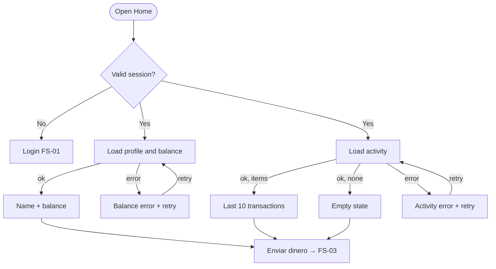

# FS-02 — Home

| Field | Value |
|---|---|
| **ID** | FS-02 |
| **Module** | HOME |
| **Status** | Approved |
| **Version** | 1.3 |
| **Author** | Claude (AI-assisted draft) |
| **Reviewer** | Project owner |
| **Last updated** | 2026-10-13 |
| **Origin** | Challenge §2 "Home" · FR-HOME-01…11 in [requirements analysis](../00-context/requirements-analysis.md#32-home--balance-and-recent-transactions) · OQ-11 decision (hide balance) |
| **Implemented by** | [TS-02 Home](../02-technical/TS-02-home.md) |

---

## 1. Goal

Give the user an immediate, trustworthy picture of where they stand (who they are, how much they have, what happened recently) and a single obvious way to send money. Every piece of information loads, fails and recovers on its own, so a problem in one section never blanks the whole screen.

## 2. Scope

**In scope**
- Greeting with the user's name.
- Available balance, with hide/show control.
- Recent activity: the last 10 transactions.
- Primary action to start a new transaction.
- Loading, empty and error states per section, with retry.
- Reflecting a just-completed transaction (updated balance and new item).
- Entry points to log out and to change the theme.

**Out of scope** (and why)
- Full transaction history, filters, search, export — not required; list bounded (ASM-10).
- Transaction detail view — not required; listed as "with more time".
- Notifications, promotions, other products — not in the challenge.

## 3. Actors, preconditions and postconditions

| | Detail |
|---|---|
| **Actor** | Authenticated user |
| **Preconditions** | Valid session (BR-14). Without one, the user is sent to Login (FS-01). |
| **Success postcondition** | The user sees their name, balance and recent activity, or a clear state for each section that could not load. |
| **Failure postcondition** | Sections that failed show an error with retry; the rest of the screen stays usable. |

## 4. Functional requirements

| ID | Description | Priority | Origin |
|---|---|---|---|
| FR-HOME-01 | Show the user's name. | Must | §2 Datos |
| FR-HOME-02 | Show the available balance. | Must | §2 Datos |
| FR-HOME-03 | Show recent transactions (date, counterparty, amount, direction, status). | Must | §2 Movimientos |
| FR-HOME-04 | Loading state. | Must | §2 Estados |
| FR-HOME-05 | Empty state with a suggested action. | Must | §2 Estados |
| FR-HOME-06 | Error state with retry; sections fail independently. | Must | §2 Estados |
| FR-HOME-07 | Primary action to start a new transaction. | Must | §2 Acción |
| FR-HOME-08 | Responsive, mobile-first layout. | Must | §2 |
| FR-HOME-09 | Reflect the updated balance and the new transaction after a successful transfer. | Should | OQ-07 (recommendation) |
| FR-HOME-10 | List bounded to the 10 most recent items. | Should | NFR-01, ASM-10 |
| FR-HOME-11 | The user can hide/show the balance. | Should | OQ-11 decision (raised from Could) |
| FR-AUTH-10 | Log out (entry point lives on Home; behavior in FS-01). | Should | FS-01 |

## 5. Rules

### 5.1 Business and input validation rules

| ID | Type | Rule | When it is evaluated | Outcome if violated |
|---|---|---|---|---|
| BR-14 | Business | Session required for every private view and operation. | Every request for Home data (server) | Redirect to Login |

Home displays data; it does not change it. Balance and transactions are always the server's values, never computed on the client.

### 5.2 UI rules

| ID | Rule | Trigger | Behavior | Related |
|---|---|---|---|---|
| UIR-HOME-01 | Independent sections | Home opens | Profile/balance and activity load and fail independently; each has its own loading, error and retry. | FR-HOME-06, UX-02 |
| UIR-HOME-02 | Stable loading | A section is loading | Placeholders with the shape and size of the final content; no layout shift when data arrives. | UX-15, A11Y-19 |
| UIR-HOME-03 | Primary action always visible | Any Home state | "Enviar dinero" is visible and enabled regardless of balance or activity state; on small viewports it stays within thumb reach. | FR-HOME-07, UX-01 |
| UIR-HOME-04 | Zero balance hint | Balance is exactly zero | A short note under the balance ("No tienes saldo disponible"); the primary action stays enabled — the amount step explains the rule (BR-02). | UX-05, BR-02 |
| UIR-HOME-05 | Hide/show balance | User toggles the control | Balance is replaced by `$ ••••••`; the control exposes its pressed state; the preference persists on this device across sessions; it also masks the resulting balance on the summary and receipt (FS-03, FS-04). Activity amounts are not masked. | FR-HOME-11, UX-17 |
| UIR-HOME-06 | Transaction item content | Activity renders | Each item: counterparty name (or initials avatar), concept if any, relative date, amount with sign and direction label, and a status badge only when not completed. | FR-HOME-03, A11Y-11, A11Y-17 |
| UIR-HOME-07 | Direction is never color-only | Activity renders | Outgoing: `−$250.00` + "Enviado"; incoming: `+$1,000.00` + "Recibido"; color reinforces but never carries meaning alone. | A11Y-11 |
| UIR-HOME-08 | Relative dates | Activity renders | "Hoy, 14:32", "Ayer, 09:10", otherwise "12 oct, 18:05" (year shown only if not the current year); the full date is available to assistive technology. | UX-16, A11Y-17 |
| UIR-HOME-09 | Long names | Counterparty name exceeds available width | Truncated with ellipsis visually; full name kept in the accessible name. | A11Y-17 |
| UIR-HOME-10 | Fresh data on every visit | Home is opened or returned to (e.g. from a receipt) | Data is requested again; previously shown values may stay visible while refreshing, marked as updating. | FR-HOME-09 |
| UIR-HOME-11 | Just-completed transfer | Returning from a successful receipt | The new transaction appears first in the list and the balance reflects it; the new item is briefly highlighted (respecting reduced motion). | FR-HOME-09, A11Y-20 |
| UIR-HOME-12 | Section error | A section fails to load | Message, reference code and "Intentar de nuevo" inside that section; retry reloads only that section. | FR-HOME-06, UX-05 |
| UIR-HOME-13 | Header actions | Any Home state | Header holds the greeting, the theme switcher and "Cerrar sesión"; logout is immediate (no confirmation dialog). | FR-AUTH-10, UX-22 |

## 6. User stories

- **US-01** — As a customer, I want to see my balance as soon as I open the app, so that I know how much I can spend.
- **US-02** — As a customer, I want to see my latest transactions, so that I can confirm a payment arrived or left.
- **US-03** — As a customer in a public place, I want to hide my balance, so that people around me can't see it.
- **US-04** — As a new customer with no activity, I want to understand why the list is empty and what to do next.
- **US-05** — As a customer, I want the rest of the screen to keep working when one part fails, so that I can still send money.

## 7. Flows

### 7.1 Main flow (happy path)
1. The user arrives at Home after login, from a receipt, or by opening the app with a valid session.
2. Profile/balance and activity show loading placeholders.
3. The greeting ("Hola, Ana"), the balance and the last 10 transactions appear.
4. The user presses **Enviar dinero** → New transaction (FS-03).

### 7.2 Alternate flows
- **A1 — Empty activity:** at step 3, the user has no transactions → empty state with "Enviar dinero" suggestion.
- **A2 — Hide balance:** the user toggles the control → balance masked; the choice is remembered (UIR-HOME-05).
- **A3 — Return after a transfer:** coming from a successful receipt → updated balance and highlighted new item (UIR-HOME-11).
- **A4 — Log out:** the user presses "Cerrar sesión" → FS-01 logout flow.

### 7.3 Exception flows
- **E1 — Balance fails, activity loads:** balance section shows its error with retry; the activity list and primary action work.
- **E2 — Activity fails, balance loads:** activity section shows its error with retry.
- **E3 — Both fail:** each section shows its own error; the primary action stays available.
- **E4 — Session invalid:** data requests are rejected (BR-14) → Login with the session-ended notice (FS-01 E8).



## 8. UI states

| State | When it happens | What the user sees | Available actions |
|---|---|---|---|
| Loading | Opening Home | Header; placeholders for balance and 3–5 list rows | Enviar dinero, theme, logout |
| Ready | Both sections loaded | Greeting, balance, activity list | All |
| Ready — zero balance | Balance is 0 | Balance `$0.00` + zero-balance note | All |
| Ready — balance hidden | Hide preference on | `$ ••••••`; control in pressed state | Show balance, all |
| Empty activity | No transactions | Illustration-free message + "Enviar dinero" suggestion | Enviar dinero |
| Balance error | Profile/balance request fails | Error message + reference + retry in the balance card; greeting falls back to "Hola" | Retry, all others |
| Activity error | Activity request fails | Error message + reference + retry in the list area | Retry, all others |
| Refreshing | Returning to Home with data already shown | Previous values with an "Actualizando…" indication | All |

## 9. Input and output data

### 9.1 Fields captured from the user

N/A — Home captures no data. The only user input is the hide/show balance toggle (UIR-HOME-05).

### 9.2 Information displayed

| Data | Display format | Source |
|---|---|---|
| User's first name | "Hola, Ana" | Profile |
| Available balance | `$12,345.67` (MXN, 2 decimals, es-MX grouping) | Balance |
| Counterparty | Name; initials avatar (`AL`) | Transaction |
| Concept | Secondary line, truncated | Transaction (optional) |
| Amount and direction | `−$250.00 · Enviado` / `+$1,000.00 · Recibido` | Transaction |
| Date | "Hoy, 14:32" / "Ayer, 09:10" / "12 oct, 18:05" | Transaction |
| Status | Badge "Pendiente" or "Fallido"; none for completed | Transaction |
| Reference code (errors) | Short monospaced code | Correlation ID (NFR-04) |

## 10. Acceptance criteria

**AC-HOME-01 — Name and balance**
```gherkin
Given I am logged in as "Ana López" with a balance of 12345.67 MXN
When I open Home
Then I see "Hola, Ana"
And I see the balance "$12,345.67"
```

**AC-HOME-02 — Recent activity bounded to 10**
```gherkin
Given I have 25 transactions
When I open Home
Then I see exactly the 10 most recent, newest first
```

**AC-HOME-03 — Transaction item content**
```gherkin
Given I sent 250.00 MXN to "Luis Pérez" today at 14:32 with concept "Tacos"
When I open Home
Then the item shows "Luis Pérez", "Tacos", "Hoy, 14:32", "−$250.00" and "Enviado"
And no status badge is shown because it is completed
```

**AC-HOME-04 — Loading state**
```gherkin
Given the data takes time to arrive
When I open Home
Then I see placeholders for the balance and the list
And the "Enviar dinero" action is available
And the layout does not shift when the data appears
```

**AC-HOME-05 — Empty state**
```gherkin
Given I have no transactions
When I open Home
Then I see "Aún no tienes movimientos" and a suggestion to send money
```

**AC-HOME-06 — Independent section errors**
```gherkin
Given the activity request fails and the balance request succeeds
When I open Home
Then I see my balance
And the activity area shows an error with a reference code and "Intentar de nuevo"
When I press "Intentar de nuevo" and the request succeeds
Then the list appears without reloading the balance
```

**AC-HOME-07 — Start a transaction**
```gherkin
Given I am on Home in any state
When I press "Enviar dinero"
Then I am on the first step of New transaction
```

**AC-HOME-08 — Hide balance persists**
```gherkin
Given my balance is visible
When I activate "Ocultar saldo"
Then the balance shows "$ ••••••"
When I reload the page
Then the balance is still hidden
```

**AC-HOME-09 — Reflect a completed transfer**
```gherkin
Given my balance is 1000.00 MXN
And I complete a transfer of 250.00 MXN
When I return to Home from the receipt
Then the balance shows "$750.00"
And the new transfer is the first item of the list
```

**AC-HOME-10 — Zero balance**
```gherkin
Given my balance is 0.00 MXN
When I open Home
Then I see "$0.00" and the note "No tienes saldo disponible"
And "Enviar dinero" is still available
```

**AC-HOME-11 — Pending and failed transactions**
```gherkin
Given my activity includes a pending and a failed transaction
When I open Home
Then those items show the badges "Pendiente" and "Fallido" respectively
```

**AC-HOME-12 — Logout from Home**
```gherkin
Given I am on Home
When I press "Cerrar sesión"
Then I am on Login with the notice "Cerraste sesión."
```

## 11. Edge cases

| # | Situation | Expected behavior |
|---|---|---|
| EC-01 | Very large balance (e.g. `$9,999,999.99`) | Fits without overflow at 320 px; font may scale down, never truncates digits |
| EC-02 | Counterparty name very long or with accents/emoji | Truncated visually; full name in accessible name; characters rendered correctly |
| EC-03 | Transaction without counterparty name (only identifier) | Masked identifier shown instead (e.g. `•••• 5678`) |
| EC-04 | Exactly 10 or fewer transactions | All shown; no "see more" affordance |
| EC-05 | Transactions with the same timestamp | Stable order (newest first, then by server order) |
| EC-06 | Balance loads but name is missing | Greeting falls back to "Hola" |
| EC-07 | Returning to Home while a previous request is still in flight | Only the latest response is shown; no flicker between old and new values |
| EC-08 | User toggles hide balance while it is loading | Preference applied as soon as the value appears |
| EC-09 | Clock/time zone of the device differs from the server | Dates displayed in the user's time zone; "Hoy"/"Ayer" computed in that zone |

## 12. Copy and messages

| Key | Text | Context |
|---|---|---|
| `home.title` | "Inicio" | View title |
| `home.greeting` | "Hola, {firstName}" | Page heading (h1) at the top of the content |
| `home.balance.label` | "Saldo disponible" | Balance card |
| `home.balance.hide` | "Ocultar saldo" | Toggle (not pressed) |
| `home.balance.show` | "Mostrar saldo" | Not used: the toggle keeps the name "Ocultar saldo" and exposes `aria-pressed` (a name that flips together with the pressed state reads as contradictory to screen-reader users) |
| `home.balance.hidden` | "Saldo oculto" | Accessible text of the masked balance |
| `home.greeting.anonymous` | "Hola" | Greeting without a name (EC-06) |
| `home.balance.zero` | "No tienes saldo disponible" | Zero balance note |
| `home.balance.error` | "No pudimos cargar tu saldo." | Balance error |
| `home.send` | "Enviar dinero" | Primary action |
| `home.activity.title` | "Movimientos recientes" | List heading |
| `home.activity.empty.title` | "Aún no tienes movimientos" | Empty state |
| `home.activity.empty.body` | "Cuando envíes o recibas dinero, aparecerá aquí." | Empty state |
| `home.activity.error` | "No pudimos cargar tus movimientos." | Activity error |
| `home.activity.updating` | "Actualizando…" | Refreshing |
| `tx.direction.out` | "Enviado" | Outgoing label |
| `tx.direction.in` | "Recibido" | Incoming label |
| `tx.status.pending` | "Pendiente" | Badge |
| `tx.status.failed` | "Fallido" | Badge |
| `date.today` | "Hoy, {time}" | Relative date |
| `date.yesterday` | "Ayer, {time}" | Relative date |
| `common.retry` | "Intentar de nuevo" | Retry action |
| `common.reference` | "Referencia: {code}" | Under errors |
| `common.loading` | "Cargando…" | Text alternative of a loading region (skeletons are hidden) |
| `auth.logout` | "Cerrar sesión" | Header action |

## 13. Accessibility and responsive behavior

Applies: A11Y-01, 02, 03, 04, 08, 10, 11, 12, 13, 17, 18, 19, 20, 22, 25, 26.

- Landmarks: header (greeting, theme, logout) and main; headings "Saldo disponible" and "Movimientos recientes" (A11Y-01).
- The activity is a list; each item has one coherent accessible name, e.g. "Enviado a Luis Pérez, 250 pesos, hoy a las 14:32, concepto Tacos" (A11Y-17).
- Balance announced with currency ("12 mil 345 pesos con 67 centavos" via a proper accessible representation); when hidden, announced as "Saldo oculto" (A11Y-17).
- The hide/show control is a toggle button exposing its pressed state (A11Y-26 pattern; A11Y-18).
- Loading regions marked busy; placeholders hidden from assistive technology; a single announcement when content is ready (A11Y-19).
- Section errors announced politely; retry buttons reachable by keyboard (A11Y-08).
- Direction and status conveyed by text, not color only; contrast verified in both themes (A11Y-10, A11Y-11).
- **Responsive:** small viewports — single column, balance card on top, primary action fixed near the bottom within thumb reach; medium/large — balance and action side by side above a wider list, content width capped for readability; reflow at 320 px and 200 % text size (A11Y-12, UX-01).

## 14. Assumptions

| ID | Assumption | Impact if wrong |
|---|---|---|
| ASM-02 | Single currency MXN | Money display changes |
| ASM-03 | In-memory data per user; changes persist while the server runs | FR-HOME-09 not demonstrable |
| ASM-04 | Seeded users for normal, empty, low/zero balance and failing-data states | States hard to demo |
| ASM-10 | Last 10 transactions, no pagination | Pagination needed |

## 15. Open questions

None blocking. OQ-07 (reflect new transaction) and OQ-11 (hide balance) are applied as decided/recommended.

## 16. Traceability

| Requirement | Technical spec | Tasks | Test cases |
|---|---|---|---|
| FR-HOME-01…03, 10 | TS-02 | Phase 4 | AC-HOME-01…03, 11 |
| FR-HOME-04…06 | TS-02 | Phase 4 | AC-HOME-04…06 |
| FR-HOME-07, 08 | TS-02, TS-00 | Phase 4 | AC-HOME-07, 10 |
| FR-HOME-09 | TS-02, TS-04 | Phase 4 | AC-HOME-09 |
| FR-HOME-11 | TS-02 | Phase 4 | AC-HOME-08 |
| FR-AUTH-10 | TS-01 | Phase 4 | AC-HOME-12 |
| UIR-HOME-01…13 | TS-02 §6 | Phase 4 | Component / presentation-logic |

## 17. Change history

| Version | Date | Author | Change |
|---|---|---|---|
| 0.1 | 2026-10-13 | Claude (AI-assisted) | First draft |
| 1.0 | 2026-10-13 | Project owner | Approved |
| 1.1 | 2026-10-14 | Claude (AI-assisted) | Traceability now points to the written TS (no behavior change) |
| 1.2 | 2026-10-14 | Claude (AI-assisted) | TASK-04: `common.loading` for loading regions |
| 1.3 | 2026-10-14 | Claude (AI-assisted) | TASK-13: toggle keeps one name with aria-pressed; greeting is the view's h1; copy keys for hidden balance and anonymous greeting |
