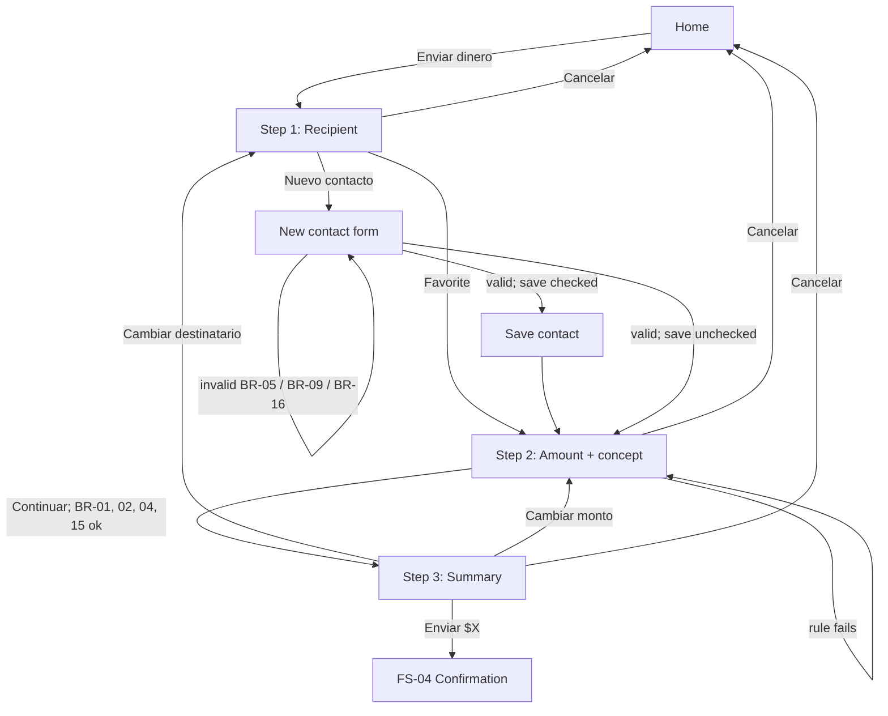

# FS-03 — New transaction

| Field | Value |
|---|---|
| **ID** | FS-03 |
| **Module** | TX |
| **Status** | Approved |
| **Version** | 1.2 |
| **Author** | Claude (AI-assisted draft) |
| **Reviewer** | Project owner |
| **Last updated** | 2026-10-13 |
| **Origin** | Challenge §3 "Nueva Transacción" and §"Reglas de Negocio" · FR-TX-01…11 in [requirements analysis](../00-context/requirements-analysis.md#33-tx--new-transaction) · decisions OQ-06, OQ-08, OQ-09, OQ-12 |
| **Implemented by** | [TS-03 Transactions](../02-technical/TS-03-transactions.md) |

---

## 1. Goal

Let the user send money to the right person, for the right amount, without surprises: choose who, say how much, review everything in one place, and only then confirm. Every business rule is checked before the user reaches the confirmation, and checked again by the server when they confirm.

## 2. Scope

**In scope**
- Step 1 — **Recipient**: choose a favorite or enter a new contact, optionally saving it.
- Step 2 — **Amount**: amount and optional concept, with the available balance visible.
- Step 3 — **Summary**: review, edit, and confirm.
- Business rules BR-01…BR-09, BR-10, BR-15, BR-16 before confirming.
- Back, edit and cancel at every step without losing data.

The confirmation itself (processing, outcomes, receipt) is specified in **FS-04**.

**Out of scope** (and why)
- Search in favorites (FR-TX-10) — not selected; "with more time".
- Editing or deleting saved favorites — not in the challenge.
- Scheduled or recurring transfers, requests for money, split bills — not in the challenge.
- Bank accounts (CLABE) or cards as recipients — ASM-09.
- Amount limits other than the balance — ASM-11.

## 3. Actors, preconditions and postconditions

| | Detail |
|---|---|
| **Actor** | Authenticated user |
| **Preconditions** | Valid session (BR-14). |
| **Success postcondition** | A complete, rule-compliant transfer draft (recipient, amount, optional concept) is shown in the summary and the user presses the confirm action → FS-04. |
| **Failure postcondition** | The user stays on the current step with a specific message; everything entered so far is preserved. If they cancel, no money moves and they return to Home. |

## 4. Functional requirements

| ID | Description | Priority | Origin |
|---|---|---|---|
| FR-TX-01 | The user enters an amount. | Must | §3 |
| FR-TX-02 | The user selects a recipient from favorites. | Must | §3 |
| FR-TX-03 | The user can manually enter a new contact. | Must | §3 |
| FR-TX-04 | A new contact can be saved to favorites (optional, on by default). | Must | §3 · OQ-06 decision |
| FR-TX-05 | A summary is shown before confirming. | Must | §3 |
| FR-TX-06 | Business rules are validated before confirming, and the user sees which rule failed. | Must | §Reglas |
| FR-TX-07 | From the summary the user can go back and edit without losing data. | Should | UX-06 |
| FR-TX-08 | The user can cancel at any step. | Should | UX-12 |
| FR-TX-09 | Favorites have their own loading, empty and error states. | Should | Derived |
| FR-TX-11 | Optional concept/note. | Should | OQ-09 decision (raised from Could) |

## 5. Rules

### 5.1 Business and input validation rules

> BR-15 and BR-16 originated in this FS and are registered in the [requirements analysis](../00-context/requirements-analysis.md#41-rules).

| ID | Type | Rule | When it is evaluated | Outcome if violated |
|---|---|---|---|---|
| BR-01 | Business | Amount greater than zero. | Amount step on continue (client) · on confirm (server) | "Ingresa un monto mayor a $0.00." |
| BR-02 | Business | Amount not greater than the available balance. | Amount step while typing feedback / on continue (client) · on confirm (server) | "El monto supera tu saldo disponible ({balance})." |
| BR-03 | Business | A recipient is required. | Leaving the recipient step (client) · on confirm (server) | Cannot advance; deep links to later steps redirect to step 1 (UIR-TX-14) |
| BR-04 | Input validation | Amount is numeric with at most 2 decimals; handled in minor units. | Amount input (client) · on confirm (server) | Invalid characters are not accepted; third decimal is not accepted |
| BR-05 | Input validation | A new contact's identifier is a valid phone or email — **as defined by BR-10**. | New contact on continue (client) · on save and on confirm (server) | Field error |
| BR-06 | Business | All rules above are re-evaluated by the server at confirmation. | On confirm (server) | Outcome per FS-04 |
| BR-07 | Business | Retrying the same transfer never moves money twice. Changing recipient, amount or concept makes it a **new** transfer. | On confirm and retries (server) — see FS-04 | — |
| BR-08 | Business | Saving a contact whose identifier already exists does not create a duplicate. | On save (server) | Existing favorite is used; user informed (UIR-TX-07) |
| BR-09 | Business | The recipient cannot be the user's own identifier. | New contact on continue (client) · on confirm (server) | "No puedes enviarte dinero a ti mismo." — OQ-12 decision |
| BR-10 | Input validation | Identifier format (Mexican 10-digit phone after normalization, or email ≤ 254 characters). | Via BR-05 | Field error |
| BR-15 | Input validation | **Concept:** optional; at most 40 characters after trimming; no line breaks or control characters. | Amount step (client) · on confirm (server) | Input stops at 40 characters; counter shown |
| BR-16 | Input validation | **Contact name:** required for a new contact; 1–50 characters after trimming. | New contact on continue (client) · on save (server) | Field error |

### 5.2 UI rules

| ID | Rule | Trigger | Behavior | Related |
|---|---|---|---|---|
| UIR-TX-01 | Step indicator | Any step | "Paso 1 de 3 — Destinatario", "Paso 2 de 3 — Monto", "Paso 3 de 3 — Resumen", visible and announced on step change. | UX-02, A11Y-02 |
| UIR-TX-02 | Focus on step change | Moving to another step | Focus moves to the step heading; the view title changes. | A11Y-02 |
| UIR-TX-03 | Favorites order and content | Recipient step loads | Most recently used first; each item shows initials avatar, name and masked identifier (`•••• 5678`, `a•••@correo.com`). | UX-13 |
| UIR-TX-04 | Choosing a favorite | User activates a favorite | That favorite becomes the recipient and the Amount step opens. Each favorite is an action ("Enviar a Ana López"), not a selection that needs a second confirmation. | UX-02, A11Y-23 |
| UIR-TX-05 | New contact form | User chooses "Nuevo contacto" | Inline form on the same step: name, phone or email, and "Guardar en favoritos" **checked by default**; "Continuar". Identifier behaves as in Login (UIR-AUTH-01, UIR-AUTH-02). | FR-TX-03, FR-TX-04, UX-03 |
| UIR-TX-06 | Saving timing | "Continuar" on a valid new contact with "Guardar en favoritos" checked | The contact is saved at that moment (independent of the transfer outcome); non-blocking confirmation "Guardamos a {name} en tus favoritos." | FR-TX-04, UX-20 |
| UIR-TX-07 | Duplicate contact | Identifier already in favorites | No duplicate is created; the existing favorite becomes the recipient; message "{name} ya estaba en tus favoritos." | BR-08 |
| UIR-TX-08 | Save failure does not block | Saving the contact fails | The transfer continues with the contact as a one-off recipient; message "No pudimos guardar el contacto. Puedes continuar con el envío." | FR-TX-04, UX-06 |
| UIR-TX-09 | Recipient context | Amount and summary steps | The chosen recipient (avatar, name, masked identifier) is shown at the top with "Cambiar". | UX-08, A11Y-15 |
| UIR-TX-10 | Amount input | User types an amount | Currency symbol fixed before the field; es-MX grouping while typing without moving the caret unexpectedly; only digits and one decimal separator; max 2 decimals; numeric keyboard on touch devices. | BR-04, UX-07 |
| UIR-TX-11 | Balance next to amount | Amount step | "Saldo disponible: $X" linked to the field as its description. If the balance cannot be loaded, the step shows an error with retry and "Continuar" explains that the balance is needed. | BR-02, UX-07 |
| UIR-TX-12 | Rule feedback timing | Amount step | BR-02 (exceeds balance) is shown as soon as the typed amount exceeds the balance; BR-01 (zero/empty) only on "Continuar". Errors clear as soon as the value becomes valid. | UX-04 |
| UIR-TX-13 | Primary actions stay enabled | Invalid or empty data | "Continuar" stays enabled; pressing it shows the errors and moves focus to the first invalid field. | A11Y-07 |
| UIR-TX-14 | Step guard | User opens the Amount or Summary step without the required previous data (deep link, reload) | Redirected to the first incomplete step; nothing is lost that was already entered. | BR-03 |
| UIR-TX-15 | Concept counter | Concept field | Counter "{n}/40"; input stops at 40 characters; the counter is announced only near the limit. | BR-15, A11Y-08 |
| UIR-TX-16 | Summary content | Summary step | Recipient (name + masked identifier), amount as the most prominent element, concept (if any), current balance and **resulting balance**; if the hide-balance preference is on, both balances are masked with a reveal control. | FR-TX-05, UX-08, UIR-HOME-05 |
| UIR-TX-17 | Specific edit actions | Summary step | "Cambiar destinatario" → step 1; "Cambiar monto" → step 2 (concept included); data preserved; returning shows the summary again with the new values. | FR-TX-07, A11Y-15 |
| UIR-TX-18 | Confirm action label | Summary step | Primary action states the amount: "Enviar $250.00". Pressing it starts FS-04. | UX-08, A11Y-05 |
| UIR-TX-19 | Draft preserved in the flow | Back, "Cambiar", or browser Back between steps | Recipient, amount and concept are kept for the whole flow. | UX-06 |
| UIR-TX-20 | Cancel | "Cancelar" on any step | If any data was entered, a dialog asks "¿Cancelar el envío? Se perderán los datos." (Seguir editando / Cancelar envío); if nothing was entered, returns to Home directly. The draft is discarded on cancel. | FR-TX-08, UX-12, A11Y-24 |
| UIR-TX-21 | Draft reset after completion | Transfer succeeded (FS-04) or cancelled | The draft is cleared; a new transfer starts empty unless started from "Enviar otra vez" (FS-04), which pre-selects the recipient. | — |

## 6. User stories

- **US-01** — As a frequent sender, I want to pick a recent contact in one tap, so that sending is fast.
- **US-02** — As a customer paying someone new, I want to enter their phone or email and save them for next time, so that I don't retype them.
- **US-03** — As a cautious customer, I want to see my balance while typing the amount, so that I know whether I can afford it.
- **US-04** — As a customer, I want to add a note like "Renta octubre", so that both of us remember what it was for.
- **US-05** — As a cautious customer, I want to review everything before sending and fix any detail without starting over.
- **US-06** — As a customer who changed their mind, I want to cancel safely, knowing no money moved.

## 7. Flows

### 7.1 Main flow (happy path)
1. From Home the user presses **Enviar dinero** → **Step 1, Recipient**: favorites list.
2. The user activates a favorite → **Step 2, Amount**, with the recipient shown at the top.
3. The user types the amount (and optionally a concept) and presses **Continuar**; BR-01, BR-02, BR-04, BR-15 pass.
4. **Step 3, Summary** shows recipient, amount, concept, current and resulting balance.
5. The user presses **Enviar $250.00** → **FS-04** Confirmation.

### 7.2 Alternate flows
- **A1 — New contact, saved:** at step 2 the user chooses "Nuevo contacto", enters name and identifier, keeps "Guardar en favoritos" checked, presses Continuar → contact saved (UIR-TX-06) → Amount step.
- **A2 — New contact, one-off:** as A1 with the checkbox unchecked → not saved; used only for this transfer.
- **A3 — Contact already exists:** as A1 with an identifier already in favorites → existing favorite used (UIR-TX-07).
- **A4 — No favorites:** at step 1 the list is empty → empty state with the new-contact form shown directly.
- **A5 — Edit from summary:** at step 4 the user chooses "Cambiar monto" or "Cambiar destinatario" → edits → back to summary with new values (UIR-TX-17).
- **A6 — Cancel:** at any step → UIR-TX-20 → Home.
- **A7 — Started from "Enviar otra vez":** the flow opens at step 2 with the recipient pre-selected (FS-04).

### 7.3 Exception flows
- **E1 — Favorites fail to load:** step 1 shows an error with retry; "Nuevo contacto" remains available.
- **E2 — Invalid new contact:** missing name (BR-16), invalid identifier (BR-05/BR-10) or own identifier (BR-09) → field errors; cannot continue.
- **E3 — Save fails:** UIR-TX-08 → continue as one-off.
- **E4 — Amount invalid:** zero/empty (BR-01), over balance (BR-02), invalid format (BR-04) → error under the field; cannot continue.
- **E5 — Balance cannot be loaded at step 2:** error with retry (UIR-TX-11).
- **E6 — Session invalid at any step:** Login with session-ended notice; after login, return to New transaction (draft may be lost; FS-01 E8).



## 8. UI states

| State | When it happens | What the user sees | Available actions |
|---|---|---|---|
| Recipient — loading | Step 1 opens | Step indicator; placeholders for favorites; "Nuevo contacto" | Nuevo contacto, Cancelar |
| Recipient — list | Favorites loaded | Favorites (recent first) + "Nuevo contacto" | Choose favorite, Nuevo contacto, Cancelar |
| Recipient — empty | No favorites | "Aún no tienes favoritos" + new-contact form open | Fill form, Cancelar |
| Recipient — error | Favorites fail | Error + reference + retry; "Nuevo contacto" still available | Retry, Nuevo contacto, Cancelar |
| New contact — editing / errors | Form open | Name, identifier, "Guardar en favoritos" (checked), field errors when applicable | Continuar, back to list, Cancelar |
| New contact — saving | Continuar with save checked | "Guardando…" on the button; fields read-only | — |
| Amount — ready | Step 2 | Recipient context, amount field, balance, concept + counter | Continuar, Cambiar, Atrás, Cancelar |
| Amount — rule error | BR-01/02/04 violated | Error under the amount field | Correct, Atrás, Cancelar |
| Amount — balance error | Balance fails to load | Error + retry in place of the balance | Retry, Atrás, Cancelar |
| Summary | Step 3 | All details, current and resulting balance, edit actions, "Enviar $X" | Enviar, Cambiar destinatario, Cambiar monto, Cancelar |
| Cancel dialog | Cancelar with data entered | Dialog with two actions | Seguir editando, Cancelar envío |

## 9. Input and output data

### 9.1 Fields captured from the user

| Field | Kind | Required | Format / validation | Error message key |
|---|---|---|---|---|
| Recipient (favorite) | Choice | Yes (BR-03) | Must be one of the user's favorites | — |
| Contact name | Text | Yes, for a new contact | BR-16 | `tx.contact.name.error.required`, `tx.contact.name.error.length` |
| Contact identifier | Text (phone or email) | Yes, for a new contact | BR-05 / BR-10; BR-09 | `tx.contact.identifier.error.*` |
| Save to favorites | Checkbox | No (default: checked) | — | — |
| Amount | Money | Yes | BR-01, BR-02, BR-04 | `tx.amount.error.*` |
| Concept | Text | No | BR-15 | — (input limited) |

### 9.2 Information displayed

| Data | Display format | Source |
|---|---|---|
| Favorite | Initials avatar, name, masked identifier | Favorites |
| Available balance | `$12,345.67` | Balance |
| Resulting balance | `$12,095.67` (balance − amount) — display only; the server computes the real one | Derived for display |
| Amount in summary | `$250.00`, most prominent element | Draft |
| Concept | As typed, trimmed | Draft |

## 10. Acceptance criteria

**AC-TX-01 — Send to a favorite (happy path)**
```gherkin
Given I have 1000.00 MXN and "Ana López" in my favorites
When I start a transfer and choose "Ana López"
And I enter 250 and press "Continuar"
Then I see the summary with "Ana López", "$250.00" and resulting balance "$750.00"
And the primary action reads "Enviar $250.00"
```

**AC-TX-02 — Amount must be greater than zero (BR-01)**
```gherkin
Given I am on the amount step
When I leave the amount empty or enter 0 and press "Continuar"
Then I see "Ingresa un monto mayor a $0.00."
And focus moves to the amount field
And I stay on the amount step
```

**AC-TX-03 — Amount cannot exceed balance (BR-02)**
```gherkin
Given my balance is 1000.00 MXN
When I type 1000.01
Then I see "El monto supera tu saldo disponible ($1,000.00)." without pressing any button
And pressing "Continuar" keeps me on the amount step
When I change the amount to 1000.00
Then the error disappears and I can continue
```

**AC-TX-04 — Amount format (BR-04)**
```gherkin
Given I am on the amount step
When I type "12.345" or letters
Then the field shows at most "12.34" and accepts no letters
```

**AC-TX-05 — Recipient required (BR-03)**
```gherkin
Given I have not chosen a recipient
When I open the amount or summary step directly
Then I am redirected to the recipient step
```

**AC-TX-06 — New contact saved by default**
```gherkin
Given I am on the recipient step
When I choose "Nuevo contacto", enter "Luis Pérez" and "5512345678"
And I keep "Guardar en favoritos" checked and press "Continuar"
Then I see "Guardamos a Luis Pérez en tus favoritos."
And I am on the amount step with "Luis Pérez" as recipient
And "Luis Pérez" appears in my favorites the next time
```

**AC-TX-07 — New contact as one-off**
```gherkin
Given I fill a new contact and uncheck "Guardar en favoritos"
When I press "Continuar"
Then I am on the amount step with that contact as recipient
And the contact is not added to my favorites
```

**AC-TX-08 — Duplicate contact (BR-08)**
```gherkin
Given "Ana López" with "5598765432" is already a favorite
When I add a new contact with identifier "55 9876 5432"
Then no duplicate favorite is created
And I see "Ana López ya estaba en tus favoritos."
And "Ana López" is the recipient
```

**AC-TX-09 — Invalid new contact (BR-05, BR-10, BR-16)**
```gherkin
Given the new-contact form is open
When I press "Continuar" with an empty name and identifier "55123"
Then I see an error under each field
And focus moves to the name field
```

**AC-TX-10 — No self-transfer (BR-09)**
```gherkin
Given I am logged in with "5512345678"
When I add a new contact with identifier "5512345678"
Then I see "No puedes enviarte dinero a ti mismo."
And I cannot continue
```

**AC-TX-11 — Concept limit (BR-15)**
```gherkin
Given I am on the amount step
When I type a 45-character concept
Then the field contains only the first 40 characters
And the counter shows "40/40"
```

**AC-TX-12 — Edit from summary keeps data**
```gherkin
Given I am on the summary for "Ana López", 250.00, concept "Tacos"
When I choose "Cambiar monto" and change the amount to 300
And I press "Continuar"
Then the summary shows "Ana López", "$300.00" and concept "Tacos"
```

**AC-TX-13 — Cancel with data asks for confirmation**
```gherkin
Given I entered an amount
When I press "Cancelar"
Then a dialog asks "¿Cancelar el envío? Se perderán los datos."
When I choose "Seguir editando"
Then I am back on the same step with my data
When I press "Cancelar" again and choose "Cancelar envío"
Then I am on Home and no transfer was made
```

**AC-TX-14 — Favorites error keeps new contact available**
```gherkin
Given the favorites request fails
When I open the recipient step
Then I see an error with a reference and "Intentar de nuevo"
And "Nuevo contacto" is available
```

**AC-TX-15 — Server enforces the rules (BR-06)**
```gherkin
Given a confirmation request is sent directly to the server, bypassing the UI
And it has an amount of 0, or above the balance, or no recipient, or the sender as recipient
Then the server rejects it with the corresponding error code
And no money moves
```

**AC-TX-16 — Save failure does not block the transfer**
```gherkin
Given saving contacts fails (simulated)
When I add a new contact with "Guardar en favoritos" checked and press "Continuar"
Then I see "No pudimos guardar el contacto. Puedes continuar con el envío."
And I am on the amount step with that contact as recipient
```

## 11. Edge cases

| # | Situation | Expected behavior |
|---|---|---|
| EC-01 | Amount equals the balance exactly | Allowed; resulting balance `$0.00` |
| EC-02 | Amount `0.01` | Allowed (BR-01 satisfied) |
| EC-03 | Amount with leading zeros or trailing separator (`007`, `25.`) | Normalized to `7.00` / `25.00` on continue |
| EC-04 | Pasted amount with currency symbol or grouping (`$1,250.50`) | Normalized to `1250.50` |
| EC-05 | Balance is zero | Any amount triggers BR-02; message shows `$0.00` |
| EC-06 | Balance changes between the amount step and confirmation | Server is authoritative; FS-04 handles insufficient funds |
| EC-07 | Contact name with accents, ñ or emoji | Accepted (BR-16 counts characters, not bytes) |
| EC-08 | Same contact added twice quickly (double click) | One save only (UX-11); BR-08 on the server as backstop |
| EC-09 | Reload on the amount or summary step | Step guard (UIR-TX-14) sends to the first incomplete step |
| EC-10 | Browser Back from the summary | Amount step with data preserved |
| EC-11 | Concept with only spaces | Treated as empty |
| EC-12 | Favorite whose identifier now equals the user's (data inconsistency) | BR-09 blocks it on continue and on the server |

## 12. Copy and messages

| Key | Text | Context |
|---|---|---|
| `tx.title` | "Enviar dinero" | View title |
| `common.step` | "Paso {n} de {total} — {name}" | Step indicator (shared component; `total` is 3 here) |
| `tx.recipient.title` | "¿A quién le envías?" | Step 1 heading |
| `tx.recipient.favorites` | "Favoritos" | List heading |
| `tx.recipient.send_to` | "Enviar a {name}" | Favorite accessible name |
| `tx.recipient.empty` | "Aún no tienes favoritos. Agrega un contacto para enviarle dinero." | Empty state |
| `tx.recipient.error` | "No pudimos cargar tus favoritos." | Error |
| `tx.contact.new` | "Nuevo contacto" | Action |
| `tx.contact.name.label` | "Nombre" | Field |
| `tx.contact.name.error.required` | "Ingresa el nombre del contacto." | BR-16 |
| `tx.contact.name.error.length` | "El nombre puede tener hasta 50 caracteres." | BR-16 |
| `tx.contact.identifier.label` | "Celular o correo electrónico" | Field |
| `tx.contact.identifier.error.format` | "Revisa el dato: usa un celular a 10 dígitos o un correo como nombre@correo.com." | BR-10 |
| `tx.contact.identifier.error.self` | "No puedes enviarte dinero a ti mismo." | BR-09 |
| `tx.contact.save` | "Guardar en favoritos" | Checkbox |
| `tx.contact.saving` | "Guardando…" | In progress |
| `tx.contact.saved` | "Guardamos a {name} en tus favoritos." | UIR-TX-06 |
| `tx.contact.duplicate` | "{name} ya estaba en tus favoritos." | UIR-TX-07 |
| `tx.contact.save_failed` | "No pudimos guardar el contacto. Puedes continuar con el envío." | UIR-TX-08 |
| `tx.amount.title` | "¿Cuánto le envías?" | Step 2 heading |
| `tx.amount.label` | "Monto" | Field |
| `tx.amount.balance` | "Saldo disponible: {balance}" | Field description |
| `tx.amount.balance_error` | "No pudimos cargar tu saldo. Lo necesitamos para validar el monto." | UIR-TX-11 |
| `tx.amount.error.min` | "Ingresa un monto mayor a $0.00." | BR-01 |
| `tx.amount.error.balance` | "El monto supera tu saldo disponible ({balance})." | BR-02 |
| `tx.concept.label` | "Concepto (opcional)" | Field |
| `tx.concept.counter` | "{n}/40" | Counter |
| `tx.summary.title` | "Revisa tu envío" | Step 3 heading |
| `tx.summary.to` | "Para" | Label |
| `tx.summary.amount` | "Monto" | Label |
| `tx.summary.concept` | "Concepto" | Label |
| `tx.summary.balance_now` | "Saldo actual" | Label |
| `tx.summary.balance_after` | "Saldo después del envío" | Label |
| `tx.summary.change_recipient` | "Cambiar destinatario" | Edit action |
| `tx.summary.change_amount` | "Cambiar monto" | Edit action |
| `tx.summary.confirm` | "Enviar {amount}" | Primary action |
| `tx.change` | "Cambiar" | Recipient context action |
| `common.continue` | "Continuar" | Primary action steps 1–2 |
| `common.back` | "Atrás" | Back |
| `tx.cancel` | "Cancelar" | Cancel |
| `tx.cancel.dialog.title` | "¿Cancelar el envío?" | Dialog |
| `tx.cancel.dialog.body` | "Se perderán los datos que ingresaste." | Dialog |
| `tx.cancel.dialog.keep` | "Seguir editando" | Dialog action |
| `tx.cancel.dialog.confirm` | "Cancelar envío" | Dialog action |

## 13. Accessibility and responsive behavior

Applies: A11Y-01, 02, 03, 04, 05, 06, 07, 08, 09, 10, 11, 12, 13, 15, 17, 18, 22, 23, 24, 25, 26.

- Each step has its own heading and view title; focus moves to the heading on step change; the step indicator is announced (A11Y-02).
- Favorites are a list of buttons with names like "Enviar a Ana López, celular terminación 5678" (A11Y-17, A11Y-18).
- Amount field: visible label, currency and balance programmatically associated as description; numeric keyboard; formatted value never re-announced on every keystroke; BR-02 error announced when it appears (A11Y-05, A11Y-07, A11Y-08).
- Fields declare their purpose (name, phone/email) for autofill (A11Y-06).
- Summary repeats all data; edit actions have specific names; nothing already entered is asked again (A11Y-09, A11Y-15).
- Cancel dialog: focus enters the dialog, Escape = "Seguir editando", focus returns to "Cancelar" on close (A11Y-24).
- No time limit anywhere in the flow (A11Y-16).
- **Responsive:** small viewports — one step per screen, recipient context compact at the top, primary action stays visible above the on-screen keyboard; medium/large — same steps in a centered column with capped width; summary uses a two-column label/value layout only when width allows; reflow at 320 px and 200 % text size (A11Y-12, UX-01).

## 14. Assumptions

| ID | Assumption | Impact if wrong |
|---|---|---|
| ASM-02 | MXN, 2 decimals | Money model changes |
| ASM-03 | Saved contacts persist in memory while the server runs | Favorites reset more often |
| ASM-08 | Insufficient funds can still happen at confirmation | FS-04 scenario unreachable |
| ASM-09 | Contact = name + phone or email | New fields |
| ASM-11 | No amount limit besides balance | New rule |

## 15. Open questions

None blocking. Decisions applied: OQ-06 (save optional, on by default), OQ-08 (Recipient → Amount → Summary), OQ-09 (concept included), OQ-12 (self-transfer blocked). FR-TX-10 (search favorites) not selected → "with more time".

## 16. Traceability

| Requirement | Technical spec | Tasks | Test cases |
|---|---|---|---|
| FR-TX-01, BR-01, BR-02, BR-04 | TS-03 | Phase 4 | AC-TX-02…04, 15 |
| FR-TX-02, FR-TX-09 | TS-03 | Phase 4 | AC-TX-01, 14 |
| FR-TX-03, FR-TX-04, BR-05, BR-08, BR-10, BR-16 | TS-03 | Phase 4 | AC-TX-06…09, 16 |
| BR-03 | TS-03 | Phase 4 | AC-TX-05, 15 |
| BR-09 | TS-03 | Phase 4 | AC-TX-10, 15 |
| FR-TX-11, BR-15 | TS-03 | Phase 4 | AC-TX-11 |
| FR-TX-05, FR-TX-07 | TS-03 | Phase 4 | AC-TX-01, 12 |
| FR-TX-08 | TS-03 | Phase 4 | AC-TX-13 |
| BR-06, BR-07 | TS-03, TS-04 | Phase 4 | AC-TX-15, FS-04 ACs |
| UIR-TX-01…21 | TS-03 §6 | Phase 4 | Component / presentation-logic |

## 17. Change history

| Version | Date | Author | Change |
|---|---|---|---|
| 0.1 | 2026-10-13 | Claude (AI-assisted) | First draft |
| 1.0 | 2026-10-13 | Project owner | Approved |
| 1.1 | 2026-10-14 | Claude (AI-assisted) | Traceability now points to the written TS (no behavior change) |
| 1.2 | 2026-10-14 | Claude (AI-assisted) | TASK-04: step indicator copy key generalized to `common.step` (same text) |
