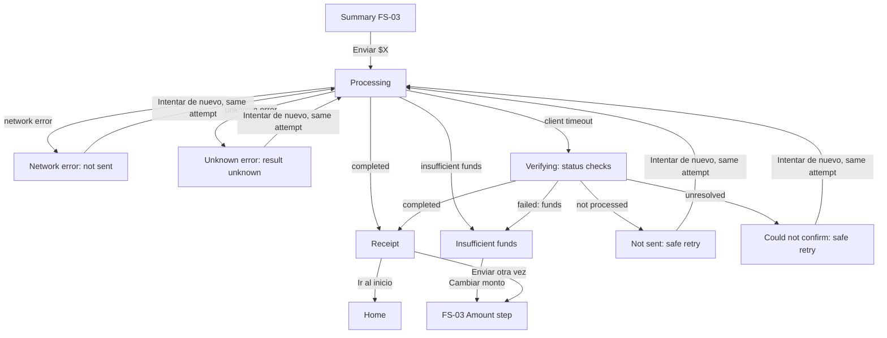

# FS-04 — Confirmation and receipt

| Field | Value |
|---|---|
| **ID** | FS-04 |
| **Module** | CONF |
| **Status** | Implemented |
| **Version** | 1.2 |
| **Author** | Claude (AI-assisted draft) |
| **Reviewer** | Project owner |
| **Last updated** | 2026-10-13 |
| **Origin** | Challenge §4 "Confirmación" · FR-CONF-01…13 and outcome matrix in [requirements analysis](../00-context/requirements-analysis.md#34-conf--confirmation-and-receipt) · decisions OQ-05 (status check), OQ-10 (copy reference) |
| **Implemented by** | [TS-04 Confirmation](../02-technical/TS-04-confirmation.md) |

---

## 1. Goal

Turn the user's "Send" into a result they can trust. Whatever happens (success, failure, or a result that is not yet known) the user always knows whether their money left, what to do next, and never ends up sending twice by retrying.

## 2. Scope

**In scope**
- Submitting the transfer from the summary (FS-03) and the processing state.
- The five outcomes required by the challenge: success, network error, insufficient funds, timeout, unknown error.
- Automatic status verification after a timeout.
- Safe retries (same transfer attempt).
- Receipt: content, revisiting it, copying the reference, "Ir al inicio" and "Enviar otra vez".
- Random outcomes in normal use; forced outcomes outside production.

**Out of scope** (and why)
- Share/download of the receipt (FR-CONF-12) — "with more time"; only copying the reference (OQ-10 recommendation).
- Reversals, refunds, disputes — not in the challenge.
- Push/email notifications of the outcome — not in the challenge.

## 3. Actors, preconditions and postconditions

| | Detail |
|---|---|
| **Actor** | Authenticated user |
| **Preconditions** | Valid session (BR-14); a complete transfer draft on the summary (FS-03). |
| **Success postcondition** | Money moved exactly once; the user sees the receipt; Home reflects the new balance and transaction (FR-HOME-09). |
| **Failure postcondition** | Money did not move and the user is told so explicitly, with a way to retry or edit; **or** the outcome is still unknown and the user is told exactly that, with a safe next step. |

## 4. Functional requirements

| ID | Description | Priority | Origin |
|---|---|---|---|
| FR-CONF-01 | Submit the transfer; mocked response with a random outcome among five scenarios. | Must | §4 |
| FR-CONF-02 | Processing state; confirmation cannot be triggered twice. | Must | §4 |
| FR-CONF-03 | Success → confirmed transaction and receipt. | Must | §4 Éxito |
| FR-CONF-04 | Network error → error state with retry. | Must | §4 Error de red |
| FR-CONF-05 | Insufficient funds → descriptive error. | Must | §4 Fondos insuficientes |
| FR-CONF-06 | Timeout → bounded wait, "verifying" state, automatic status check, then the final outcome. | Must | §4 Timeout · OQ-05 |
| FR-CONF-07 | Unknown error → generic fallback. | Must | §4 Error desconocido |
| FR-CONF-08 | Retrying never creates a duplicate transaction. | Should | BR-07 |
| FR-CONF-09 | Receipt shows reference, date/time, recipient, amount, concept, resulting balance. | Should | Derived |
| FR-CONF-10 | From the receipt: go Home or send again. | Should | Derived |
| FR-CONF-11 | Outcomes can be forced deterministically outside production. | Should | NFR-10 |
| FR-CONF-13 | Status of a transfer attempt can be queried; if the check fails, safe retry. | Must | OQ-05 |

## 5. Rules

### 5.1 Business and input validation rules

> BR-17 originated in this FS and is registered in the [requirements analysis](../00-context/requirements-analysis.md#41-rules).

| ID | Type | Rule | When it is evaluated | Outcome if violated |
|---|---|---|---|---|
| BR-06 | Business | BR-01…BR-05, BR-09, BR-15 are re-evaluated by the server at confirmation. | On confirm (server) | Rule-specific error; no money moves |
| BR-02 | Business | Amount ≤ balance **at the moment of confirmation**. | On confirm (server) | Insufficient-funds outcome |
| BR-07 | Business | **Idempotent attempt:** each summary produces one transfer attempt; any retry or status check of that attempt refers to the same attempt and can never move money twice. Editing recipient, amount or concept creates a new attempt. | On confirm, retry, status check (server) | Original outcome returned |
| BR-14 | Business | Session required. | On confirm and status check (server) | `UNAUTHENTICATED`; FS-01 E8 |
| BR-17 | Business | **Single final outcome:** a transfer attempt is in exactly one state at a time — *in progress*, *completed*, *failed* (with reason) or *not processed* (never received) — and once final it never changes. Status checks report that state. | Status check (server) | — |

### 5.2 UI rules

| ID | Rule | Trigger | Behavior | Related |
|---|---|---|---|---|
| UIR-CONF-01 | Processing lock | User presses "Enviar $X" | The button shows "Enviando…", is non-interactive and exposed as busy; edit, cancel and in-app navigation are unavailable until an outcome arrives. | FR-CONF-02, UX-11 |
| UIR-CONF-02 | Slow-response message | Processing longer than the "slow" threshold (ASM-17) | Message changes to "Esto está tardando un poco más de lo normal…" without leaving the processing state. | UX-02 |
| UIR-CONF-03 | Bounded wait | Processing reaches the client timeout (ASM-17) | Processing ends and the **verifying** state starts (UIR-CONF-04). The user never waits indefinitely. | FR-CONF-06 |
| UIR-CONF-04 | Verifying | Timeout reached | "Estamos verificando tu envío…" with the transfer details; the app checks the attempt's status automatically a limited number of times with increasing intervals (ASM-17); no action is required from the user. | FR-CONF-13, UX-09 |
| UIR-CONF-05 | Verification results | A status check answers | *Completed* → receipt. *Failed (insufficient funds)* → insufficient-funds view. *Not processed* → "Tu dinero no se envió" view with safe retry. *In progress* → keep checking until the limit. | BR-17, UX-09 |
| UIR-CONF-06 | Unresolved verification | All checks fail or keep returning *in progress* | "No pudimos confirmar el estado de tu envío." Explains that retrying is safe (it will not send twice) and that the result will appear in Movimientos. Actions: "Intentar de nuevo" (same attempt), "Ir al inicio". Never states success or failure. | UX-09, BR-07 |
| UIR-CONF-07 | Success view = receipt | Outcome *completed* | Receipt view (UIR-CONF-12); focus moves to its heading; the draft is cleared (UIR-TX-21); the history is replaced so Back leads to Home, not to the summary. | FR-CONF-03, A11Y-02 |
| UIR-CONF-08 | Network error view | Request did not reach the server | "No pudimos conectarnos. Tu dinero no se envió." with the transfer details. Actions: "Intentar de nuevo" (same attempt), "Cambiar datos" (back to summary), "Cancelar". | FR-CONF-04, ASM-06 |
| UIR-CONF-09 | Insufficient-funds view | Server rejects for BR-02 | "No tienes saldo suficiente para este envío. Saldo disponible: {balance}" with the **updated** balance from the server. Actions: "Cambiar monto" (amount step with the amount kept and the BR-02 error visible), "Cancelar". No retry of the same attempt is offered. | FR-CONF-05 |
| UIR-CONF-10 | Unknown-error view | Unexpected error | "No pudimos completar tu envío." + "Si se realizó, lo verás en tus movimientos." + reference code. Actions: "Intentar de nuevo" (same attempt — safe), "Ir al inicio". Never states the money did or did not move. | FR-CONF-07, UX-09 |
| UIR-CONF-11 | Reference code on every non-success | Any error or unresolved view | Reference code (correlation ID) shown, monospaced and copyable. | NFR-04, UX-05 |
| UIR-CONF-12 | Receipt content | Receipt view | Heading "Envío realizado", amount as the most prominent element, "a {name}" + masked identifier, concept (if any), date and time, status "Completado", folio (reference number) with "Copiar folio", resulting balance (masked if the hide-balance preference is on, with a reveal control). | FR-CONF-09, UX-10, UIR-HOME-05 |
| UIR-CONF-13 | Copy folio | User presses "Copiar folio" | Folio copied; non-blocking confirmation "Folio copiado" announced. | UX-10, A11Y-08 |
| UIR-CONF-14 | Receipt actions | Receipt view | "Ir al inicio" (primary) and "Enviar otra vez" (secondary). "Enviar otra vez" opens FS-03 at the amount step with the same recipient and an empty amount. | FR-CONF-10 |
| UIR-CONF-15 | Revisitable receipt | Receipt view reloaded or reopened by its address | The same receipt is shown again (no new transfer); if the receipt doesn't belong to the user or doesn't exist, a "not found" state with "Ir al inicio". | FR-CONF-09, BR-14 |
| UIR-CONF-16 | Leaving during processing | User closes or navigates away with the browser while processing | Nothing is retried automatically; the attempt completes or not on the server; Home shows the result on the next visit; no duplicate is possible (BR-07). | BR-07 |
| UIR-CONF-17 | Forced outcome (non-production) | Environment is not production | A mechanism lets tests and demos choose the outcome (including timeout sub-cases) per attempt. Never available in production. | FR-CONF-11, ASM-16 |

## 6. User stories

- **US-01** — As a customer, I want a clear confirmation and a folio when the money is sent, so that I can prove it.
- **US-02** — As a customer with a bad connection, I want to retry without fear of sending twice.
- **US-03** — As a customer, I want to know exactly why a transfer was rejected and how to fix it.
- **US-04** — As a cautious customer, I want the app to be honest when it doesn't know the result yet, instead of guessing.
- **US-05** — As a frequent sender, I want to send again to the same person from the receipt.

## 7. Flows

### 7.1 Main flow (happy path)
1. On the summary (FS-03) the user presses **Enviar $250.00**.
2. Processing state (UIR-CONF-01).
3. The server re-validates the rules (BR-06), processes the attempt once (BR-07) and answers *completed*.
4. The **receipt** is shown (UIR-CONF-12); Home will reflect the transfer.
5. The user presses **Ir al inicio** or **Enviar otra vez**.

### 7.2 Alternate flows
- **A1 — Slow response:** at step 2, after the slow threshold → slow message (UIR-CONF-02); continues normally.
- **A2 — Retry after network error:** from the network-error view, "Intentar de nuevo" → back to step 2 with the **same attempt**.
- **A3 — Copy folio:** on the receipt, "Copiar folio" (UIR-CONF-13).
- **A4 — Send again:** on the receipt, "Enviar otra vez" → FS-03 amount step with the same recipient (UIR-CONF-14).
- **A5 — Revisit receipt:** reload or reopen the receipt → same receipt (UIR-CONF-15).

### 7.3 Exception flows (the five outcomes)
- **E1 — Network error:** the request does not reach the server → network-error view (UIR-CONF-08). Money did not move.
- **E2 — Insufficient funds:** the server rejects for BR-02 → insufficient-funds view with the updated balance (UIR-CONF-09). Money did not move.
- **E3 — Timeout:** no answer within the client timeout → verifying (UIR-CONF-04) → status checks →
  - **E3a** completed → receipt;
  - **E3b** not processed → "Tu dinero no se envió" + safe retry;
  - **E3c** failed (insufficient funds) → E2 view;
  - **E3d** unresolved → UIR-CONF-06.
- **E4 — Unknown error:** unexpected error → unknown-error view (UIR-CONF-10); retry is the same attempt.
- **E5 — Rule violation detected by the server** (BR-01, 03, 04, 05, 09, 15 — only reachable bypassing the UI or with stale data): treated as a failed outcome with a specific message and "Cambiar datos".
- **E6 — Session invalid:** FS-01 E8; the attempt, if it reached the server, keeps its outcome.



## 8. UI states

| State | When it happens | What the user sees | Available actions |
|---|---|---|---|
| Processing | After "Enviar $X" | Summary details; "Enviando…" busy button | None |
| Processing — slow | Above slow threshold | Same + "Esto está tardando un poco más de lo normal…" | None |
| Verifying | Client timeout reached | "Estamos verificando tu envío…" + details + progress | None (automatic) |
| Receipt | Completed | UIR-CONF-12 | Copiar folio, Ir al inicio, Enviar otra vez |
| Network error | Not reached server | Title, "Tu dinero no se envió.", details, reference | Intentar de nuevo, Cambiar datos, Cancelar |
| Not processed (after verification) | Status = not processed | Same as network error, wording "No se procesó tu envío. Tu dinero no se envió." | Intentar de nuevo, Cambiar datos, Cancelar |
| Insufficient funds | BR-02 at confirmation | Explanation + updated balance + reference | Cambiar monto, Cancelar |
| Unknown error | Unexpected error | Generic message, "si se realizó, lo verás en tus movimientos", reference | Intentar de nuevo, Ir al inicio |
| Unresolved | Verification inconclusive | "No pudimos confirmar el estado…", safe-retry explanation, reference | Intentar de nuevo, Ir al inicio |
| Receipt not found | Opening a receipt that doesn't exist / isn't the user's | "No encontramos este comprobante." | Ir al inicio |

## 9. Input and output data

### 9.1 Fields captured from the user

N/A — the user only triggers actions (send, retry, copy, navigate). Data comes from the FS-03 draft.

### 9.2 Information displayed

| Data | Display format | Source |
|---|---|---|
| Amount | `$250.00`, most prominent | Server response (receipt) / draft (processing, errors) |
| Recipient | Name + masked identifier | Same |
| Concept | As entered | Same |
| Date and time | "13 oct 2026, 14:32" | Server (receipt) |
| Folio (reference number) | e.g. `MW-7K3P9Q`, monospaced | Server (receipt) |
| Resulting balance | `$750.00` or masked | Server (receipt) |
| Updated balance (insufficient funds) | `$180.00` | Server |
| Reference code (errors) | Short monospaced code | Correlation ID (NFR-04) |

## 10. Acceptance criteria

**AC-CONF-01 — Success shows the receipt**
```gherkin
Given I am on the summary for 250.00 MXN to "Ana López" with concept "Tacos"
And the outcome is forced to success
When I press "Enviar $250.00"
Then I see "Envío realizado", "$250.00", "Ana López", "Tacos", the date and time, a folio and my resulting balance
And focus is on the receipt heading
```

**AC-CONF-02 — Processing cannot be triggered twice**
```gherkin
Given I am on the summary
When I press "Enviar $250.00" twice quickly
Then exactly one transfer attempt is submitted
And the button shows "Enviando…" and is not interactive
```

**AC-CONF-03 — Network error says money was not sent**
```gherkin
Given the outcome is forced to network error
When I press "Enviar $250.00"
Then I see "No pudimos conectarnos. Tu dinero no se envió."
And I see a reference code and "Intentar de nuevo"
And my balance is unchanged
```

**AC-CONF-04 — Retry never duplicates**
```gherkin
Given my transfer attempt failed with a network error or an unknown error
When I press "Intentar de nuevo" and it succeeds
Then exactly one transaction exists for that attempt
And my balance decreased only once
```

**AC-CONF-05 — Insufficient funds**
```gherkin
Given the outcome is forced to insufficient funds and my balance on the server is 180.00 MXN
When I press "Enviar $250.00"
Then I see "No tienes saldo suficiente para este envío. Saldo disponible: $180.00"
When I press "Cambiar monto"
Then I am on the amount step with 250 in the field and the balance error visible
```

**AC-CONF-06 — Timeout resolved as completed**
```gherkin
Given the outcome is forced to "timeout, then completed"
When I press "Enviar $250.00"
Then after the client timeout I see "Estamos verificando tu envío…"
And then I see the receipt for that transfer
And exactly one transaction exists
```

**AC-CONF-07 — Timeout resolved as not processed**
```gherkin
Given the outcome is forced to "timeout, then not processed"
When I press "Enviar $250.00"
Then after verifying I see "No se procesó tu envío. Tu dinero no se envió."
And "Intentar de nuevo" uses the same attempt
```

**AC-CONF-08 — Timeout unresolved never asserts the result**
```gherkin
Given the outcome is forced to "timeout, unresolved"
When I press "Enviar $250.00"
Then after the verification attempts I see "No pudimos confirmar el estado de tu envío."
And I am told that retrying will not send twice
And the screen does not say the transfer succeeded or failed
```

**AC-CONF-09 — Unknown error fallback**
```gherkin
Given the outcome is forced to unknown error
When I press "Enviar $250.00"
Then I see "No pudimos completar tu envío." and "Si se realizó, lo verás en tus movimientos."
And I see a reference code, "Intentar de nuevo" and "Ir al inicio"
```

**AC-CONF-10 — Bounded wait**
```gherkin
Given the server never answers
When I press "Enviar $250.00"
Then within the client timeout plus the verification window I see a final or unresolved state
And I am never left in "Enviando…" indefinitely
```

**AC-CONF-11 — Receipt cannot be resubmitted with Back**
```gherkin
Given I am on the receipt
When I press the browser Back button
Then I am on Home, not on the summary
```

**AC-CONF-12 — Revisit receipt**
```gherkin
Given I am on the receipt with folio "MW-7K3P9Q"
When I reload the page
Then I see the same receipt
And no new transaction is created
```

**AC-CONF-13 — Copy folio**
```gherkin
Given I am on the receipt
When I press "Copiar folio"
Then the folio is copied and "Folio copiado" is announced
```

**AC-CONF-14 — Send again**
```gherkin
Given I am on the receipt of a transfer to "Ana López"
When I press "Enviar otra vez"
Then I am on the amount step with "Ana López" as recipient and an empty amount
```

**AC-CONF-15 — Forced outcomes only outside production**
```gherkin
Given the app runs outside production
Then each of the five outcomes and the timeout sub-cases can be forced for a transfer attempt
Given the app runs in production
Then the forcing mechanism is ignored and outcomes follow the configured distribution
```

**AC-CONF-16 — Random outcomes in normal use**
```gherkin
Given no outcome is forced
When many transfers are confirmed
Then every one of the five outcomes occurs with the configured distribution
```

**AC-CONF-17 — Receipt of another user**
```gherkin
Given a receipt address that belongs to another user
When I open it
Then I see "No encontramos este comprobante." and no data from that transfer
```

## 11. Edge cases

| # | Situation | Expected behavior |
|---|---|---|
| EC-01 | Server answers *completed* just after the client timeout | Verification finds *completed* → receipt (E3a) |
| EC-02 | User retries after "unresolved" while the original attempt actually completed | Retry returns the original *completed* outcome → receipt; no second transfer (BR-07) |
| EC-03 | Balance changed between summary and confirmation (e.g. an incoming transfer) | Server validates against the current balance; success if sufficient |
| EC-04 | Network drops during verification | Counts as a failed check; after the limit → unresolved (UIR-CONF-06) |
| EC-05 | User edits the amount after an insufficient-funds outcome | New attempt (BR-07) |
| EC-06 | Two tabs confirm the same summary | Same attempt → one transaction; the second tab shows the same outcome |
| EC-07 | Session expires during verification | Login with session-ended notice; the attempt keeps its outcome; Home shows it after login |
| EC-08 | Hide-balance preference on | Receipt and insufficient-funds balances masked with a reveal control |
| EC-09 | Very long recipient name or concept on the receipt | Wraps; never truncates the folio or the amount |

## 12. Copy and messages

| Key | Text | Context |
|---|---|---|
| `conf.processing` | "Enviando…" | Button during processing |
| `conf.slow` | "Esto está tardando un poco más de lo normal…" | Slow threshold |
| `conf.verifying.title` | "Estamos verificando tu envío…" | Verifying |
| `conf.verifying.body` | "No cierres esta pantalla. Te mostraremos el resultado en unos segundos." | Verifying |
| `conf.receipt.title` | "Envío realizado" | Receipt heading |
| `conf.receipt.to` | "a {name}" | Receipt |
| `conf.receipt.status` | "Completado" | Receipt |
| `conf.receipt.folio` | "Folio" | Receipt label |
| `conf.receipt.copy` | "Copiar folio" | Action |
| `conf.receipt.copied` | "Folio copiado" | Toast |
| `common.close` | "Cerrar" | Toast dismiss button |
| `common.notification` | "Notificación" | Prefix read before a toast by screen readers |
| `common.notifications_region` | "Notificaciones ({hotkey})" | Toast region label (F8 jumps to it) |
| `conf.receipt.balance` | "Saldo disponible" | Receipt label |
| `conf.receipt.home` | "Ir al inicio" | Primary action |
| `conf.receipt.again` | "Enviar otra vez" | Secondary action |
| `conf.receipt.not_found` | "No encontramos este comprobante." | Not found |
| `conf.receipt.not_found_body` | "Revisa el enlace o busca el envío en tus movimientos." | Not found |
| `conf.receipt.date` / `conf.receipt.status_label` | "Fecha y hora" / "Estado" | Receipt labels |
| `conf.receipt.copy_failed` | "No pudimos copiar el folio. Selecciónalo para copiarlo." | Clipboard unavailable |
| `conf.network.title` | "No pudimos conectarnos" | Network error |
| `conf.network.body` | "Tu dinero no se envió. Revisa tu conexión e intenta de nuevo." | Network error |
| `conf.not_processed.title` | "No se procesó tu envío" | After verification |
| `conf.not_processed.body` | "Tu dinero no se envió. Puedes intentarlo de nuevo." | After verification |
| `conf.funds.title` | "No tienes saldo suficiente" | Insufficient funds |
| `conf.funds.body` | "No tienes saldo suficiente para este envío. Saldo disponible: {balance}" | Insufficient funds |
| `conf.funds.change_amount` | "Cambiar monto" | Action |
| `conf.unknown.title` | "No pudimos completar tu envío" | Unknown error |
| `conf.unknown.body` | "Si se realizó, lo verás en tus movimientos." | Unknown error |
| `conf.unresolved.title` | "No pudimos confirmar el estado de tu envío" | Unresolved |
| `conf.unresolved.body` | "Si lo intentas de nuevo no se enviará dos veces. El resultado también aparecerá en tus movimientos." | Unresolved |
| `conf.change_data` | "Cambiar datos" | Back to summary |
| `conf.funds.body_no_balance` | "No tienes saldo suficiente para este envío." | Insufficient funds when the server sent no balance |
| `conf.rule.title` | "No pudimos hacer tu envío" | E5 rule violation |
| `conf.rule.recipient` / `conf.rule.concept` / `conf.rule.other` | "Elige de nuevo a quién le envías." / "Revisa el concepto: hasta 40 caracteres, sin saltos de línea." / "Revisa los datos del envío e inténtalo de nuevo." | E5 (other codes reuse FS-03 copy) |
| `conf.home` | "Ir al inicio" | Unknown error / unresolved action |
| `conf.redirecting` | "Abriendo tu comprobante…" | Between success and the receipt |
| `common.retry` | "Intentar de nuevo" | Retry |
| `common.cancel` | "Cancelar" | Cancel |
| `common.reference` | "Referencia: {code}" | Errors |

## 13. Accessibility and responsive behavior

Applies: A11Y-01, 02, 03, 04, 08, 09, 10, 11, 12, 13, 16, 17, 18, 20, 22, 25, 26.

- Processing announced once ("Enviando"); slow message and verifying announced politely; the spinner is never the only indicator (A11Y-08, A11Y-20).
- Every outcome view has its own heading and view title; focus moves to the heading on arrival (A11Y-01, A11Y-02).
- Success and failure differ by heading text and icon, not only color; contrast verified in both themes (A11Y-10, A11Y-11).
- The folio is readable character by character (spelled out to assistive technology) and copyable; "Folio copiado" announced (A11Y-17, A11Y-08).
- Amounts announced with currency; masked balances announced as "Saldo oculto" (A11Y-17).
- The verification window is a system wait, not a user time limit; the user is never asked to act within a time (A11Y-16).
- **Responsive:** small viewports — outcome views full-screen with actions stacked at the bottom within thumb reach, primary first; medium/large — centered card with capped width; receipt details in a label/value list that reflows at 320 px and 200 % text size (A11Y-12, UX-01).

## 14. Assumptions

| ID | Assumption | Impact if wrong |
|---|---|---|
| ASM-06 | Network error = request never reached the server | Retry semantics change |
| ASM-07 | Timeout/unknown = outcome unknown; same attempt for retries and checks | Duplicate risk |
| ASM-08 | Insufficient funds can occur at confirmation | Scenario unreachable |
| ASM-16 | **Outcome distribution** when not forced: success 60 %, network error 10 %, insufficient funds 10 %, timeout 10 %, unknown error 10 % (configurable). Timeout sub-case by default: completed late. Forcing available outside production for every outcome and sub-case. | Different demo/test behavior |
| ASM-17 | **Timing** (configurable): slow message after 3 s; client timeout 10 s; up to 3 status checks at 2 s, 4 s and 8 s. | Different waits |

## 15. Open questions

| ID | Question | Blocking? | Answer / decision |
|---|---|---|---|
| OQ-04 | Outcome distribution and forcing mechanism | No | Applied as ASM-16 (recommendation); change in config if needed. |
| OQ-10 | Receipt share/download | No | Copy folio only (recommendation); share/download "with more time". |

## 16. Traceability

| Requirement | Technical spec | Tasks | Test cases |
|---|---|---|---|
| FR-CONF-01, 11 | TS-04 | Phase 4 | AC-CONF-15, 16 |
| FR-CONF-02 | TS-04 | Phase 4 | AC-CONF-02 |
| FR-CONF-03, 09, 10 | TS-04 | Phase 4 | AC-CONF-01, 11…14, 17 |
| FR-CONF-04 | TS-04 | Phase 4 | AC-CONF-03 |
| FR-CONF-05 | TS-04 | Phase 4 | AC-CONF-05 |
| FR-CONF-06, 13 | TS-04 | Phase 4 | AC-CONF-06…08, 10 |
| FR-CONF-07 | TS-04 | Phase 4 | AC-CONF-09 |
| FR-CONF-08, BR-07 | TS-04 | Phase 4 | AC-CONF-04, EC-02, EC-06 |
| BR-17 | TS-04 §6 | Phase 4 | Unit + integration |
| UIR-CONF-01…17 | TS-04 §6 | Phase 4 | Component / presentation-logic + E2E |

## 17. Change history

| Version | Date | Author | Change |
|---|---|---|---|
| 0.1 | 2026-10-13 | Claude (AI-assisted) | First draft |
| 1.0 | 2026-10-13 | Project owner | Approved |
| 1.1 | 2026-10-14 | Claude (AI-assisted) | Traceability now points to the written TS (no behavior change) |
| 1.2 | 2026-10-14 | Claude (AI-assisted) | TASK-04: toast copy keys (`common.close`, `common.notification`, `common.notifications_region`) |
| 1.3 | 2026-10-14 | Claude (AI-assisted) | TASK-18: §12 adds the keys the build needed (rule-violation copy, no-balance variant, "Ir al inicio", redirecting); no behavior change |
| 1.4 | 2026-10-14 | Claude (AI-assisted) | TASK-19: §12 adds receipt labels, not-found body and copy failure; no behavior change |
