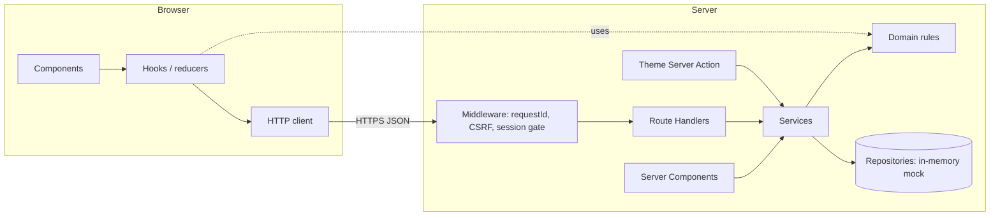

# TS-00 — Architecture and cross-cutting conventions

| Field | Value |
|---|---|
| **ID** | TS-00 |
| **Module** | CORE |
| **Status** | Approved |
| **Version** | 1.8 |
| **Author** | Claude (AI-assisted draft) |
| **Reviewer** | Project owner |
| **Last updated** | 2026-10-14 |
| **Implements** | NFR-01…03, 05…07, 11…13, 16, 17 · CON-01…08 · cross-cutting parts of FS-01…FS-04 |
| **Related decisions** | ADR-001…ADR-009 |

> This is the only TS that names technologies outside of ADRs: §3.4 is the **technology bindings** table that every module TS refers to.

---

## 1. Context and technical goal

Define the structure every module follows so that business rules live once, every entry point enforces them, and any screen can be changed live without touching unrelated code. Constraints: mocked data (CON-08), high-volume context (NFR-01), 3-day delivery (DEL-05), WCAG 2.2 AA (NFR-14), light/dark themes (UX-22).

## 2. Technical scope

**In scope:** layering and dependency rules, folder structure, technology bindings, coding standards, shared domain types, error model, HTTP client contract, configuration, mock/simulation layer, design tokens and breakpoints, performance budgets, i18n approach.
**Out of scope:** per-module contracts and flows (TS-01…TS-04), event catalog (TS-05), test cases (test plan).

## 3. Module architecture

### 3.1 Layers and responsibilities

| Layer | Responsibility | Location | May depend on |
|---|---|---|---|
| Presentation (UI) | Render state, capture input, implement UI rules (UIR-*) | `src/components/**`, `src/features/*/components` | Presentation logic, domain types |
| Presentation logic | Screen state, reducers, hooks, calls through the HTTP client | `src/features/*/hooks`, `src/features/*/state` | Domain, HTTP client |
| HTTP client (browser) | Typed calls, timeout/cancellation, correlation + idempotency headers, response → `Result` | `src/lib/http` | Domain |
| Interface (controllers) | Route Handlers: session, input parsing, call service, map errors to HTTP | `src/app/api/**/route.ts` | Server helpers, services |
| Application (services) | Use cases; enforce BR-*; idempotency; logging | `src/server/services` (server-only) | Domain, repository ports |
| Core (domain) | Types, value objects, pure rules and validators | `src/core` | Nothing |
| Infrastructure (repositories, mocks) | In-memory data, simulated latency/outcomes, session/OTP stores | `src/server/repositories`, `src/server/mock` (server-only) | Domain (ports) |

**Dependency rule:** arrows point inward (UI → logic → client → controllers → services → domain). The core imports nothing from the project, the framework or I/O; an ESLint `no-restricted-imports` rule on `src/core/**` enforces it. Services depend on repository **ports** (interfaces), not on the in-memory implementations. Server-only modules cannot be imported from client code (build fails).

### 3.2 Diagram



### 3.3 Folder structure

```
src/
  app/
    layout.tsx                    # <html lang="es-MX" data-theme>, providers, skip link
    globals.css                   # design tokens per theme (§9)
    (public)/login/page.tsx
    (private)/layout.tsx          # authoritative session check (getSession)
    (private)/page.tsx            # Home (streamed sections)
    (private)/transfer/layout.tsx # TransferDraftProvider + step guard
    (private)/transfer/{recipient,amount,summary}/page.tsx
    (private)/receipts/[transferId]/page.tsx
    api/auth/{code,verify,logout}/route.ts
    api/me/{summary,transactions}/route.ts
    api/contacts/route.ts
    api/transfers/route.ts
    api/transfers/attempts/[key]/route.ts
    api/client-logs/route.ts
    api/mock/reset/route.ts     # non-production only
  proxy.ts                        # route gate: requestId, CSRF, session (Next.js 16 name for middleware; ADR-001)
  instrumentation.ts              # logger init (ADR-006)
  core/                           # domain: money, identifier, otp, contact, transfer, errors, result
  server/                         # server-only
    services/                     # auth, account, contacts, transfers, preferences
    repositories/                 # ports + in-memory implementations
    mock/                         # seed data, outcome simulator, latency
    http/                         # controller helpers: withSession, parseBody, toResponse
    session/                      # sign/verify cookie, getSession
    logging/                      # logger, request context, redaction
    actions/                      # theme Server Action
  lib/
    http/                         # browser HTTP client
    config.ts                     # typed configuration (§8)
    i18n/messages.es-MX.ts        # copy keys from FS §12
    format/                       # money, dates, masking (shared, pure)
  components/
    ui/                           # base components (ADR-008)
    wallet/                       # wallet-specific: MoneyText, MoneyInput, TransactionItem…
  features/
    auth/ home/ transfer/ confirmation/ theme/   # screen components, hooks, reducers
tests/e2e/                        # Playwright
```

### 3.4 Technology bindings

| Concept | Binding | ADR |
|---|---|---|
| Language | TypeScript (strict) | CON-01 |
| Framework | Next.js, App Router | ADR-001 |
| Route groups / protected views | `(public)` / `(private)` + Next.js `proxy` (`src/proxy.ts`, the Next.js 16 name for middleware) + `getSession()` in private layout and controllers | ADR-001 |
| Server-rendered reads | React Server Components, dynamic, `no-store`, Suspense per section | ADR-002 |
| Server entry points for client calls | Route Handlers under `/api` | ADR-002 |
| Server-only boundary | `server-only` package | ADR-002 |
| Server-side mutation (exception) | One Server Action: theme preference | ADR-002, ADR-007 |
| Client HTTP | `fetch` + `AbortController` in a typed client | ADR-002 |
| Client state | React Context + `useReducer` (transfer draft, theme) | ADR-003 |
| Session | Signed opaque ID, `HttpOnly; Secure; SameSite=Lax` cookie; in-memory session store | ADR-004 |
| CSRF | Origin / `Sec-Fetch-Site` check, JSON + custom header, no CORS, safe GETs | ADR-004 |
| Runtime validation at boundaries | Zod schemas in controllers and the HTTP client | ADR-009 |
| Logging | pino + `x-request-id` + `AsyncLocalStorage` | ADR-006 |
| Theming | CSS custom properties per `data-theme`, `theme` cookie, `prefers-color-scheme` | ADR-007 |
| UI primitives | Radix UI (Dialog, Toast, theme selector) | ADR-008 |
| Styling | Tailwind CSS mapped to token variables | ADR-008 |
| Unit / component / integration tests | Vitest + React Testing Library + user-event | ADR-005 |
| E2E + a11y scan | Playwright + axe-core | ADR-005 |
| Formatting of money/dates | `Intl.NumberFormat` / `Intl.DateTimeFormat` (`es-MX`) | — (platform API) |

## 4. Domain model and shared types

| Type | Kind | Shape | Invariants |
|---|---|---|---|
| `Money` | Value object | `{ amountMinor: number; currency: 'MXN' }` | `amountMinor` is a safe integer ≥ 0; created only through `Money.fromMinor` / `Money.parse` |
| `Identifier` | Tagged union | `{ kind: 'phone'; value: string /*10 digits*/ } \| { kind: 'email'; value: string /*lowercase*/ }` | Only produced by `parseIdentifier` (BR-10) |
| `MaskedIdentifier` | Branded string | `•••• 5678` / `a•••@correo.com` | Produced only by `maskIdentifier` |
| `UserId`, `ContactId`, `TransferId`, `AttemptKey` | Branded strings | opaque | Not interchangeable at compile time |
| `Result<T, E>` | Tagged union | `{ ok: true; value: T } \| { ok: false; error: E }` | Exactly one variant; used by domain, services and HTTP client |
| `DomainError` | Tagged union | `{ code: ErrorCode; …details }` | `code` from the closed catalog (§5) |
| `TransferStatus` | Union | `'in_progress' \| 'completed' \| 'failed' \| 'not_processed'` | BR-17: final states never change |
| `Theme` | Union | `'light' \| 'dark' \| 'system'` | — |

Rules are exposed as pure functions returning `Result` (e.g. `validateAmount(amount, balance)`), imported by client hooks for feedback and by services for enforcement (BR-06).

## 5. Error model

### 5.1 Common error body

| Field | Type | Notes |
|---|---|---|
| `code` | `ErrorCode` | Closed set below |
| `message` | string | Safe, generic; UI copy comes from i18n keys, not from this field |
| `requestId` | string | Correlation ID (ADR-006) |
| `details` | object, optional | e.g. `{ field }`, `{ attemptsLeft }`, `{ retryAfterSec }`, `{ balance }` |

### 5.2 Error code catalog

| Code | HTTP | Origin | Retryable | Used by |
|---|---|---|---|---|
| `VALIDATION_ERROR` | 400 | Malformed body / schema mismatch | No | All |
| `UNAUTHENTICATED` | 401 | No/invalid session (BR-14) | No | All private |
| `CSRF_REJECTED` | 403 | Origin / fetch-metadata / custom header check failed | No | All mutations |
| `NOT_FOUND` | 404 | Resource absent **or not owned** (never reveal which) | No | Receipts, attempts |
| `IDEMPOTENCY_KEY_REUSED` | 409 | Same key, different payload | No | Transfers |
| `PAYLOAD_TOO_LARGE` | 413 | Body or item over its size limit | No | Client logs |
| `UNSUPPORTED_MEDIA_TYPE` | 415 | Mutation not `application/json` | No | All mutations |
| `INVALID_IDENTIFIER` | 422 | BR-10 / BR-05 | No | Auth, contacts, transfers |
| `INVALID_CODE_FORMAT` | 422 | BR-11 | No | Auth |
| `CODE_INCORRECT` | 422 | BR-12, `details.attemptsLeft` | No | Auth |
| `CODE_EXPIRED` | 422 | BR-12 | No | Auth |
| `CODE_LOCKED` | 422 | BR-12 | No | Auth |
| `INVALID_AMOUNT` | 422 | BR-01 / BR-04 | No | Transfers |
| `INSUFFICIENT_FUNDS` | 422 | BR-02, `details.balance` | No | Transfers |
| `RECIPIENT_REQUIRED` | 422 | BR-03 | No | Transfers |
| `SELF_TRANSFER` | 422 | BR-09 | No | Contacts, transfers |
| `INVALID_CONCEPT` | 422 | BR-15 | No | Transfers |
| `INVALID_CONTACT_NAME` | 422 | BR-16 | No | Contacts |
| `CODE_THROTTLED` | 429 | BR-13, `details.retryAfterSec` | After wait | Auth |
| `RATE_LIMITED` | 429 | Generic limits (client logs) | After wait | Client logs |
| `INTERNAL_ERROR` | 500 | Unexpected / simulated unknown error | Yes (same idempotency key) | All |
| `NETWORK_UNAVAILABLE` | 503 | Simulated payment-network outage: **nothing processed** | Yes | Transfers |
| `SERVICE_UNAVAILABLE` | 503 | Simulated dependency outage (login, home data) | Yes | Auth, home, contacts |
| `NETWORK_ERROR` | — | Client: request failed to reach the server | Yes | HTTP client |
| `TIMEOUT` | — | Client: no response within the configured timeout | Yes (same key / status check) | HTTP client |
| `ABORTED` | — | Client: the caller cancelled (unmount, navigation); never shown to users | — | HTTP client |

### 5.3 Error flow

- Domain/services return `Result` with a `DomainError`; they do not throw for expected failures.
- Controllers map `DomainError.code` → HTTP status via one table (`toResponse`); unexpected exceptions become `INTERNAL_ERROR` and are logged with the stack.
- The HTTP client maps every response (or failure) to `Result<T, ClientError>` where `ClientError` adds `NETWORK_ERROR`, `TIMEOUT` and `ABORTED`; every result carries the `requestId`. A `401` triggers one global handler (full navigation to `/login?reason=session_ended&returnTo=…`). A 2xx that fails the response schema is `INTERNAL_ERROR`.
- UI chooses copy by `code` (i18n keys), never displays `message` from the server.
- Error containment: `error.tsx` in `(private)` and per Home section boundaries; `global-error.tsx` as last resort with the reference code.

## 6. Interface contracts (cross-cutting)

| Convention | Rule |
|---|---|
| Base path | `/api` |
| Media type | JSON only; mutations require `Content-Type: application/json` (ADR-004) |
| Headers in | `x-request-id` (required on mutations, generated by the HTTP client), `idempotency-key` (transfers), `x-mock-outcome` (non-production only) |
| Headers out | `x-request-id` on every response; `Cache-Control: no-store` on every private response |
| Money in JSON | `{ "amountMinor": 25000, "currency": "MXN" }` — never floats |
| Dates in JSON | ISO 8601 UTC strings |
| Identifiers in responses | Masked unless the owner needs the full value |
| Status codes | Per §5.2; `201` creation, `202` accepted/in progress, `204` no content |

### 6.1 HTTP client contract (browser)

| Aspect | Behavior |
|---|---|
| Signature | `request<T>(method, path, { body?, schema, timeoutMs?, idempotencyKey? }) → Promise<Result<T, ClientError>>` |
| Correlation | Generates `x-request-id` per call; returns it with every result (success or error) |
| Timeout | `AbortController`; default from config; returns `TIMEOUT` on expiry |
| Network failure | `TypeError` from fetch → `NETWORK_ERROR` |
| Parsing | Response validated with the endpoint's schema; mismatch → `INTERNAL_ERROR` (logged) |
| Retries | Never automatic, except status checks orchestrated by TS-04 |

## 7. Rendering and data loading

Per ADR-002. Every private route is dynamic and uncached; per-user data is never stored in shared caches. Details per view in TS-01…TS-04.

## 8. Configuration

Typed, validated at startup; defaults from ASM-15…ASM-17.

| Key | Default | Notes |
|---|---|---|
| `APP_ENV` | `development` | `development` \| `test` \| `production`. E2E runs a production build with `APP_ENV=test` |
| `SESSION_SECRET` | — (required) | HMAC key (ADR-004) |
| `APP_ORIGIN` | `http://localhost:3000` | Used by CSRF origin check |
| `MOCK_CONTROLS_ENABLED` | `true` in development/test; **always off when `APP_ENV=production`** | Enables `x-mock-outcome`, `/api/mock/reset`, demo code hint |
| `OTP_TTL_SEC` / `OTP_MAX_ATTEMPTS` / `OTP_RESEND_COOLDOWN_SEC` | `300` / `3` / `30` | BR-12, BR-13 |
| `TRANSFER_SLOW_MS` / `TRANSFER_TIMEOUT_MS` | `3000` / `10000` | ASM-17 |
| `TRANSFER_STATUS_CHECK_DELAYS_MS` | `2000,4000,8000` | ASM-17 |
| `OUTCOME_WEIGHTS` | `success:60,network_error:10,insufficient_funds:10,timeout:10,unknown_error:10` | ASM-16 |
| `MOCK_LATENCY_MS` | `300–900` random | Realistic loading states |
| `ACTIVITY_LIMIT` | `10` | ASM-10 |
| `LOG_LEVEL` | `info` | ADR-006 |

Public (client-visible) configuration is limited to timings and `MOCK_CONTROLS_ENABLED`.

## 9. Mock and simulation layer

### 9.1 Seeded users (ASM-04)

| Identifier (phone / email) | Name | Balance | Data | Purpose |
|---|---|---|---|---|
| `5512345678` / `ana@demo.mx` | Ana López | $12,345.67 | 25 transactions (incl. pending/failed), 4 favorites | Normal path |
| `5500000001` / `nuevo@demo.mx` | Nico Ruiz | $500.00 | No transactions, no favorites | Empty states |
| `5500000002` / `cero@demo.mx` | Carla Díaz | $0.00 | 3 transactions, 2 favorites | Zero balance, BR-02 |
| `5500000003` / `falla.saldo@demo.mx` | Beto Sánchez | — | Balance request fails | Section error (balance) |
| `5500000004` / `falla.movs@demo.mx` | Marta Gil | $2,000.00 | Activity request fails | Section error (activity) |
| `5500000005` / `falla.login@demo.mx` | — | — | Code request fails | Login service error (FS-01 E3) |

All other well-formed identifiers proceed to the code step and fail verification generically (OQ-14).

### 9.2 Outcome simulator (transfers)

| Outcome | Server behavior | Attempt state |
|---|---|---|
| `success` | Processes after mock latency → `201` | `completed` |
| `network_error` | Responds `503 NETWORK_UNAVAILABLE` immediately; nothing processed | `not_processed` |
| `insufficient_funds` | `422 INSUFFICIENT_FUNDS` with current balance | `failed` (reason `INSUFFICIENT_FUNDS`) |
| `timeout-completed` (default timeout) | Delays the response beyond the client timeout; completes the transfer meanwhile | `in_progress` → `completed` |
| `timeout-not-processed` | Delays; marks attempt as not processed | `in_progress` → `not_processed` |
| `timeout-unresolved` | Delays; attempt stays `in_progress` longer than the verification window | `in_progress` |
| `unknown_error` | `500 INTERNAL_ERROR`; nothing processed | `not_processed` |

- Random selection by `OUTCOME_WEIGHTS` when not forced; `x-mock-outcome` forces it when mock controls are enabled.
- A retry with the same idempotency key returns the stored final outcome (`completed`/`failed`); if the attempt is `not_processed`, it is processed again (new roll or forced outcome).
- Real business rules still apply first: a genuinely insufficient balance always yields `INSUFFICIENT_FUNDS`.

### 9.3 Other simulations
- Home/contacts: failures driven by seeded users; `x-mock-outcome: service_unavailable` also supported (`GET /api/me/*`, `GET/POST /api/contacts`).
- Auth: `x-mock-outcome: service_unavailable` on `POST /api/auth/code` and `POST /api/auth/verify`; `x-mock-outcome: otp_expired` on `POST /api/auth/verify` makes the current challenge expire (tests AC-AUTH-09 without waiting 5 minutes).
- Latency on every repository call (`MOCK_LATENCY_MS`) to make loading states visible.
- `POST /api/mock/reset` restores seed data (tests).

## 10. Security, session and permissions

See TS-01 and ADR-004. Cross-cutting rules: private responses `no-store`; no sensitive data in client storage; all inputs validated server-side with schemas and domain rules; security headers (`Content-Security-Policy` without inline scripts except framework needs, `X-Content-Type-Options: nosniff`, `Referrer-Policy: same-origin`, `frame-ancestors 'none'`).

**Implementation (TASK-09):** the proxy sets a per-request nonce CSP on pages (`script-src 'self' 'nonce-…' 'strict-dynamic'`; `'unsafe-eval'` only in development; Next.js applies the nonce to its own scripts, verified 12/12 on `/login`). `style-src` allows `'unsafe-inline'` because UI primitives set `style` attributes and inject scroll-lock styles; scripts never do. Static headers in `next.config.ts`: `X-Content-Type-Options`, `Referrer-Policy`, `X-Frame-Options: DENY`, `Permissions-Policy`, `Cross-Origin-Opener-Policy`. HSTS is left to the hosting layer.

## 11. Observability

Standard and event catalog in TS-05 (ADR-006). Every module TS lists its events.

## 12. Performance and scalability

| Budget / rule | Target |
|---|---|
| Largest Contentful Paint (mid-range mobile, 4G) | ≤ 2.5 s |
| Interaction to Next Paint | ≤ 200 ms |
| Cumulative Layout Shift | ≤ 0.1 (UX-15) |
| Client JavaScript on first load per route | Kept minimal; no styled UI kit; service code never shipped |
| Lists | Bounded (`ACTIVITY_LIMIT`) |
| Statelessness | Request handling keeps no per-user state outside repositories (scalable horizontally once repositories are shared stores) |
| Retries | Manual for users; automatic status checks bounded and spaced (ASM-17) to avoid retry storms |

## 13. Accessibility and design foundations

### 13.1 Design tokens (NFR-16, ADR-007)

| Group | Tokens |
|---|---|
| Surfaces | `surface`, `surface-raised`, `surface-sunken`, `overlay` |
| Text | `text-primary`, `text-secondary`, `text-inverse`, `text-link` |
| Borders / focus | `border`, `border-strong`, `focus-ring` |
| Actions | `action-primary`, `action-primary-hover`, `action-primary-text`, `action-secondary`, `action-secondary-hover`, `action-secondary-text` |
| Status | `status-success`, `status-error`, `status-warning`, `status-info` (+ `*-surface` variants) |
| Money | `amount-in`, `amount-out` |
| Spacing / radius / type | 4-px spacing scale; radius `sm/md/lg`; type scale with rem units |

Every text/background pair is contrast-checked in both themes (A11Y-10) by an automated test that reads the token file (TC-UNIT-24).

**Implementation (TASK-03):** each token is defined once as `light-dark(<light>, <dark>)` on `:root`; `data-theme` on `<html>` only sets `color-scheme` (`system` → `light dark`, `light`, `dark`), so the server-rendered attribute alone selects the theme with zero JavaScript. Tailwind's default palette is removed (`--color-*: initial`) and replaced with utilities mapped to these tokens, so components cannot use raw colors (also guarded by a test). Palette: cool slate neutrals, añil (indigo) actions, jade for money in and success, grana (cochineal) for errors, maize for warnings. System font stack (no web-font download on the critical path).

### 13.2 Layout foundations

| Item | Value |
|---|---|
| Breakpoints | small < 640 px · medium 640–1023 px · large ≥ 1024 px |
| Content width | max 480 px for forms/flows; max 960 px for Home |
| Touch targets | ≥ 44 × 44 px for primary/frequent actions; ≥ 24 × 24 px minimum (A11Y-13) |
| Root | `<html lang="es-MX">`, skip link to `<main>`, one `h1` per view |
| Motion | Animations disabled under `prefers-reduced-motion` |

### 13.3 i18n (NFR-13)
- All copy in `messages.es-MX.ts`, keyed exactly as FS §12; components never hard-code text.
- Money via `Intl.NumberFormat('es-MX', { style: 'currency', currency: 'MXN' })`.
- Dates via `Intl.DateTimeFormat('es-MX')` in the user's time zone, captured at login and stored in the session (FS-02 EC-09); default `America/Mexico_City`.

## 14. Coding standards

- TypeScript `strict`, `noUncheckedIndexedAccess`, `noImplicitOverride`; ESLint forbids `any`, non-null assertions and unused exports.
- Exhaustive `switch` over unions with a `never` check.
- No business logic in components; no HTTP concerns in services; no I/O or framework imports in `src/core` (domain).
- Files and folders in kebab-case; components in PascalCase; one component per file.
- Every UIR implemented in a component or hook has a test referencing its ID in the test name.
- Commits follow the plan's Conventional Commits rule with task IDs.

## 15. Module test strategy

Per ADR-005 and the test plan. TS-00-specific: unit tests for `Money`, `parseIdentifier`, `maskIdentifier`, `Result` helpers, error-to-HTTP mapping, config validation; integration test that mock controls are rejected when disabled.

## 16. Risks and mitigations

| Risk | Likelihood | Impact | Mitigation |
|---|---|---|---|
| In-memory state differs between middleware and server runtime | Medium | Session gate inconsistent | Middleware only verifies cookie signature (no store); store lookups happen in server code |
| Mock controls leak to production | Low | Outcome manipulation | Forced off whenever `APP_ENV=production`; integration test |
| Scope exceeds 3 days | Medium | Missing Musts | Scope-cut list in the plan; Should/Could items isolated |
| Framework convention changes (middleware → proxy) | — | — | Resolved in TASK-01: Next.js 16.4 deprecates `middleware`; we use `src/proxy.ts` |

## 17. Known limitations and technical debt

- Single-instance in-memory repositories and session store; data lost on restart (ASM-03).
- No real payment network, OTP delivery or fraud controls.
- Draft lost on full reload (ADR-003).

## 18. Traceability

| Requirement | Section | Tasks | Test cases |
|---|---|---|---|
| NFR-01, NFR-07 | §12 | Phase 4 | Perf checks (test plan) |
| NFR-02, NFR-03 | §3, §4, §14 | Phase 4 | Lint/typecheck, unit |
| NFR-05, NFR-17 | §10, ADR-004 | Phase 4 | Integration (CSRF, session) |
| NFR-06 | §5, §6.1, §9.2 | Phase 4 | Unit, E2E outcomes |
| NFR-10 | §8, §9 | Phase 4 | Integration (mock flag) |
| NFR-11, NFR-14, NFR-16 | §13, ADR-008 | Phase 4 | Component, axe |
| NFR-13 | §13.3 | Phase 4 | Unit (formatters) |

## 19. Change history

| Version | Date | Author | Change |
|---|---|---|---|
| 0.1 | 2026-10-14 | Claude (AI-assisted) | First draft |
| 1.0 | 2026-10-14 | Project owner | Approved |
| 1.1 | 2026-10-14 | Claude (AI-assisted) | ADR-009 accepted; mock outcomes for auth and contacts listed (needed by the test plan) |
| 1.2 | 2026-10-14 | Claude (AI-assisted) | TASK-01 findings: `src/proxy.ts` (Next.js 16.4 deprecates `middleware`); `APP_ENV` decouples mock controls from `NODE_ENV` so E2E can run a production build |
| 1.3 | 2026-10-14 | Claude (AI-assisted) | One-time code is random per challenge; the demo hint shows the current code outside production (owner decision, resolves conflict between fixed demo code and AC-AUTH-10) |
| 1.4 | 2026-10-14 | Claude (AI-assisted) | TASK-08: `PAYLOAD_TOO_LARGE` (413) added to the catalog (client-logs already answered 413 without a code); client-only `ABORTED`; HTTP client contract details in §5.3 |
| 1.5 | 2026-10-14 | Project owner | Domain layer folder renamed `src/domain` → `src/core` (owner preference); dependency rule now enforced by ESLint |
| 1.6 | 2026-10-14 | Project owner | Wallet-specific components folder renamed `src/components/domain` → `src/components/wallet` (avoids confusion with `src/core`) |
| 1.7 | 2026-10-14 | Claude (AI-assisted) | TASK-03: token implementation with `light-dark()` + `color-scheme`; secondary action tokens; contrast verified by TC-UNIT-24 |
| 1.8 | 2026-10-14 | Claude (AI-assisted) | TASK-09: CSP with nonce from the proxy and static security headers |
