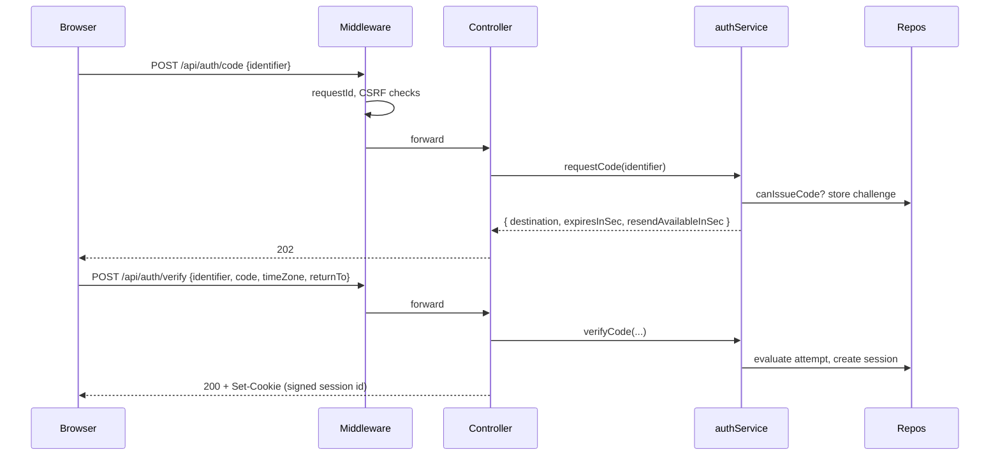

# TS-01 — Auth and session

| Field | Value |
|---|---|
| **ID** | TS-01 |
| **Module** | AUTH |
| **Status** | Implemented |
| **Version** | 1.4 |
| **Author** | Claude (AI-assisted draft) |
| **Reviewer** | Project owner |
| **Last updated** | 2026-10-14 |
| **Implements** | [FS-01](../01-functional/FS-01-login.md) · NFR-05, NFR-17 |
| **Related decisions** | ADR-001, ADR-002, ADR-004, ADR-006, ADR-009 |

---

## 1. Context and technical goal

Implement the two-step one-time-code login, the session lifecycle, route protection (middleware + server authority) and CSRF protection for the whole API. Everything here is mocked except the security mechanics, which are implemented for real.

## 2. Technical scope

**In scope:** `POST /api/auth/code`, `POST /api/auth/verify`, `POST /api/auth/logout`; middleware gate; `getSession()`; session and OTP repositories; CSRF layers; `returnTo` sanitization; login UI state machine; logout entry.
**Out of scope:** real OTP delivery; signed CSRF token (ADR-004 §8); session expiry warning.

## 3. Module architecture

### 3.1 Layers and responsibilities

| Layer | Elements |
|---|---|
| Presentation | `LoginPage`, `IdentifierStep`, `CodeStep`, `OneTimeCodeField`, `ResendCountdown`, `SessionNotice`, `LogoutButton` |
| Presentation logic | `useLoginFlow` (reducer state machine), `useCountdown` |
| HTTP client | `authApi.requestCode`, `authApi.verify`, `authApi.logout` |
| Controllers | `app/api/auth/{code,verify,logout}/route.ts` |
| Middleware | requestId, CSRF, session gate, redirects |
| Services | `authService.requestCode`, `authService.verifyCode`, `authService.logout`; `getSession()` |
| Domain | `parseIdentifier` (BR-10), `parseOtpCode` (BR-11), `evaluateOtpAttempt` (BR-12), `canIssueCode` (BR-13), `sanitizeReturnTo`, `maskIdentifier` |
| Repositories | `UserRepository`, `OtpChallengeRepository`, `SessionRepository` (in-memory) |

### 3.2 Diagram



### 3.3 Module structure

```
src/features/auth/components/{login-view,identifier-step,code-step,one-time-code-field,resend-countdown,session-notice,step-error}/
src/features/auth/hooks/{use-login-flow,use-countdown}/
src/features/auth/state/login-state.ts
src/shared/api/auth.ts                   # POST /api/auth/{code,verify,logout} client
src/shared/components/app-header/        # AppHeader + LogoutButton
src/app/(public)/login/page.tsx
src/app/api/auth/{code,verify,logout}/route.ts
src/proxy.ts
src/server/session/{cookie,session}.ts   # sign/verify, cookie serialize/read; getSession, createSession, destroySession
src/server/security/{csrf,routes,csp}.ts # CSRF layers 2–3, route classification, CSP with nonce
src/server/http/with-session.ts          # controller authority wrapper
src/shared/lib/routes.ts                 # loginUrl(), LOGIN_PATH, RETURN_TO_HEADER, HIGHLIGHT_PARAM
src/shared/components/bfcache-guard/     # reload on bfcache restore of private pages
src/app/(private)/layout.tsx             # page authority
src/server/services/auth.service.ts
src/server/repositories/{ports,in-memory}.ts
src/core/{identity,auth}/
```

**Folder structure (ADR-010):** the block above is current. Paths inside the *As built* notes below are those of the task that wrote them; ADR-010 maps them to today's folders.

### 3.4 Technology bindings

See TS-00 §3.4. No module-specific deviations.

## 4. Domain model and types

| Type | Kind | Shape | Invariants |
|---|---|---|---|
| `OtpChallenge` | Entity | `{ identifierKey, issuedAt, failedAttempts, locked }` | Only the latest per identifier is valid (BR-12) |
| `OtpAttemptResult` | Tagged union | `valid \| incorrect(attemptsLeft) \| expired \| locked` | `attemptsLeft` 0–2 |
| `Session` | Entity | `{ sessionId, userId, timeZone, createdAt }` | `sessionId` 256-bit random |
| `SignedSessionCookie` | Branded string | `<sessionId>.<hmac>` | Verified with constant-time compare |
| `LoginState` | Tagged union | `identifier \| requestingCode \| code{destination, cooldown, attemptsLeft?} \| verifying \| locked \| success` | Drives every UIR-AUTH |
| `SafeReturnTo` | Branded string | Relative path | Starts with `/`, not `//`, no scheme, not `/login` |

## 5. Interface contracts

### Operation: request code — `POST /api/auth/code`

| | Detail |
|---|---|
| **Purpose** | Issue a one-time code for an identifier (FR-AUTH-12) |
| **Authentication** | Public; CSRF-protected |
| **Idempotency** | No; throttled by BR-13 |
| **Expected client timeout** | 10 s |

**Request**

| Field | Type | Required | Constraints |
|---|---|---|---|
| `identifier` | string | Yes | ≤ 254 chars; BR-10 applied in service |

**Success `202`**

| Field | Type | Notes |
|---|---|---|
| `destination` | string | Masked identifier (UIR-AUTH-06) |
| `expiresInSec` | number | `OTP_TTL_SEC` |
| `resendAvailableInSec` | number | `OTP_RESEND_COOLDOWN_SEC` |
| `demoCode` | string, optional | Present **only** when mock controls are enabled (never with `APP_ENV=production`) **and** the identifier has an account; feeds the demo hint (UIR-AUTH-16) and E2E |
| `demoUnknownAccount` | `true`, optional | Mock controls enabled and no account for the identifier: the demo hint says it is not a demo account (OQ-14 amendment) |

Unknown identifiers also receive `202` (OQ-14); no challenge can ever verify for them.

**Errors:** `400 VALIDATION_ERROR` · `403 CSRF_REJECTED` · `415` · `422 INVALID_IDENTIFIER` · `429 CODE_THROTTLED {retryAfterSec}` · `503 SERVICE_UNAVAILABLE` (seeded `falla.login`, or forced).

### Operation: verify code — `POST /api/auth/verify`

**Request**

| Field | Type | Required | Constraints |
|---|---|---|---|
| `identifier` | string | Yes | BR-10 |
| `code` | string | Yes | BR-11 after normalization |
| `timeZone` | string | No | IANA name; default `America/Mexico_City` |
| `returnTo` | string | No | Sanitized; ignored if unsafe |

**Success `200`** — body `{ firstName, redirectTo }`; header `Set-Cookie: session=<signed>; HttpOnly; Secure; SameSite=Lax; Path=/`.

**Errors:** `422 INVALID_CODE_FORMAT` (no attempt consumed) · `422 CODE_INCORRECT {attemptsLeft}` · `422 CODE_EXPIRED` · `422 CODE_LOCKED` · `503 SERVICE_UNAVAILABLE` (no attempt consumed) · `400/403/415`.

### Operation: logout — `POST /api/auth/logout`

`204`; deletes the session record and clears the cookie. Idempotent (no session → `204`).

## 6. Rules: where they are enforced

| Rule | Type | Domain | Client (presentation) | Server (authority) | Notes |
|---|---|---|---|---|---|
| BR-10 Identifier format | Input validation | `parseIdentifier` | On blur / continue | `requestCode`, `verifyCode` | Normalizes `+52`, spaces, case |
| BR-11 Code format | Input validation | `parseOtpCode` | On verify | `verifyCode` before consuming an attempt | |
| BR-12 Code validity | Business | `evaluateOtpAttempt` | — | `verifyCode` | Time from server clock only (FS-01 EC-13) |
| BR-13 Code throttling | Business | `canIssueCode` | Countdown display only | `requestCode` | Locked challenge bypasses cooldown |
| BR-14 Session required | Business | — | — | Middleware (gate) + `getSession()` (authority) | ADR-001 |
| NFR-17 CSRF | Security | — | HTTP client sends JSON + `x-request-id` | Middleware | Layers 1–5 |
| UIR-AUTH-01 Type inference | UI | `parseIdentifier` | `IdentifierStep` | N/A | |
| UIR-AUTH-02 Validation timing | UI | — | `IdentifierStep`, `CodeStep` | N/A | blur / submit, live clear |
| UIR-AUTH-03 Actions stay enabled | UI | — | `Button` (no disabled for invalid) | N/A | |
| UIR-AUTH-04 In-progress lock | UI | — | `useLoginFlow` (`requestingCode`, `verifying`) | N/A | |
| UIR-AUTH-05 Focus on code step | UI | — | `CodeStep` | N/A | |
| UIR-AUTH-06 Masking | UI | `maskIdentifier` | `CodeStep` | Server returns masked value | |
| UIR-AUTH-07 Code input | UI | `parseOtpCode` | `OneTimeCodeField` (`inputmode=numeric`, `autocomplete=one-time-code`) | N/A | |
| UIR-AUTH-08 Explicit verify | UI | — | `CodeStep` | N/A | |
| UIR-AUTH-09 Incorrect code | UI | — | `useLoginFlow` | Provides `attemptsLeft` | |
| UIR-AUTH-10 Locked/expired | UI | — | `useLoginFlow` → `locked` | Provides code | |
| UIR-AUTH-11 Cooldown | UI | — | `ResendCountdown`, `useCountdown` | Provides seconds | Announce only at zero |
| UIR-AUTH-12 New code issued | UI | — | `useLoginFlow` + Toast | N/A | |
| UIR-AUTH-13 Change identifier | UI | — | `useLoginFlow` keeps identifier | N/A | Browser Back handled via step in URL (`?step=code`) |
| UIR-AUTH-14 Post-login navigation | UI | `sanitizeReturnTo` | `router.replace(redirectTo)` | Computes `redirectTo` | |
| UIR-AUTH-15 No flash | UI | — | — | Middleware redirect | |
| UIR-AUTH-16 Demo hint | UI | — | `CodeStep` | Config flag | Never in production |
| UIR-AUTH-17 Session notice | UI | — | `SessionNotice` reads `?reason=` | Redirects add reason | `logged_out` / `session_ended` |
| UIR-AUTH-18 Theme control | UI | — | Header (ADR-007) | N/A | |

## 7. Rendering and data loading

| View | Strategy | Mutations | Reason | Cache policy |
|---|---|---|---|---|
| `/login` | Server-rendered shell; client steps | Route Handlers via HTTP client | Interactive form; no per-user data | Static shell; API `no-store` |

## 8. State management

| State | Kind | Where it lives | Lifecycle |
|---|---|---|---|
| Session | Server | Signed cookie + `SessionRepository` | Until logout / restart |
| OTP challenge | Server | `OtpChallengeRepository` | TTL 5 min |
| Login step, identifier, cooldown, attempts | Client | `useLoginFlow` reducer | Login page lifetime; step mirrored in URL (`?step=code`) |
| Field values / errors | Client | Component state | Per step |

## 9. Error handling

| Code | Origin | HTTP | User message key | UI action | Retryable | Log event |
|---|---|---|---|---|---|---|
| `INVALID_IDENTIFIER` | Server/Domain | 422 | `auth.identifier.error.format` | Focus field | No | `auth.code.rejected` |
| `CODE_THROTTLED` | Server | 429 | `auth.resend.cooldown` | Show countdown | After wait | `auth.code.throttled` |
| `INVALID_CODE_FORMAT` | Server/Domain | 422 | `auth.code.error.format` | Focus field | No | `auth.verify.rejected` |
| `CODE_INCORRECT` | Server | 422 | `auth.code.error.incorrect` | Select field content | No | `auth.verify.failed` |
| `CODE_EXPIRED` | Server | 422 | `auth.code.error.expired` | Locked state | No | `auth.verify.failed` |
| `CODE_LOCKED` | Server | 422 | `auth.code.error.locked` | Locked state | No | `auth.verify.locked` |
| `SERVICE_UNAVAILABLE` | Server (mock) | 503 | `auth.error.service` | Retry | Yes | `auth.code.request_failed` / `auth.verify.request_failed` |
| `NETWORK_ERROR` | Client | — | `auth.error.network` | Retry | Yes | client log |
| `TIMEOUT` | Client | — | `auth.error.timeout` | Retry | Yes | client log |
| `UNAUTHENTICATED` (any private API) | Server | 401 | `auth.session.ended` | Global handler → `/login?reason=session_ended&returnTo=` | No | `auth.session.rejected` |
| `CSRF_REJECTED` | Middleware | 403 | `auth.error.service` (generic) | Retry | No | `security.csrf.rejected` |

## 10. Security, session and permissions

- **Middleware gate:** matcher covers private pages and `/api/*`. Order: (1) requestId (TS-05), (2) CSRF for state-changing `/api/*`, (3) session cookie signature for private pages and private API, (4) `/login` redirect when the cookie is valid.
- **CSRF (ADR-004):** reject state-changing requests when `Origin` ≠ `APP_ORIGIN`; if `Origin` is missing, require `Sec-Fetch-Site: same-origin`; require `Content-Type: application/json` (`415` otherwise) and `x-request-id` (`403` otherwise); no CORS headers ever emitted; `GET` handlers never mutate.
- **Authority:** `(private)/layout.tsx` and every private controller call `getSession()`, which verifies the signature **and** loads the record; failure → redirect (`/login?reason=session_ended&returnTo=…`) or `401`.
- **Cookie:** `session`, `HttpOnly; Secure` (relaxed only on `http://localhost`); `SameSite=Lax; Path=/`; no `Max-Age` beyond the store's lifetime.
- **Brute force:** max 3 attempts per code (BR-12); resend throttled (BR-13); responses identical for unknown identifiers (OQ-14).
- **Open redirect:** `sanitizeReturnTo` (unit-tested).
- **Implementation notes (TASK-09):**
  - Route classification is secure by default: every page except `/login` and every `/api/*` except `health`, `auth/{code,verify,logout}`, `client-logs` and `mock/*` is private.
  - The proxy forwards `x-return-to` (path + query) so a private layout that finds no session can redirect back with `returnTo`.
  - `/login` with a valid cookie bounces to `returnTo` (or Home) **unless** `reason` is present: the server already found that session invalid (e.g. store lost on restart), so bouncing would loop. The stale cookie is harmless and is replaced on the next login; clearing it from a GET would make logout-by-link possible.
  - Controllers use `withApi(route, withSession(handler))`; `withSession` answers `401` without running the handler.
  - The proxy logs `security.csrf.rejected` (with `reason`) and `auth.session.rejected` (with `layer`: proxy, layout or controller).
- **Implementation notes (TASK-10):**
  - Code delivery is a port (`OtpDelivery.send`) next to the repositories; the mock never sends and fails for seeded users with `codeRequestFails`, so a failed delivery issues no challenge and starts no cooldown.
  - Unknown identifiers get a decoy challenge (`code: null`). With mock controls on they get `demoUnknownAccount: true` instead of a `demoCode` (amended 2026-10-15: a code that could never verify confused testers); with mock controls off the response is identical to a known account's (OQ-14).
  - `x-mock-outcome: otp_expired` ages the stored challenge past its TTL, so it stays expired for later attempts.
  - A verified code is deleted (single use). Invalid `timeZone` falls back to `America/Mexico_City`.
  - `auth.code.rejected` / `auth.verify.rejected` are logged by the service (it is where the rule is evaluated), with `errorCode`.
- **Hardening (TASK-12):** only the canonical base64url spelling of the signature is accepted (the last character has two unused bits, so several spellings decode to the same bytes); found through a flaky tamper test.
- **Implementation notes (TASK-11):** after a successful verification the client does a full navigation (`location.replace`), not a router navigation: the client router cache would otherwise restore `/login` on Back without asking the server. `BfcacheGuard` reloads Login and private pages restored from the back/forward cache, so the proxy and `getSession()` always decide.
- **Never logged:** code, session ID, full identifier (TS-05).

## 11. Observability

| Event | Level | Emitted from | Fields | Masked data |
|---|---|---|---|---|
| `auth.code.requested` | info | `authService.requestCode` | `requestId`, `identifierKind`, `knownAccount` (bool) | identifier masked |
| `auth.code.rejected` | info | controller | `code` | — |
| `auth.code.throttled` | warn | service | `retryAfterSec` | — |
| `auth.code.request_failed` | error | service | `code` | — |
| `auth.verify.succeeded` | info | service | `userId` | — |
| `auth.verify.rejected` | info | controller | `code` (format errors; no attempt consumed) | — |
| `auth.verify.failed` | warn | service | `reason`, `attemptsLeft` | — |
| `auth.verify.locked` | warn | service | — | — |
| `auth.logout` | info | service | `userId` | — |
| `auth.session.rejected` | info | `getSession` / middleware | `reason` (`missing`, `bad_signature`, `unknown`) | — |
| `security.csrf.rejected` | warn | middleware | `reason`, `origin` | — |

Reference code shown on `auth.error.*` states = short form of the failed call's `requestId`.

## 12. Performance and scalability

- Middleware performs only HMAC verification (no I/O).
- Production: session/OTP stores move to a shared low-latency store with TTLs; throttling becomes distributed.

## 13. Accessibility

Per FS-01 §13. Technical notes: `autocomplete="username"` + `inputmode="email"` is not used because the field accepts both; use `autocomplete="username"` and `inputmode="text"`; code field `autocomplete="one-time-code"`, `inputmode="numeric"`, `pattern="[0-9]*"`; status messages through a single polite live region owned by the page; focus management on step change via a ref to the step heading.

## 14. Module test strategy

| What | Level | TC |
|---|---|---|
| `parseIdentifier`, `parseOtpCode`, `evaluateOtpAttempt`, `canIssueCode`, `sanitizeReturnTo`, cookie sign/verify | Unit | Phase 5 |
| `useLoginFlow` transitions; `useCountdown` | Presentation logic | Phase 5 |
| `IdentifierStep`, `CodeStep`, `OneTimeCodeField` (UIR-AUTH-01…13, 16, 17) | Component | Phase 5 |
| Auth route handlers; middleware CSRF and gate; private API without session | Integration | Phase 5 |
| Login happy path, wrong code, lock, deep link, logout, persistence | E2E | Phase 5 |

## 15. Risks and mitigations

| Risk | Likelihood | Impact | Mitigation |
|---|---|---|---|
| Middleware runtime cannot reach in-memory store | High | Gate inconsistent | Gate verifies signature only; store lookups in server code |
| Mock controls or demo hint shipped to production | Low | Security | Build-time flag; integration test |
| `localhost` without HTTPS breaks `Secure` cookie | Medium | Dev friction | Relax `Secure` only for `http://localhost` |

## 16. Known limitations and technical debt

- Codes stored in plain text in memory (production: store a hash, deliver by SMS/email, never return it to the client).
- Sessions lost on restart; no expiry warning (A11Y-16 path documented).

## 17. Traceability

| Requirement / AC | Section | Tasks | Test cases |
|---|---|---|---|
| FR-AUTH-01…05, 12…16; AC-AUTH-01…11, 16…18 | §5, §6, §9 | Phase 4 | Phase 5 |
| FR-AUTH-06…11; AC-AUTH-12…15, 19 | §8, §10 | Phase 4 | Phase 5 |
| BR-10…14 | §6 | Phase 4 | Unit + integration |
| NFR-17 | §10 | Phase 4 | Integration |
| UIR-AUTH-01…18 | §6 | Phase 4 | Component |

## 18. Change history

| Version | Date | Author | Change |
|---|---|---|---|
| 0.1 | 2026-10-14 | Claude (AI-assisted) | First draft |
| 1.0 | 2026-10-14 | Project owner | Approved |
| 1.1 | 2026-10-14 | Claude (AI-assisted) | One-time code is random per challenge; the demo hint shows the current code outside production (owner decision, resolves conflict between fixed demo code and AC-AUTH-10) |
| 1.2 | 2026-10-14 | Claude (AI-assisted) | TASK-09: module files, secure-by-default route classification, `x-return-to`, no-bounce rule for `/login?reason=…`, `withSession` |
| 1.3 | 2026-10-14 | Claude (AI-assisted) | TASK-10: `OtpDelivery` port, decoy behavior, `otp_expired` persistence, single-use codes, log origins |
| 1.4 | 2026-10-14 | Claude (AI-assisted) | Canonical signature encoding required |
| 1.5 | 2026-10-14 | Project owner | Folder structure per ADR-010 (features / shared / core); §3.3 updated |
| 1.6 | 2026-10-15 | Project owner | `demoUnknownAccount` replaces the decoy demo code outside production (OQ-14 amendment) |
