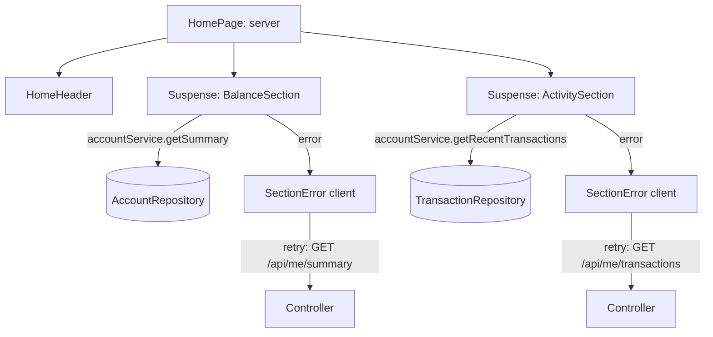

# TS-02 — Home

| Field | Value |
|---|---|
| **ID** | TS-02 |
| **Module** | HOME |
| **Status** | Approved |
| **Version** | 1.3 |
| **Author** | Claude (AI-assisted draft) |
| **Reviewer** | Project owner |
| **Last updated** | 2026-10-14 |
| **Implements** | [FS-02](../01-functional/FS-02-home.md) |
| **Related decisions** | ADR-002, ADR-003, ADR-006, ADR-007, ADR-008 |

---

## 1. Context and technical goal

Render name, balance and recent activity on the first paint from the server, with each section loading and failing independently, and allow retrying a single failed section from the client. Read-only module.

## 2. Technical scope

**In scope:** Home page composition, `accountService`, `GET /api/me/summary`, `GET /api/me/transactions`, section boundaries, hide-balance preference, relative dates, highlight of a just-completed transfer.
**Out of scope:** transaction detail, pagination.

## 3. Module architecture

### 3.1 Layers and responsibilities

| Layer | Elements |
|---|---|
| Presentation | `HomePage` (server), `HomeHeader`, `BalanceSection` (server, async), `ActivitySection` (server, async), `BalanceCard`, `ActivityList`, `TransactionItem`, `SectionError` (client), `BalanceSkeleton`, `ActivitySkeleton`, `EmptyState`, `HideBalanceToggle` (client) |
| Presentation logic | `useSectionRetry` (client fetch + state), `useHideBalance` |
| HTTP client | `accountApi.getSummary`, `accountApi.getTransactions` |
| Controllers | `app/api/me/summary/route.ts`, `app/api/me/transactions/route.ts` |
| Services | `accountService.getSummary(userId)`, `accountService.getRecentTransactions(userId, limit)` |
| Domain | `Money`, `Transaction`, `formatRelativeDate`, `maskIdentifier` |
| Repositories | `AccountRepository`, `TransactionRepository` (in-memory, seeded) |

### 3.2 Diagram



### 3.3 Module structure

```
src/app/(private)/page.tsx
src/features/home/components/{sections,balance-card,transaction-item,activity-list,activity-retry,balance-retry,skeletons,send-money-action}/
src/features/home/{data,activity-view}.ts
src/shared/components/{hide-balance,money-text,app-header,start-transfer-link}/
src/shared/hooks/use-section-retry/
src/shared/api/account.ts                # GET /api/me/{summary,transactions} client
src/app/api/me/{summary,transactions}/route.ts
src/server/services/account.service.ts
src/server/repositories/{ports,in-memory}.ts
```

**Folder structure (ADR-010):** the block above is current. Paths inside the *As built* notes below are those of the task that wrote them; ADR-010 maps them to today's folders.

### 3.4 Technology bindings

See TS-00 §3.4. No deviations.

## 4. Domain model and types

| Type | Kind | Shape | Invariants |
|---|---|---|---|
| `AccountSummary` | DTO | `{ firstName: string \| null; balance: Money }` | `balance.amountMinor ≥ 0` |
| `Transaction` | Entity/DTO | `{ id; direction: 'in' \| 'out'; counterparty: { name: string \| null; maskedIdentifier }; amount: Money; concept: string \| null; status: TransferStatus-like ('completed' \| 'pending' \| 'failed'); occurredAt: ISO }` | Sorted newest first |
| `SectionState<T>` | Tagged union | `loading \| ready(T) \| error(code, requestId)` | Client retry only |

## 5. Interface contracts

### `GET /api/me/summary`

| | Detail |
|---|---|
| **Purpose** | Name + balance (section retry, transfer amount step) |
| **Authentication** | Session required |
| **Idempotency** | Safe (GET) |
| **Expected client timeout** | 10 s |

**Success `200`:** `{ firstName, balance: { amountMinor, currency } }`
**Errors:** `401 UNAUTHENTICATED` · `503 SERVICE_UNAVAILABLE` (seeded `falla.saldo` or forced) · `500 INTERNAL_ERROR`.

### `GET /api/me/transactions?limit=10`

**Request:** `limit` optional integer 1–10 (clamped to `ACTIVITY_LIMIT`).
**Success `200`:** `{ items: Transaction[] }` (empty array for no activity).
**Errors:** `400 VALIDATION_ERROR` (non-numeric `limit`) · `401` · `503 SERVICE_UNAVAILABLE` (seeded `falla.movs` or forced) · `500`.

**Implementation notes (TASK-12):** items never include the internal owner ID. Seeded outages are modelled in the data source: `AccountRepository.getBalance` and `TransactionRepository.listRecent` return `Result<…, SERVICE_UNAVAILABLE>`, so the service maps a failing dependency instead of checking for test users. A user with no stored balance has $0.00.

## 6. Rules: where they are enforced

| Rule | Type | Domain | Client (presentation) | Server (authority) | Notes |
|---|---|---|---|---|---|
| BR-14 Session required | Business | — | — | Private layout + controllers | |
| FR-HOME-10 Bounded list | Business (NFR-01) | — | — | Service clamps `limit` | |
| UIR-HOME-01 Independent sections | UI | — | Suspense boundary + `SectionError` per section | Services called separately | |
| UIR-HOME-02 Stable loading | UI | — | Skeletons sized as final content | N/A | CLS ≤ 0.1 |
| UIR-HOME-03 Primary action visible | UI | — | `HomeHeader`/sticky action | N/A | |
| UIR-HOME-04 Zero balance hint | UI | `Money.isZero` | `BalanceCard` | N/A | |
| UIR-HOME-05 Hide balance | UI | — | `useHideBalance` + `HideBalanceToggle`; masks `MoneyText` | Server reads `hide_balance` cookie to render masked on first paint | Also used by FS-03/FS-04 |
| UIR-HOME-06/07 Item content, direction | UI | `formatSignedAmount` | `TransactionItem` | N/A | |
| UIR-HOME-08 Relative dates | UI | `formatRelativeDate(date, now, tz)` | `TransactionItem` | Rendered on server in session time zone | No hydration mismatch |
| UIR-HOME-09 Long names | UI | — | CSS truncation + full accessible name | N/A | |
| UIR-HOME-10 Fresh data | UI | — | Dynamic route, no client cache for `/` | `no-store` | |
| UIR-HOME-11 Highlight new item | UI | — | `?highlight=<transferId>` from receipt | N/A | Reduced-motion aware |
| UIR-HOME-12 Section error | UI | — | `SectionError` + `useSectionRetry` | N/A | Retries only its endpoint |
| UIR-HOME-13 Header actions | UI | — | `HomeHeader` (theme, logout) | N/A | |

## 7. Rendering and data loading

| View | Strategy | Mutations | Reason | Cache policy |
|---|---|---|---|---|
| `/` | Server Components; header renders immediately; Balance and Activity each streamed inside its own `Suspense` | None (logout and theme handled by their modules) | Fast first content; independent failures | Dynamic; `no-store` |
| Section retry | Client fetch of that section's GET endpoint; same presentational components | — | Retry only the failed section (AC-HOME-06) | `no-store` |

**Implementation (TASK-13):** activity items are turned into display-ready view models (`toActivityItemView`: labels, relative date, one accessible sentence) where the data is fetched — on the server for the first render, on the client after a retry — so server and client HTML always match. The greeting and the balance share one summary request per render (`React.cache`). Constants read by Server Components (`hide_balance`, `highlight`) live in a plain module, not in a client one.

Server sections **catch** expected service errors and render `SectionError` with `{ code, requestId }` instead of throwing, so one failure never triggers the page-level error boundary. Unexpected exceptions still reach `(private)/error.tsx`.

## 8. State management

| State | Kind | Where it lives | Lifecycle |
|---|---|---|---|
| Summary, activity | Server | Fetched per request | Per navigation |
| Retried section data | Client | `useSectionRetry` local state | Until next navigation |
| Hide-balance preference | Client, persisted | `hide_balance` cookie (non-HttpOnly, 1 year) read by server and client | Per device |
| Highlight | URL | `?highlight=` | Removed after first render (replace) |

## 9. Error handling

| Code | Origin | HTTP | User message key | UI action | Retryable | Log event |
|---|---|---|---|---|---|---|
| `SERVICE_UNAVAILABLE` (balance) | Server (mock) | 503 | `home.balance.error` | Section retry | Yes | `home.summary.failed` |
| `SERVICE_UNAVAILABLE` (activity) | Server (mock) | 503 | `home.activity.error` | Section retry | Yes | `home.activity.failed` |
| `INTERNAL_ERROR` | Server | 500 | Section error copy | Section retry | Yes | `home.*.failed` |
| `NETWORK_ERROR` / `TIMEOUT` (retry) | Client | — | Section error copy | Retry again | Yes | client log |
| `UNAUTHENTICATED` | Server | 401 / redirect | `auth.session.ended` | Login | No | `auth.session.rejected` |

## 10. Security, session and permissions

- Data always scoped to `session.userId`; no user ID accepted from the client.
- Counterparty identifiers returned masked.
- Responses `Cache-Control: no-store`.

## 11. Observability

| Event | Level | Emitted from | Fields | Masked data |
|---|---|---|---|---|
| `home.summary.loaded` | debug | service | `durationMs` | — |
| `home.summary.failed` | error | service | `code` | — |
| `home.activity.loaded` | debug | service | `count`, `durationMs` | — |
| `home.activity.failed` | error | service | `code` | — |

## 12. Performance and scalability

- Header (greeting placeholder-free once summary resolves) and skeletons stream immediately; sections resolve independently.
- Payload bounded to 10 items; amounts as integers; no client data library.
- Production: summary and activity become calls to account/ledger services, cached per user only within the request.

## 13. Accessibility

Per FS-02 §13. Technical notes: list as `<ul>` with each `TransactionItem` as `<li>` containing one accessible text (visual parts `aria-hidden`); `aria-busy` on loading sections; `HideBalanceToggle` as a button with `aria-pressed`; masked balance has accessible text "Saldo oculto".

## 14. Module test strategy

| What | Level | TC |
|---|---|---|
| `formatRelativeDate`, `formatSignedAmount`, `maskIdentifier` | Unit | Phase 5 |
| `useSectionRetry`, `useHideBalance` | Presentation logic | Phase 5 |
| `BalanceCard`, `TransactionItem`, `ActivityList` empty/error, `SectionError` (UIR-HOME-*) | Component | Phase 5 |
| `/api/me/summary`, `/api/me/transactions` (auth, limit clamp, failures) | Integration | Phase 5 |
| Home states with seeded users; refresh after transfer | E2E | Phase 5 |

## 15. Risks and mitigations

| Risk | Likelihood | Impact | Mitigation |
|---|---|---|---|
| Section error escalates to page error | Medium | Whole Home blank | Sections catch expected errors; boundary test |
| Hydration mismatch on dates or hidden balance | Medium | Console errors, flicker | Server formats with session tz; hide preference from cookie |

## 16. Known limitations and technical debt

- No pagination or detail view.
- Streaming race (observed in E2E, Next 16.4 / React 19.3): if a section's streamed content arrives after hydration has started, React renders it on the client and the streamed copy stays in a `<div hidden>` outside `<main>`. Invisible and outside the accessibility tree; E2E assertions are scoped to `<main>`.

## 17. Traceability

| Requirement / AC | Section | Tasks | Test cases |
|---|---|---|---|
| FR-HOME-01…03, 10; AC-HOME-01…03, 11 | §5, §7 | Phase 4 | Phase 5 |
| FR-HOME-04…06; AC-HOME-04…06 | §7, §9 | Phase 4 | Phase 5 |
| FR-HOME-07…09; AC-HOME-07, 09, 10 | §6, §7 | Phase 4 | Phase 5 |
| FR-HOME-11; AC-HOME-08 | §8 | Phase 4 | Phase 5 |
| UIR-HOME-01…13 | §6 | Phase 4 | Component |

## 18. Change history

| Version | Date | Author | Change |
|---|---|---|---|
| 0.1 | 2026-10-14 | Claude (AI-assisted) | First draft |
| 1.0 | 2026-10-14 | Project owner | Approved |
| 1.1 | 2026-10-14 | Project owner | Wallet-specific components folder renamed `src/components/domain` → `src/components/wallet` (avoids confusion with `src/core`) |
| 1.2 | 2026-10-14 | Claude (AI-assisted) | TASK-12: 400 for a non-numeric limit, response without owner ID, outages modelled in repositories |
| 1.3 | 2026-10-14 | Claude (AI-assisted) | TASK-13: view models built where data is fetched, request dedupe, constants outside client modules |
| 1.4 | 2026-10-14 | Project owner | Folder structure per ADR-010 (features / shared / core); §3.3 updated |
