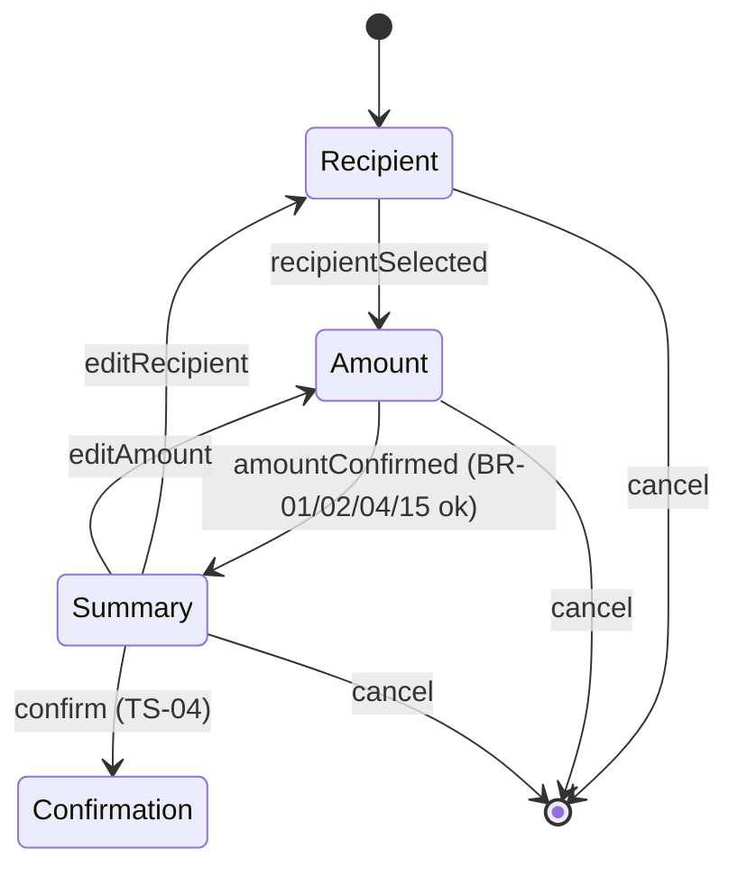

# TS-03 — Transactions (transfer flow)

| Field | Value |
|---|---|
| **ID** | TS-03 |
| **Module** | TX |
| **Status** | Approved |
| **Version** | 1.1 |
| **Author** | Claude (AI-assisted draft) |
| **Reviewer** | Project owner |
| **Last updated** | 2026-10-14 |
| **Implements** | [FS-03](../01-functional/FS-03-new-transaction.md) |
| **Related decisions** | ADR-002, ADR-003, ADR-008, ADR-009 |

---

## 1. Context and technical goal

Implement the three-step transfer flow (recipient → amount → summary) with business rules defined once in the domain, used by the client for feedback and by the server as the authority (BR-06). Hand off a complete, rule-compliant draft and a stable attempt key to the confirmation (TS-04).

## 2. Technical scope

**In scope:** transfer layout and step guard, `TransferDraft` context/reducer, favorites read, `POST /api/contacts`, amount input parsing/formatting, summary, cancel dialog, domain rules BR-01…BR-05, BR-08…BR-10, BR-15, BR-16.
**Out of scope:** submitting the transfer and outcomes (TS-04); favorites search (Won't).

## 3. Module architecture

### 3.1 Layers and responsibilities

| Layer | Elements |
|---|---|
| Presentation | `TransferLayout` (server), `StepIndicator`, `RecipientStep`, `FavoritesList`, `ContactItem`, `NewContactForm`, `AmountStep`, `MoneyInput`, `ConceptField`, `SummaryStep`, `RecipientContext`, `CancelTransferDialog` |
| Presentation logic | `TransferDraftProvider` (`useReducer`), `useTransferDraft`, `useStepGuard`, `useSaveContact`, `useAmountField` |
| HTTP client | `contactsApi.list`, `contactsApi.create`, `accountApi.getSummary` (retry) |
| Controllers | `app/api/contacts/route.ts` (GET, POST) |
| Services | `contactsService.list(userId)`, `contactsService.create(userId, input)` |
| Domain | `parseAmountInput`, `formatAmountInput`, `validateAmount` (BR-01, BR-02, BR-04), `validateRecipient` (BR-03, BR-09), `parseIdentifier` (BR-10), `validateConcept` (BR-15), `validateContactName` (BR-16), `draftFingerprint` |
| Repositories | `ContactRepository` (in-memory, per user, unique by identifier), `AccountRepository` |

### 3.2 Diagram



### 3.3 Module structure

```
src/app/(private)/transfer/layout.tsx           # server: session, initial balance + favorites; client provider
src/app/(private)/transfer/{recipient,amount,summary}/page.tsx
src/features/transfer/                           # steps, draft reducer, hooks
src/components/wallet/{MoneyInput,ContactItem,RecipientContext}.tsx
src/app/api/contacts/route.ts
src/server/services/contacts.service.ts
src/core/{money,transfer-rules,contact}.ts
```

**As built (TASK-15):** `FavoritesList` → `favorites-section.tsx`; `CancelTransferDialog` → `CancelTransfer` (`cancel-transfer.tsx`); `useTransferDraft` → `useDraft` / `useDraftDispatch`; `contactsApi.create` → `contactsApi.save`. Added `TransferDataProvider` (server data as `Loaded<T>`), `StepHeading`, `Avatar` and `MaskedIdentifierText` (`src/components/wallet/masked-identifier.tsx`, spoken form via `parseMaskedIdentifier` in `src/core/identifier.ts`). The draft also carries `notice` (saved / duplicate / save-failed, shown once on the amount step) and `completed` (UIR-TX-21).

**As built (TASK-20 fixes):** favorites are client state in `TransferDataProvider`; a contact saved in the flow is added at once (`rememberFavorite`, ordered with `compareByRecentUse` from `src/core/contact.ts`, the same order the server uses). Submit buttons don't take focus on mouse down, so a blur error appearing above the button can't make the click miss.

**As built (TASK-16):** domain helpers are `cleanAmountText` / `formatAmountText` / `editAmountText` (caret mapping by digit index) in `src/core/money-input.ts` and `truncateCharacters` / `stripControlCharacters` in `src/core/text.ts`. `MoneyInput` (`src/components/wallet/money-input.tsx`) writes the formatted value and caret during the change event, and Backspace/Delete beside a grouping comma removes the digit beyond it. The balance is client state in `TransferDataProvider` (`useTransferBalance`), so a retry on the amount step (`GET /api/me/summary` only) also feeds the summary. `ConceptField` lives in `src/features/transfer/`. The transfer layout also reads the hide-balance cookie and wraps the flow in `HideBalanceProvider`; the summary reuses Home's toggle (`HideBalanceToggle`). `SummaryStep` dispatches `summaryReached` (BR-07 key) and hands a `ConfirmableDraft` to `onConfirm`, which TS-04 wires. Cancel dispatches `cancelled` (empty draft + `completed`), not `reset`: with an empty draft the mounted step guard would redirect to step 1 and win over the navigation Home.

### 3.4 Technology bindings

See TS-00 §3.4. Cancel dialog uses the Radix Dialog wrapper (ADR-008).

## 4. Domain model and types

| Type | Kind | Shape | Invariants |
|---|---|---|---|
| `Contact` | Entity/DTO | `{ id: ContactId; name; maskedIdentifier; lastUsedAt: ISO \| null }` | Unique by normalized identifier per user (BR-08) |
| `Recipient` | Tagged union | `{ kind: 'contact'; contactId; name; maskedIdentifier } \| { kind: 'oneOff'; name; identifier: Identifier; maskedIdentifier }` | `oneOff` only when not saved |
| `TransferDraft` | Value | `{ recipient: Recipient \| null; amount: Money \| null; concept: string; attempt: { key: AttemptKey; fingerprint: string } \| null }` | `attempt` set only when the summary is reached |
| `DraftAction` | Tagged union | `recipientSelected \| amountConfirmed \| conceptChanged \| summaryReached \| noticeShown \| completed \| cancelled \| reset \| seedRecipient` | Handled exhaustively |

**Attempt key rule (BR-07):** on `summaryReached`, compute `draftFingerprint(recipient, amount, concept)`; keep the existing key if the fingerprint is unchanged, otherwise generate a new UUID. `reset` clears everything.

## 5. Interface contracts

### `GET /api/contacts`

**Success `200`:** `{ items: Contact[] }` ordered by `lastUsedAt` desc, then name.
**Errors:** `401` · `503 SERVICE_UNAVAILABLE` (forced) · `500`.

### `POST /api/contacts`

| | Detail |
|---|---|
| **Purpose** | Save a new favorite (FR-TX-04) |
| **Authentication** | Session required; CSRF-protected |
| **Idempotency** | Natural: duplicate identifier returns the existing contact (BR-08) |

**Request**

| Field | Type | Required | Constraints |
|---|---|---|---|
| `name` | string | Yes | BR-16 |
| `identifier` | string | Yes | BR-10; not the user's own (BR-09) |

**Success:** `201 { contact, created: true }` · `200 { contact, created: false }` (duplicate).
**Errors:** `422 INVALID_CONTACT_NAME` · `422 INVALID_IDENTIFIER` · `422 SELF_TRANSFER` · `503 SERVICE_UNAVAILABLE` · `400/401/403/415`.

The balance for the amount step comes from the transfer layout (server, `accountService.getSummary`); on failure, the client retries with `GET /api/me/summary` (TS-02).

## 6. Rules: where they are enforced

| Rule | Type | Domain | Client (presentation) | Server (authority) | Notes |
|---|---|---|---|---|---|
| BR-01 Amount > 0 | Business | `validateAmount` | `useAmountField` on continue | `transfersService` on confirm (TS-04) | |
| BR-02 Amount ≤ balance | Business | `validateAmount` | Live, as soon as exceeded (UIR-TX-12) | On confirm, against current balance | |
| BR-03 Recipient required | Business | `validateRecipient` | Step guard | On confirm | |
| BR-04 Amount format | Input validation | `parseAmountInput` | `MoneyInput` blocks invalid characters/decimals | Schema + domain on confirm | Integer minor units |
| BR-05 / BR-10 Identifier | Input validation | `parseIdentifier` | `NewContactForm` on blur/continue | `contactsService.create`; confirm (one-off) | |
| BR-08 No duplicate favorites | Business | — | Shows "already in favorites" | `ContactRepository` unique key | |
| BR-09 No self-transfer | Business | `validateRecipient` | `NewContactForm` (compares with session identifier provided by layout) | `contactsService.create`; confirm | |
| BR-15 Concept | Input validation | `validateConcept` | `ConceptField` max 40, strips control chars | On confirm | |
| BR-16 Contact name | Input validation | `validateContactName` | `NewContactForm` | `contactsService.create` | |
| UIR-TX-01/02 Step indicator, focus | UI | — | `StepIndicator`, heading ref | N/A | |
| UIR-TX-03 Favorites order/content | UI | `maskIdentifier` | `FavoritesList`, `ContactItem` | Server orders | |
| UIR-TX-04 Choose favorite | UI | — | `ContactItem` as button → `recipientSelected` → `/transfer/amount` | N/A | |
| UIR-TX-05…08 New contact, save, duplicate, failure | UI | — | `NewContactForm`, `useSaveContact` | Contracts above | Save on continue |
| UIR-TX-09 Recipient context | UI | — | `RecipientContext` | N/A | |
| UIR-TX-10 Amount input | UI | `parseAmountInput`, `formatAmountInput` | `MoneyInput` (`inputmode=decimal`) | N/A | Caret preserved |
| UIR-TX-11 Balance next to amount | UI | — | `AmountStep` + `aria-describedby` | Layout provides balance | |
| UIR-TX-12/13 Feedback timing, enabled actions | UI | — | `useAmountField`, `Button` | N/A | |
| UIR-TX-14 Step guard | UI | — | `useStepGuard` → `router.replace` before rendering step content | N/A | |
| UIR-TX-15 Concept counter | UI | — | `ConceptField` | N/A | |
| UIR-TX-16 Summary content | UI | `Money.subtract` (display) | `SummaryStep` (+ hide-balance masking) | Real balance computed server-side | |
| UIR-TX-17 Edit actions | UI | — | `SummaryStep` links | N/A | |
| UIR-TX-18 Confirm label | UI | — | `SummaryStep` → TS-04 | N/A | |
| UIR-TX-19 Draft preserved | UI | — | Provider in `/transfer` layout | N/A | |
| UIR-TX-20 Cancel | UI | — | `CancelTransferDialog` | N/A | |
| UIR-TX-21 Reset after completion | UI | — | `reset` action (TS-04), `seedRecipient` for "send again" | N/A | |

## 7. Rendering and data loading

| View | Strategy | Mutations | Reason | Cache policy |
|---|---|---|---|---|
| `/transfer` layout | Server: session, balance, own identifier (for BR-09), favorites; wraps children in `TransferDraftProvider` | — | Data on first paint; draft scoped to flow | Dynamic, `no-store` |
| `/transfer/recipient` | Client step; favorites from layout; retry via `GET /api/contacts` | `POST /api/contacts` | Interactive | `no-store` |
| `/transfer/amount`, `/transfer/summary` | Client steps guarded by `useStepGuard` | — | Interactive | `no-store` |

## 8. State management

| State | Kind | Where it lives | Lifecycle |
|---|---|---|---|
| Transfer draft + attempt key | Client, shared | `TransferDraftProvider` (`useReducer`, split state/dispatch contexts) | Created on entering `/transfer`; reset on cancel/success; gone when leaving the layout |
| Favorites, balance | Server → props | Layout | Per navigation; client retry on error |
| New-contact form, amount field text | Client, local | Component state | Per step |
| Current step | URL | `/transfer/<step>` | Survives reload (guard applies) |

## 9. Error handling

| Code | Origin | HTTP | User message key | UI action | Retryable | Log event |
|---|---|---|---|---|---|---|
| `INVALID_CONTACT_NAME` | Server/Domain | 422 | `tx.contact.name.error.*` | Focus field | No | `tx.contact.rejected` |
| `INVALID_IDENTIFIER` | Server/Domain | 422 | `tx.contact.identifier.error.format` | Focus field | No | `tx.contact.rejected` |
| `SELF_TRANSFER` | Server/Domain | 422 | `tx.contact.identifier.error.self` | Focus field | No | `tx.contact.rejected` |
| `SERVICE_UNAVAILABLE` (save) | Server (mock) | 503 | `tx.contact.save_failed` | Continue as one-off | — | `tx.contact.save_failed` |
| `SERVICE_UNAVAILABLE` (favorites) | Server (mock) | 503 | `tx.recipient.error` | Retry; new contact available | Yes | `tx.contacts.failed` |
| `NETWORK_ERROR` / `TIMEOUT` (save) | Client | — | `tx.contact.save_failed` | Continue as one-off | — | client log |
| Balance load failure | Server/Client | 503/— | `tx.amount.balance_error` | Retry | Yes | `home.summary.failed` |

## 10. Security, session and permissions

- Contacts scoped to `session.userId`; contact IDs from the client are verified to belong to the user at confirmation (TS-04).
- The user's own identifier is provided to the client only as needed for BR-09 feedback; the server re-checks.

## 11. Observability

| Event | Level | Emitted from | Fields | Masked data |
|---|---|---|---|---|
| `tx.contacts.loaded` | debug | service | `count` | — |
| `tx.contacts.failed` | error | service | `code` | — |
| `tx.contact.created` | info | service | `contactId` | identifier masked |
| `tx.contact.duplicate` | info | service | `contactId` | — |
| `tx.contact.rejected` | info | controller | `code` | — |
| `tx.contact.save_failed` | error | service | `code` | — |

## 12. Performance and scalability

- Favorites list bounded in practice; production would paginate/search (FR-TX-10 Won't).
- Draft context split (state vs dispatch) to avoid re-rendering dispatch-only components.

## 13. Accessibility

Per FS-03 §13. Technical notes: `MoneyInput` keeps a visible label and `aria-describedby` → balance + error; formatting applied without moving the caret (track caret by digit index); live region announces BR-02 error once when it appears; `ContactItem` accessible name "Enviar a {name}, {masked}"; dialog via Radix with Escape → "Seguir editando".

## 14. Module test strategy

| What | Level | TC |
|---|---|---|
| `parseAmountInput`, `formatAmountInput`, `validateAmount`, `validateRecipient`, `validateConcept`, `validateContactName`, `draftFingerprint` | Unit | Phase 5 |
| Draft reducer (all actions, attempt-key regeneration) | Unit | Phase 5 |
| `useStepGuard`, `useAmountField`, `useSaveContact` | Presentation logic | Phase 5 |
| `MoneyInput`, `NewContactForm`, `FavoritesList`, `SummaryStep`, `CancelTransferDialog` (UIR-TX-*) | Component | Phase 5 |
| `GET/POST /api/contacts` (validation, duplicate, self, auth, CSRF) | Integration | Phase 5 |
| Happy path, new contact, rules, edit, cancel | E2E | Phase 5 |

## 15. Risks and mitigations

| Risk | Likelihood | Impact | Mitigation |
|---|---|---|---|
| Caret jumps while formatting amount | Medium | Poor UX, a11y | Digit-index caret tracking; component tests |
| Step guard flashes the step before redirecting | Medium | Visual glitch | Guard runs before rendering step content |
| Floating-point errors | Low | Wrong amounts | Integer minor units end to end |

## 16. Known limitations and technical debt

- Draft lost on full reload (ADR-003); favorites not editable or deletable.

## 17. Traceability

| Requirement / AC | Section | Tasks | Test cases |
|---|---|---|---|
| FR-TX-01…05, 07…09, 11; AC-TX-01…14, 16 | §5–§8 | Phase 4 | Phase 5 |
| BR-01…05, 08…10, 15, 16; AC-TX-15 | §6 | Phase 4 | Unit + integration |
| UIR-TX-01…21 | §6 | Phase 4 | Component |

## 18. Change history

| Version | Date | Author | Change |
|---|---|---|---|
| 0.1 | 2026-10-14 | Claude (AI-assisted) | First draft |
| 1.0 | 2026-10-14 | Project owner | Approved |
| 1.1 | 2026-10-14 | Project owner | Wallet-specific components folder renamed `src/components/domain` → `src/components/wallet` (avoids confusion with `src/core`) |
| 1.2 | 2026-10-14 | Claude (AI-assisted) | TASK-15: §3.3 as-built names; draft adds `notice` and `completed` (no behavior change to the contracts) |
| 1.3 | 2026-10-14 | Claude (AI-assisted) | TASK-16: §3.3 as-built notes for amount, concept, balance retry and summary |
