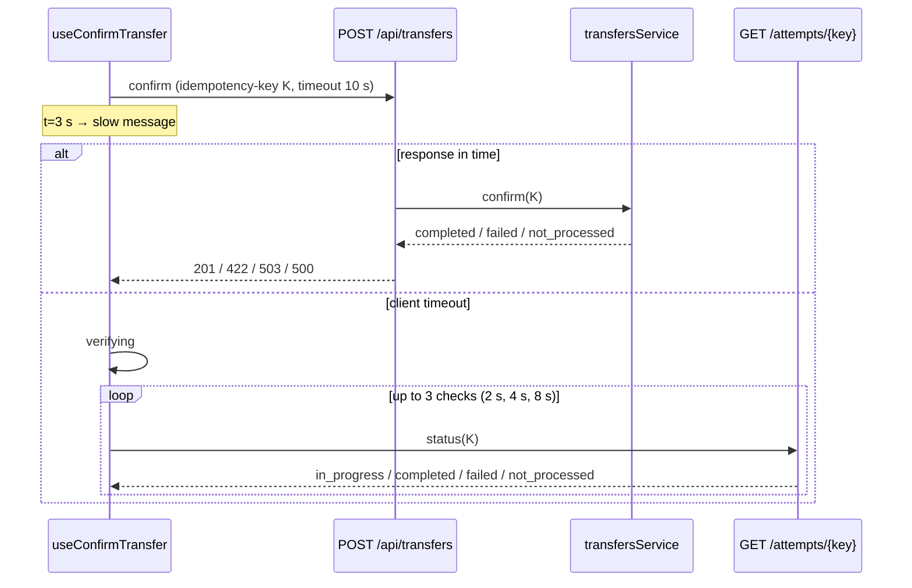

# TS-04 — Confirmation and receipt

| Field | Value |
|---|---|
| **ID** | TS-04 |
| **Module** | CONF |
| **Status** | Approved |
| **Version** | 1.0 |
| **Author** | Claude (AI-assisted draft) |
| **Reviewer** | Project owner |
| **Last updated** | 2026-10-14 |
| **Implements** | [FS-04](../01-functional/FS-04-confirmation-receipt.md) · NFR-06, NFR-10 |
| **Related decisions** | ADR-002, ADR-003, ADR-005, ADR-006, ADR-009 |

---

## 1. Context and technical goal

Submit a transfer attempt exactly once, survive every failure mode required by the challenge (success, network error, insufficient funds, timeout, unknown error), and never present an unknown outcome as known. Core mechanisms: idempotency key per attempt, bounded client timeout, automatic status verification, and a server-authoritative attempt state (BR-17).

## 2. Technical scope

**In scope:** `POST /api/transfers`, `GET /api/transfers/attempts/{key}`, `transfersService`, attempt/idempotency store, outcome simulator, client confirmation state machine, outcome views, receipt page.
**Out of scope:** receipt share/download (FR-CONF-12), reversals.

## 3. Module architecture

### 3.1 Layers and responsibilities

| Layer | Elements |
|---|---|
| Presentation | `ConfirmButton`, `ProcessingNotice`, `VerifyingView`, `OutcomeView` (variants: `NetworkError`, `NotProcessed`, `InsufficientFunds`, `UnknownError`, `Unresolved`, `RuleViolation`), `ReceiptPage` (server), `ReceiptDetails`, `CopyFolioButton`, `ReceiptNotFound` |
| Presentation logic | `useConfirmTransfer` (reducer state machine + timers), `useCopyToClipboard` |
| HTTP client | `transfersApi.confirm(draft, attemptKey)`, `transfersApi.getAttemptStatus(attemptKey)` |
| Controllers | `app/api/transfers/route.ts` (POST), `app/api/transfers/attempts/[key]/route.ts` (GET) |
| Services | `transfersService.confirm(userId, input, key)`, `transfersService.getAttemptStatus(userId, key)`, `transfersService.getReceipt(userId, transferId)` |
| Domain | All transfer rules (TS-03 §6), `TransferStatus` transitions (BR-17), `generateFolio` |
| Repositories | `AttemptRepository` (keyed by `userId + key`), `TransferRepository`, `AccountRepository` (atomic debit), `OutcomeSimulator` |

### 3.2 Diagram



### 3.3 Module structure

```
src/features/confirmation/                     # useConfirmTransfer, outcome views
src/app/(private)/transfer/summary/page.tsx    # hosts ConfirmButton and outcome views
src/app/(private)/receipts/[transferId]/page.tsx
src/app/api/transfers/route.ts
src/app/api/transfers/attempts/[key]/route.ts
src/server/services/transfers.service.ts
src/server/repositories/{attempt,transfer}.repository.ts
src/server/mock/outcome-simulator.ts
```

### 3.4 Technology bindings

See TS-00 §3.4. Clipboard via the platform Clipboard API.

## 4. Domain model and types

| Type | Kind | Shape | Invariants |
|---|---|---|---|
| `Attempt` | Entity | `{ userId; key: AttemptKey; payloadHash; status: TransferStatus; transferId?; failure?: DomainError; createdAt; updatedAt }` | BR-17: `completed`, `failed`, `not_processed` are final **for that processing round**; `not_processed` may be re-processed by a retry with the same key |
| `Receipt` | DTO | `{ transferId; folio; amount: Money; recipient: { name; maskedIdentifier }; concept: string \| null; completedAt: ISO; balanceAfter: Money }` | Only for `completed` |
| `ConfirmState` | Tagged union | `idle \| processing{slow} \| verifying{checksDone} \| completed{receipt} \| networkError{ref} \| notProcessed{ref} \| insufficientFunds{balance, ref} \| unknownError{ref} \| unresolved{ref} \| ruleViolation{code, ref}` | Exactly one; drives UIR-CONF-* |

## 5. Interface contracts

### `POST /api/transfers`

| | Detail |
|---|---|
| **Purpose** | Submit a transfer attempt (FR-CONF-01) |
| **Authentication** | Session required; CSRF-protected |
| **Required headers** | `idempotency-key` (UUID), `x-request-id`; `x-mock-outcome` only with mock controls |
| **Idempotency** | Per `(userId, key)`: same payload → stored result; different payload → `409` |
| **Expected client timeout** | `TRANSFER_TIMEOUT_MS` (10 s) |

**Request**

| Field | Type | Required | Constraints |
|---|---|---|---|
| `recipient` | `{ contactId } \| { name, identifier }` | Yes | BR-03; contact must belong to user; BR-10, BR-16 for one-off; BR-09 |
| `amount` | `Money` | Yes | BR-01, BR-02, BR-04 |
| `concept` | string | No | BR-15 |

**Responses**

| Status | Body | Meaning |
|---|---|---|
| `201` | `Receipt` | Completed (first time or replay of a completed attempt) |
| `202` | `{ status: 'in_progress' }` | Same key already being processed (concurrent duplicate) |
| `422` | `INSUFFICIENT_FUNDS {balance}` / `INVALID_AMOUNT` / `RECIPIENT_REQUIRED` / `SELF_TRANSFER` / `INVALID_IDENTIFIER` / `INVALID_CONCEPT` / `INVALID_CONTACT_NAME` | Failed by rule; attempt `failed` |
| `409` | `IDEMPOTENCY_KEY_REUSED` | Key reused with a different payload |
| `503` | `NETWORK_UNAVAILABLE` | Nothing processed; attempt `not_processed` |
| `500` | `INTERNAL_ERROR` | Unknown error; attempt `not_processed` (mock) |
| `400/401/403/415` | per TS-00 | — |

### `GET /api/transfers/attempts/{key}`

**Success `200`:** `{ status: 'in_progress' } | { status: 'completed', receipt } | { status: 'failed', code, details } | { status: 'not_processed' }`. An unknown key for this user returns `not_processed` (the server never received it — BR-17).
**Errors:** `401` · `500`.

### Receipt (server-rendered)

`/receipts/[transferId]` → `transfersService.getReceipt(userId, transferId)`; not found **or not owned** → not-found view (UIR-CONF-15, AC-CONF-17).

## 6. Rules: where they are enforced

| Rule | Type | Domain | Client (presentation) | Server (authority) | Notes |
|---|---|---|---|---|---|
| BR-06 Server re-validation | Business | All TS-03 validators | — | `transfersService.confirm` before debit | |
| BR-02 at confirmation | Business | `validateAmount` | — | Against current balance, atomically with debit | |
| BR-07 Idempotent attempt | Business | `draftFingerprint` | Same key on retry/status (TS-03 reducer) | `AttemptRepository` keyed by `(userId, key)` + `payloadHash` | |
| BR-14 Session | Business | — | — | Controllers, receipt page | |
| BR-17 Single final outcome | Business | `transition(status, event)` | — | Attempt state machine | |
| UIR-CONF-01 Processing lock | UI | — | `useConfirmTransfer` (`processing`) disables edit/cancel/nav | N/A | |
| UIR-CONF-02 Slow message | UI | — | Timer at `TRANSFER_SLOW_MS` | N/A | |
| UIR-CONF-03 Bounded wait | UI | — | `AbortController` at `TRANSFER_TIMEOUT_MS` | N/A | |
| UIR-CONF-04/05/06 Verify, results, unresolved | UI | — | Checks at `TRANSFER_STATUS_CHECK_DELAYS_MS` | Status endpoint | Never asserts unknown |
| UIR-CONF-07 Success → receipt | UI | — | `reset` draft; set completion marker; `router.replace('/receipts/{id}')` | N/A | Back → Home (§8) |
| UIR-CONF-08…10 Error views | UI | — | `OutcomeView` variants | N/A | |
| UIR-CONF-11 Reference code | UI | — | Short `requestId` (TS-05) | Provides `requestId` | |
| UIR-CONF-12…14 Receipt content/actions | UI | — | `ReceiptDetails`, `CopyFolioButton` | Receipt DTO | "Enviar otra vez" → `seedRecipient` |
| UIR-CONF-15 Revisitable receipt | UI | — | — | Server-rendered by ID | |
| UIR-CONF-16 Leaving during processing | UI | — | No auto-retry on unmount | Attempt continues | |
| UIR-CONF-17 Forced outcome | UI/Test | — | — | Simulator honors `x-mock-outcome` only with mock controls | |

## 7. Rendering and data loading

| View | Strategy | Mutations | Reason | Cache policy |
|---|---|---|---|---|
| `/transfer/summary` (confirm + outcome views) | Client | `POST /api/transfers`, `GET /attempts/{key}` | Timers, cancellation, retries | `no-store` |
| `/receipts/[transferId]` | Server Component | None | Revisitable, per-user | Dynamic, `no-store` |

## 8. State management

| State | Kind | Where it lives | Lifecycle |
|---|---|---|---|
| Attempt key | Client | Transfer draft (TS-03) | Until draft reset / changed payload |
| `ConfirmState` | Client | `useConfirmTransfer` reducer | Summary page lifetime |
| Attempt / transfer | Server | `AttemptRepository`, `TransferRepository` | Server lifetime |
| Completion marker | Client | `sessionStorage` key `mw.transfer.completed` | Set on success; read by the transfer layout guard: if present, cleared and `router.replace('/')` — so browser Back from the receipt lands on Home (AC-CONF-11). Cleared by "Enviar dinero" and "Enviar otra vez". |

### Client timeline (defaults, ASM-17)

| Time | Event |
|---|---|
| 0 s | POST with key K |
| 3 s | `processing.slow = true` |
| 10 s | Abort → `verifying` |
| +2 s | Status check 1 (own timeout 5 s) |
| +4 s | Status check 2 |
| +8 s | Status check 3 → if still `in_progress` or failing → `unresolved` |

### Response → state mapping

| Response | State |
|---|---|
| `201` | `completed` |
| `202 in_progress` | `verifying` (start checks immediately) |
| `503 NETWORK_UNAVAILABLE` or client `NETWORK_ERROR` | `networkError` |
| `422 INSUFFICIENT_FUNDS` | `insufficientFunds` |
| `422` other rule codes | `ruleViolation` |
| `500 INTERNAL_ERROR` | `unknownError` |
| Client `TIMEOUT` | `verifying` |
| Status `completed` / `failed(INSUFFICIENT_FUNDS)` / `failed(other)` / `not_processed` | `completed` / `insufficientFunds` / `ruleViolation` / `notProcessed` |
| Checks exhausted | `unresolved` |
| `409 IDEMPOTENCY_KEY_REUSED` | `unknownError` + error log (should never happen; indicates a client bug) |

## 9. Error handling

| Code | Origin | HTTP | User message key | UI action | Retryable | Log event |
|---|---|---|---|---|---|---|
| `NETWORK_UNAVAILABLE` / `NETWORK_ERROR` | Server (mock) / Client | 503 / — | `conf.network.*` | Retry (same K), change data, cancel | Yes | `tx.confirm.network_unavailable` |
| `INSUFFICIENT_FUNDS` | Server | 422 | `conf.funds.*` | Change amount, cancel | No (new K after edit) | `tx.confirm.failed` |
| Rule codes | Server | 422 | Specific copy | Change data | No | `tx.confirm.rejected` |
| `TIMEOUT` | Client | — | `conf.verifying.*` | Automatic checks | Yes | `tx.confirm.timeout` (client log) |
| Unresolved | Client | — | `conf.unresolved.*` | Retry (same K), Home | Yes | `tx.confirm.unresolved` (client log) |
| `INTERNAL_ERROR` | Server | 500 | `conf.unknown.*` | Retry (same K), Home | Yes | `tx.confirm.error` |
| `NOT_FOUND` (receipt) | Server | — | `conf.receipt.not_found` | Home | No | `receipt.not_found` |

## 10. Security, session and permissions

- Debit and transfer creation are one atomic operation in the repository (no double debit under concurrent requests with the same key: per-key lock / check-and-set).
- `contactId` must belong to `session.userId`; otherwise `RECIPIENT_REQUIRED`.
- Receipts only for the owner; non-owned IDs indistinguishable from missing (`NOT_FOUND`).
- `x-mock-outcome` ignored (and logged) when mock controls are disabled.

## 11. Observability

| Event | Level | Emitted from | Fields | Masked data |
|---|---|---|---|---|
| `tx.confirm.requested` | info | service | `attemptKey`, `amountMinor`, `recipientKind` | — |
| `tx.confirm.completed` | info | service | `transferId`, `folio`, `durationMs` | — |
| `tx.confirm.failed` | warn | service | `code` | — |
| `tx.confirm.rejected` | info | controller/service | `code` | — |
| `tx.confirm.network_unavailable` | warn | simulator | — | — |
| `tx.confirm.error` | error | controller | `code`, stack | — |
| `tx.confirm.replayed` | info | service | `attemptKey`, `status` | — |
| `tx.confirm.idempotency_conflict` | error | service | `attemptKey` | — |
| `tx.status.checked` | debug | service | `attemptKey`, `status` | — |
| `tx.confirm.timeout` | warn | client log | `attemptKey`, `requestId` | — |
| `tx.confirm.unresolved` | error | client log | `attemptKey`, `checks` | — |
| `receipt.viewed` / `receipt.not_found` | info | receipt page | `transferId` | — |
| `mock.outcome.forced` / `mock.outcome.ignored` | info / warn | simulator | `outcome` | — |

## 12. Performance and scalability

- Status checks bounded (3) and spaced; no polling loops.
- Production: attempts persisted with TTL in a shared store; idempotency keys scoped per user; ledger debit transactional.

## 13. Accessibility

Per FS-04 §13. Technical notes: one polite live region announces "Enviando", the slow message and "Verificando"; on reaching an outcome, focus moves to the outcome heading; the folio is rendered with an accessible label that spells it out; `CopyFolioButton` announces "Folio copiado" via toast.

## 14. Module test strategy

| What | Level | TC |
|---|---|---|
| Attempt state transitions (BR-17), payload hash, folio generation | Unit | Phase 5 |
| `useConfirmTransfer` with fake timers: every row of the mapping table | Presentation logic | Phase 5 |
| `OutcomeView` variants, `ReceiptDetails`, `CopyFolioButton` (UIR-CONF-*) | Component | Phase 5 |
| `POST /api/transfers`: rules, idempotent replay, 409, 202 concurrent, forced outcomes; status endpoint | Integration | Phase 5 |
| Each of the 5 outcomes + timeout sub-cases; Back from receipt; reload receipt; send again | E2E | Phase 5 |

## 15. Risks and mitigations

| Risk | Likelihood | Impact | Mitigation |
|---|---|---|---|
| Double debit on concurrent retries | Low | Critical | Per-key check-and-set; concurrency integration test |
| Timers leak after unmount | Medium | Ghost requests | Abort and clear timers on unmount; hook tests |
| Long timeout makes E2E slow | High | Slow suite | Timings from config, shortened in E2E |

## 16. Known limitations and technical debt

- `unknown_error` in the mock never moves money; production would require status verification for that case too.
- Completion marker in `sessionStorage` is a pragmatic history fix; a router-level history API would be cleaner.

## 17. Traceability

| Requirement / AC | Section | Tasks | Test cases |
|---|---|---|---|
| FR-CONF-01…11, 13; AC-CONF-01…17 | §5–§9 | Phase 4 | Phase 5 |
| BR-06, BR-07, BR-17 | §6, §10 | Phase 4 | Unit + integration |
| NFR-06, NFR-10 | §8, TS-00 §9 | Phase 4 | E2E |
| UIR-CONF-01…17 | §6 | Phase 4 | Component + E2E |

## 18. Change history

| Version | Date | Author | Change |
|---|---|---|---|
| 0.1 | 2026-10-14 | Claude (AI-assisted) | First draft |
| 1.0 | 2026-10-14 | Project owner | Approved |
