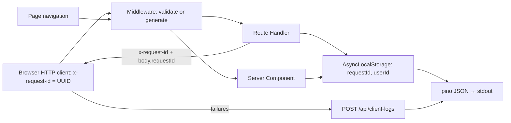

# TS-05 — Observability and traceability

| Field | Value |
|---|---|
| **ID** | TS-05 |
| **Module** | OBS |
| **Status** | Approved |
| **Version** | 1.0 |
| **Author** | Claude (AI-assisted draft) |
| **Reviewer** | Project owner |
| **Last updated** | 2026-10-14 |
| **Implements** | NFR-04, NFR-05 (logging part) · UIR-CONF-11 and reference codes in FS-01…FS-04 |
| **Related decisions** | ADR-006 |

---

## 1. Context and technical goal

Every request (page render, API call, Server Action) and every client-side failure carries one correlation ID, logged as structured JSON with a fixed schema and a closed event catalog, without sensitive data. The same ID, shortened, is the reference code users see on errors.

## 2. Technical scope

**In scope:** ID generation and propagation, logger configuration, per-request context, log schema, levels, redaction, event catalog, client-log endpoint, reference-code format.
**Out of scope:** metrics/tracing backends (production path in ADR-006 §8).

## 3. Module architecture

### 3.1 Layers and responsibilities

| Layer | Elements |
|---|---|
| Middleware | `ensureRequestId(req)`: reuse a valid incoming `x-request-id` (UUID) or generate one; forward on the request; set on the response |
| Server runtime | `instrumentation.ts` initializes the logger; `withRequestContext` wraps controllers, Server Components entry and the Server Action with `AsyncLocalStorage` `{ requestId, userId? }` |
| Logger | `logger` (pino) with base fields, redaction, level from config; `log.event(name, fields)` helper that enforces catalog names |
| HTTP client | Generates `x-request-id` per call; includes it in every `Result` |
| Client reporting | `reportClientEvent(event)` → batched `POST /api/client-logs` |
| UI | `ReferenceCode` component renders the short form |

### 3.2 Diagram



### 3.3 Module structure

```
src/proxy.ts                 # ensureRequestId
src/instrumentation.ts
src/server/logging/{logger,context,events,redaction}.ts
src/app/api/client-logs/route.ts
src/lib/observability/report-client-event.ts
src/components/ui/ReferenceCode.tsx
```

### 3.4 Technology bindings

See TS-00 §3.4 (pino, `AsyncLocalStorage`, Next.js instrumentation).

## 4. Domain model and types

| Type | Kind | Shape | Invariants |
|---|---|---|---|
| `RequestId` | Branded string | UUID v4 | Validated before reuse |
| `ReferenceCode` | Derived | First 8 hex chars of `RequestId`, uppercase, grouped `XXXX-XXXX` | Display only |
| `LogEvent` | Union of catalog names | `'auth.code.requested' \| …` | Only catalog names compile |
| `ClientEvent` | DTO | `{ event; level: 'warn' \| 'error'; requestId?; route; attemptKey?; details?; at }` | ≤ 2 KB serialized |

## 5. Interface contracts

### `POST /api/client-logs`

| | Detail |
|---|---|
| **Purpose** | Receive client-side failures for correlation |
| **Authentication** | Optional session (attached if present); CSRF-protected |
| **Limits** | ≤ 10 events per request; ≤ 2 KB per event; 20 requests/min per session or IP |

**Request:** `{ events: ClientEvent[] }` — only catalog events with `client.` or listed client-origin names (`tx.confirm.timeout`, `tx.confirm.unresolved`, `client.render.error`, `client.http.network_error`).
**Success:** `204`. **Errors:** `400` · `403` · `413` (too large) · `429 RATE_LIMITED`.

## 6. Rules: where they are enforced

| Rule | Type | Domain | Client | Server | Notes |
|---|---|---|---|---|---|
| Every response has `x-request-id` | NFR-04 | — | — | Middleware | Integration test |
| Every error body has `requestId` | NFR-04 | — | — | `toResponse` (TS-00 §5) | |
| No sensitive data in logs | NFR-05 | — | `reportClientEvent` strips fields not in schema | pino redaction + masked helpers | |
| Catalog-only event names | NFR-04 | — | Typed | Typed | Compile-time |

## 7. Rendering and data loading

N/A — cross-cutting.

## 8. State management

| State | Kind | Where it lives | Lifecycle |
|---|---|---|---|
| Request context | Server | `AsyncLocalStorage` | One request |
| Pending client events | Client | In-memory queue, flushed on next tick or `pagehide` (beacon) | Page lifetime |

## 9. Error handling

Logging never throws into business code: logger failures are swallowed after a best-effort `stderr` write. Client reporting failures are ignored (no retry storms).

## 10. Security, session and permissions

**Never logged:** session ID / cookie values, one-time codes, full identifiers, names of counterparties, `authorization` headers, request bodies as a whole.
**Logged masked:** identifiers (`•••• 5678`, `a•••@correo.com`) only when needed.
**Redaction paths:** `req.headers.cookie`, `req.headers.authorization`, `*.identifier`, `*.code`, `*.name`, `*.destination`, `*.sessionId`.

## 11. Observability — standard

### 11.1 Log line schema

| Field | Always | Notes |
|---|---|---|
| `time`, `level` | Yes | ISO 8601, pino levels |
| `event` | Yes | Catalog name |
| `requestId` | Yes (server) | From context |
| `userId` | When authenticated | Internal ID |
| `route`, `method`, `status`, `durationMs` | Request summary lines | Emitted once per API request by the controller wrapper |
| `code` | On failures | `ErrorCode` |
| module fields | Per event | See catalog |

### 11.2 Levels

| Level | Use |
|---|---|
| `error` | Unexpected failures, simulated outages, unresolved transfers |
| `warn` | Expected but notable failures (throttling, CSRF rejection, wrong code, timeouts) |
| `info` | Business events (code requested, login, transfer completed) |
| `debug` | Successful reads, status checks (off by default) |

### 11.3 Event catalog

| Module | Events (defined in) |
|---|---|
| HTTP | `http.request.completed` (all API requests: route, method, status, durationMs) |
| AUTH | `auth.code.requested`, `auth.code.rejected`, `auth.code.throttled`, `auth.code.request_failed`, `auth.verify.rejected`, `auth.verify.succeeded`, `auth.verify.failed`, `auth.verify.locked`, `auth.verify.request_failed`, `auth.logout`, `auth.session.rejected` (TS-01) |
| SECURITY | `security.csrf.rejected` (TS-01) |
| HOME | `home.summary.loaded`, `home.summary.failed`, `home.activity.loaded`, `home.activity.failed` (TS-02) |
| TX | `tx.contacts.loaded`, `tx.contacts.failed`, `tx.contact.created`, `tx.contact.duplicate`, `tx.contact.rejected`, `tx.contact.save_failed` (TS-03) |
| CONF | `tx.confirm.requested`, `tx.confirm.completed`, `tx.confirm.failed`, `tx.confirm.rejected`, `tx.confirm.network_unavailable`, `tx.confirm.error`, `tx.confirm.replayed`, `tx.confirm.idempotency_conflict`, `tx.status.checked`, `tx.confirm.timeout`*, `tx.confirm.unresolved`*, `receipt.viewed`, `receipt.not_found` (TS-04) |
| MOCK | `mock.outcome.forced`, `mock.outcome.ignored`, `mock.reset` (TS-04, TS-00) |
| PREFS | `prefs.theme.changed` (Server Action) |
| CLIENT | `client.render.error`*, `client.http.network_error`* |

\* Client-origin events received through `/api/client-logs`.

### 11.4 Reference code

- Shown on every error/unresolved state (FS §12 `common.reference`) as `Referencia: 3F9A-12C4`.
- Derived from the failed call's `requestId` (client-generated, so available even on timeout or network error).
- Support can search logs by the 8-character prefix.

## 12. Performance and scalability

- pino asynchronous JSON to stdout; `debug` disabled by default; one summary line per request.
- Production: ship stdout to a log pipeline; add OpenTelemetry traces with W3C `traceparent` mapped to `requestId`.

## 13. Accessibility

`ReferenceCode` is selectable text with an accessible label "Referencia" and a copy action where the FS requires it.

## 14. Module test strategy

| What | Level | TC |
|---|---|---|
| `ensureRequestId` (reuse valid, replace invalid, generate) | Unit | Phase 5 |
| Redaction removes every configured path; reference-code formatting | Unit | Phase 5 |
| Every API response has `x-request-id`; error bodies include it; client-logs limits | Integration | Phase 5 |
| Reference code on a forced error equals the response ID prefix | E2E | Phase 5 |

## 15. Risks and mitigations

| Risk | Likelihood | Impact | Mitigation |
|---|---|---|---|
| Sensitive data logged through a new field | Medium | Privacy | Redaction by path + catalog-typed fields + unit test |
| Client-log abuse | Low | Noise, cost | Size/rate limits, CSRF, schema |
| Middleware runtime lacks Node APIs | Medium | No logger there | Middleware only handles IDs; logging happens in server runtime |

## 16. Known limitations and technical debt

- Logs only to stdout; no dashboards, alerts or traces.

## 17. Traceability

| Requirement | Section | Tasks | Test cases |
|---|---|---|---|
| NFR-04 | §3, §11 | Phase 4 | Phase 5 |
| NFR-05 | §10 | Phase 4 | Phase 5 |
| UIR-CONF-11, `common.reference` | §11.4 | Phase 4 | Phase 5 |

## 18. Change history

| Version | Date | Author | Change |
|---|---|---|---|
| 0.1 | 2026-10-14 | Claude (AI-assisted) | First draft |
| 1.0 | 2026-10-14 | Project owner | Approved |
