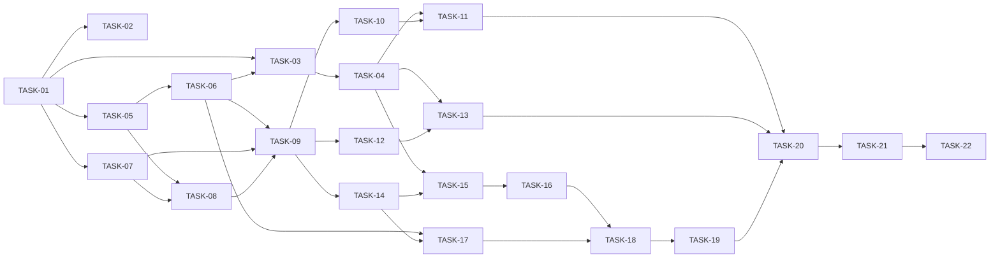

# Implementation plan — Mini Wallet Web App

| Field | Value |
|---|---|
| **Status** | Draft |
| **Version** | 0.2 |
| **Author** | Claude (AI-assisted draft) |
| **Reviewer** | Project owner |
| **Last updated** | 2026-10-14 |
| **Based on** | FS-01…FS-04 v1.1 · TS-00…TS-05 v1.0 · ADR-001…ADR-009 |
| **Repository** | `github.com/Kryztof55/mini-wallet-web-app` (`main`) |

> This plan is an ordered list of tasks to drive the build. It has no dates: the order and the dependencies are what matter.

---

## 1. Goal

Turn the approved specs into a working Next.js + TypeScript wallet that satisfies every **Must** requirement and business rule, handles the five confirmation outcomes, meets the accessibility and security baseline, and ships with README, DECISIONS.md and AI_USAGE.md (DEL-01…DEL-04).

## 2. Scope

| Type | Detail |
|---|---|
| Minimum scope (Must) | All FR/BR/NFR marked Must; acceptance criteria of Must requirements in FS-01…FS-04; five outcomes; CSRF + session; WCAG AA basics; dark mode; three delivery docs |
| Desired scope (Should/Could) | Built in order; first candidates to cut are listed in §7 |
| Estimates | Relative effort per task (**29.25 h** in total); each includes its unit/component/integration tests; E2E and the manual accessibility pass have their own tasks |

## 3. Build strategy

**Inside-out, with a navigable skeleton early.**

1. **Foundations first:** tooling, domain rules and mocks, then HTTP layers, observability, themes and base components — everything later tasks compose.
2. **Security before screens:** session, CSRF and the middleware gate exist before the first private screen, so no screen is ever built unprotected.
3. **One vertical slice per milestone:** API → service → screen → tests, in the order of the user journey (Login, Home, Transfer, Confirmation).
4. **Quality and delivery last**, but tests are written inside every task, not deferred.

## 4. Milestones

| Milestone | Contents | Tasks | Estimate | Status |
|---|---|---|---|---|
| M0 | Foundations — Project, tooling, domain, mocks, observability, HTTP layers, themes, base UI | TASK-01, TASK-02, TASK-03, TASK-04, TASK-05, TASK-06, TASK-07, TASK-08 | 8.5 h | Pending |
| M1 | Security core + Login — Session, CSRF, middleware gate, auth API and login screens (FS-01) | TASK-09, TASK-10, TASK-11 | 4.75 h | Pending |
| M2 | Home — Home API and screen (FS-02) | TASK-12, TASK-13 | 2.5 h | Pending |
| M3 | Transfer flow — Contacts API, recipient step, amount and summary (FS-03) | TASK-14, TASK-15, TASK-16 | 4.5 h | Pending |
| M4 | Confirmation and receipt — Transfers API, confirmation state machine, receipt (FS-04) | TASK-17, TASK-18, TASK-19 | 4.5 h | Pending |
| M5 | Quality and delivery — E2E suite, accessibility pass, README / DECISIONS / AI_USAGE | TASK-20, TASK-21, TASK-22 | 4.5 h | Pending |

**Exit criteria (every milestone):** its tasks meet the Definition of Done; `lint`, `typecheck` and `test` green on `main`.

## 5. Task breakdown

| ID | Task | Covers | Depends on | Milestone | Estimate | Actual | Status |
|---|---|---|---|---|---|---|---|
| [TASK-01](../04-development/tasks/TASK-01-scaffold-project.md) | Scaffold the project and tooling | TS-00 §3.3, §14 · CON-01 | — | M0 | 0.5 h | — | Pending |
| [TASK-02](../04-development/tasks/TASK-02-setup-test-tooling.md) | Set up the test tooling | ADR-005 · NFR-08, NFR-09 | TASK-01 | M0 | 0.5 h | — | Pending |
| [TASK-03](../04-development/tasks/TASK-03-themes-and-tokens.md) | Implement design tokens, themes and theme switching | UX-22 · NFR-16 · A11Y-10, A11Y-21, A11Y-26 · UIR-AUTH-18 | TASK-01, TASK-06 | M0 | 1.25 h | — | Pending |
| [TASK-04](../04-development/tasks/TASK-04-base-ui-components.md) | Build the base UI components | NFR-11 · A11Y-03, 04, 05, 07, 08, 13, 18, 19, 24 · UIR-AUTH-03, UIR-TX-13 | TASK-03 | M0 | 1.5 h | — | Pending |
| [TASK-05](../04-development/tasks/TASK-05-domain-rules.md) | Implement the domain types and business rules | BR-01…BR-17 (domain side) · NFR-03 · UIR-AUTH-06, UIR-HOME-07, UIR-HOME-08 | TASK-01 | M0 | 1.5 h | — | Pending |
| [TASK-06](../04-development/tasks/TASK-06-config-and-mocks.md) | Implement configuration and the mock layer | NFR-10 · ASM-03, ASM-04, ASM-16, ASM-17 · FR-CONF-11 | TASK-05 | M0 | 1.25 h | — | Pending |
| [TASK-07](../04-development/tasks/TASK-07-observability.md) | Implement the observability foundation | NFR-04 · NFR-05 (logs) · UIR-CONF-11 | TASK-01 | M0 | 0.75 h | — | Pending |
| [TASK-08](../04-development/tasks/TASK-08-http-layers.md) | Build the server HTTP helpers and the browser HTTP client | TS-00 §5–§6 · ADR-009 · NFR-06 | TASK-05, TASK-07 | M0 | 1.25 h | — | Pending |
| [TASK-09](../04-development/tasks/TASK-09-session-and-security.md) | Implement session handling and request security | BR-14 · NFR-05, NFR-17 · FR-AUTH-08, FR-AUTH-09 · UIR-AUTH-15 · AC-AUTH-13, 14, 19 | TASK-06, TASK-07, TASK-08 | M1 | 1.5 h | — | Pending |
| [TASK-10](../04-development/tasks/TASK-10-auth-api.md) | Implement the auth API | FR-AUTH-01, 02, 05, 06, 10, 12…16 · BR-10…BR-13 · OQ-14 | TASK-09 | M1 | 1.25 h | — | Pending |
| [TASK-11](../04-development/tasks/TASK-11-login-screens.md) | Build the login screens | FR-AUTH-01…05, 07, 11…16 · UIR-AUTH-01…17 · AC-AUTH-01…12, 15…18 | TASK-04, TASK-10 | M1 | 2 h | — | Pending |
| [TASK-12](../04-development/tasks/TASK-12-home-api.md) | Implement the Home API and services | FR-HOME-01…03, 10 · BR-14 | TASK-09 | M2 | 0.5 h | — | Pending |
| [TASK-13](../04-development/tasks/TASK-13-home-screen.md) | Build the Home screen | FR-HOME-01…11 · FR-AUTH-10 · UIR-HOME-01…13 · AC-HOME-01…12 | TASK-04, TASK-12 | M2 | 2 h | — | Pending |
| [TASK-14](../04-development/tasks/TASK-14-contacts-api.md) | Implement the contacts API | FR-TX-02, 04 · BR-08, BR-09, BR-10, BR-16 | TASK-09 | M3 | 0.5 h | — | Pending |
| [TASK-15](../04-development/tasks/TASK-15-transfer-recipient.md) | Build the transfer layout, draft state and recipient step | FR-TX-02…04, 08, 09 · UIR-TX-01…09, 14, 19, 20 · AC-TX-05…10, 13, 14, 16 | TASK-04, TASK-14 | M3 | 2 h | — | Pending |
| [TASK-16](../04-development/tasks/TASK-16-transfer-amount-summary.md) | Build the amount and summary steps | FR-TX-01, 05, 06, 07, 11 · BR-01, 02, 04, 15 · UIR-TX-10…13, 15…18 · AC-TX-01…04, 11, 12 | TASK-15 | M3 | 2 h | — | Pending |
| [TASK-17](../04-development/tasks/TASK-17-transfers-api.md) | Implement the transfers API | FR-CONF-01, 08, 11, 13 · BR-06, BR-07, BR-17 · UIR-CONF-17 · AC-TX-15, AC-CONF-04, 15, 16 | TASK-06, TASK-14 | M4 | 1.5 h | — | Pending |
| [TASK-18](../04-development/tasks/TASK-18-confirmation-flow.md) | Build the confirmation flow | FR-CONF-02…07 · UIR-CONF-01…11, 16 · AC-CONF-02…10 | TASK-16, TASK-17 | M4 | 2 h | — | Pending |
| [TASK-19](../04-development/tasks/TASK-19-receipt.md) | Build the receipt and post-transfer navigation | FR-CONF-03, 09, 10 · UIR-CONF-07, 12…15 · UIR-TX-21 · UIR-HOME-11 · AC-CONF-01, 11…14, 17 · AC-HOME-09 | TASK-18 | M4 | 1 h | — | Pending |
| [TASK-20](../04-development/tasks/TASK-20-e2e-suite.md) | Write the E2E suite | NFR-09 · NFR-14 · AC-* (E2E level) | TASK-11, TASK-13, TASK-19 | M5 | 2 h | — | Pending |
| [TASK-21](../04-development/tasks/TASK-21-a11y-responsive-pass.md) | Run the accessibility and responsive pass | NFR-14 · A11Y-01…26 · UX-01 | TASK-20 | M5 | 1.25 h | — | Pending |
| [TASK-22](../04-development/tasks/TASK-22-delivery-docs.md) | Write the delivery documents | DEL-01…05 | TASK-21 | M5 | 1.25 h | — | Pending |
| | | | | **Total** | **29.25 h** | | |

## 6. Critical path

**Critical path (longest chain by estimate, 17.5 h of strictly sequential work):** TASK-01 → TASK-05 → TASK-06 → TASK-03 → TASK-04 → TASK-15 → TASK-16 → TASK-18 → TASK-19 → TASK-20 → TASK-21 → TASK-22.
The security chain TASK-06 → TASK-09 → TASK-14 runs alongside it and must finish before TASK-15. Any delay on TASK-05, TASK-06 or TASK-09 delays everything after it.

## 7. Scope cuts (if time runs out)

Decided upfront, in order. None of them breaks a Must requirement.

| # | Cut | Affects | Saves | Fallback |
|---|---|---|---|---|
| 1 | Client error reporting endpoint | TS-05 client part | ~0.5 h | Client errors to console; server logging intact |
| 2 | Section-level retry on Home | UIR-HOME-12 (Must FR still met) | ~0.5 h | Retry re-renders the whole page |
| 3 | Hide/show balance | FR-HOME-11 (Should) | ~0.5 h | Documented as "with more time" |
| 4 | Concept field | FR-TX-11, BR-15 (Should) | ~0.5 h | Documented |
| 5 | "Send again" and Home highlight | UIR-CONF-14 (part), UIR-HOME-11 | ~0.5 h | Receipt → Home only |
| 6 | Mobile WebKit E2E project | ADR-005 | ~0.5 h | Chromium desktop + mobile viewport emulation |
| 7 | E2E for `timeout-not-processed` and `timeout-unresolved` | AC-CONF-07, 08 (covered by presentation-logic tests) | ~0.5 h | Keep hook tests with fake timers |
| 8 | Screen-reader smoke beyond the main flow | TASK-21 | ~0.5 h | VoiceOver on login → receipt only |

**Never cut:** BR-01…BR-03 on the server, the five outcomes, idempotent confirmation, CSRF and session protection, dark mode, keyboard accessibility and contrast, README / DECISIONS / AI_USAGE.

## 8. Version control workflow

- `main` is always green; one branch per milestone: `feat/m0-foundations`, `feat/m1-security-login`, `feat/m2-home`, `feat/m3-transfer-flow`, `feat/m4-confirmation-receipt`, `chore/m5-quality-delivery`.
- One or more commits per task, Conventional Commits with the task ID: `feat(tx): validate sufficient balance [TASK-05]`.
- Merge to `main` when the milestone's tasks are done and `lint`, `typecheck` and `test` pass; push to `origin`.
- Commits that include AI-generated code keep the co-author trailer used in the repository.

## 9. Definition of Ready / Done

See [specs README §5](../README.md#5-quality-gates).

## 10. Plan risks

| Risk | Impact | Mitigation |
|---|---|---|
| Effort higher than expected | Missing Should items | Scope cuts §7, applied in order |
| Framework conventions differ from specs (e.g. `middleware` → `proxy`) | Setup friction | Verified in TASK-01; TS-00 updated |
| E2E slowed by real timeouts | Slow feedback | Timings from config, shortened in E2E (ADR-005) |
| Concurrency bugs in idempotency | Double debit | Dedicated integration test in TASK-17 |
| Accessibility issues found late | Rework at the end | Base components tested with axe in TASK-04; keyboard check per task |

## 11. Tracking actual time

The challenge asks to declare the real time spent in the README (DEL-02). Each task card records its **Actual time**; TASK-22 adds them up, together with the time spent on the specs, for the README.

## 12. Change history

| Version | Date | Author | Change |
|---|---|---|---|
| 0.1 | 2026-10-14 | Claude (AI-assisted) | First draft |
| 0.2 | 2026-10-14 | Claude (AI-assisted) | Removed dates, days and daily checkpoints at the owner's request; plan is an ordered task list |
