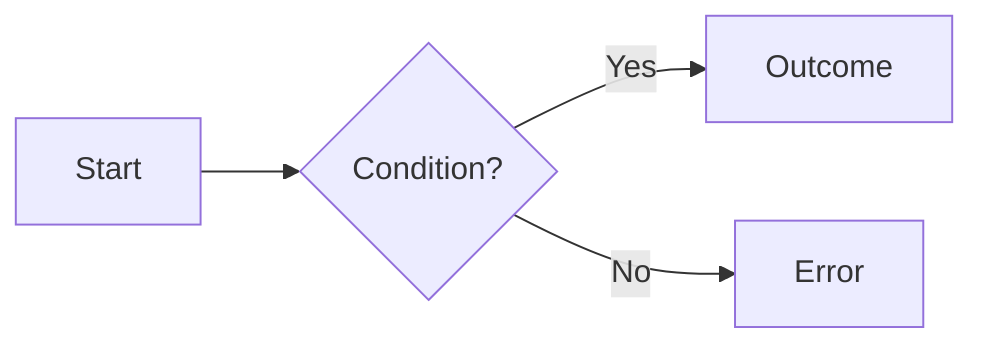

# FS-NN — <Screen or flow name>

| Field | Value |
|---|---|
| **ID** | FS-NN |
| **Module** | <MODULE> |
| **Status** | Draft |
| **Version** | 0.1 |
| **Author** | <name> |
| **Reviewer** | <name> |
| **Last updated** | YYYY-MM-DD |
| **Origin** | Source document §<x> · `FR-…` in [00-context](../00-context/) |
| **Implemented by** | [TS-NN](../02-technical/) |

<!-- Guidance: an FS describes WHAT the system does from the user's and the business's point of view.
     It never mentions technologies, libraries, components or endpoints: those belong in the TS and ADRs. -->

---

## 1. Goal

<!-- 2–3 lines: what problem this screen or flow solves and what value it gives the user. -->

## 2. Scope

**In scope**
- …

**Out of scope** (and why)
- …

## 3. Actors, preconditions and postconditions

| | Detail |
|---|---|
| **Actor** | <role> |
| **Preconditions** | … |
| **Success postcondition** | … |
| **Failure postcondition** | … |

## 4. Functional requirements

| ID | Description | Priority | Origin |
|---|---|---|---|
| FR-<MOD>-01 | The system must … | Must | Source §x |
| FR-<MOD>-02 | … | Should | ASM-NN |

<!-- MoSCoW: Must (required by the source) · Should (production would expect it) ·
     Could (extra value) · Won't (explicitly out of scope). -->

## 5. Rules

<!-- Classify every rule with the test: "If someone calls the server directly, bypassing the UI,
     must this still hold?" Yes → 5.1 (business / input validation rule). No → 5.2 (UI rule).
     See glossary "Rule classification test". -->

### 5.1 Business and input validation rules

<!-- Defined in 00-context with a BR ID; only referenced here. WHERE they are enforced is defined in the TS. -->

| ID | Type | Rule | When it is evaluated | Outcome if violated |
|---|---|---|---|---|
| BR-NN | Business / Input validation | … | On input / on continue / on submit | Message + action blocked |

### 5.2 UI rules

<!-- Presentation and interaction behaviors specific to this screen. Defined HERE with a UIR ID.
     They never protect data integrity on their own; each one is verified by a component or presentation-logic test. -->

| ID | Rule | Trigger | Behavior | Related |
|---|---|---|---|---|
| UIR-<MOD>-01 | … | e.g. amount field becomes invalid | e.g. "Continue" disabled; error shown on blur | BR-NN, UX-NN, A11Y-NN |

## 6. User stories

- **US-01** — As a <role>, I want <action>, so that <benefit>.

## 7. Flows

### 7.1 Main flow (happy path)
1. …
2. …

### 7.2 Alternate flows
- **A1 — <name>:** at step N, if …, then …

### 7.3 Exception flows
- **E1 — <name>:** at step N, if … fails, then …



## 8. UI states

<!-- Every view with asynchronous data covers at least: initial, loading, success, empty, error. -->

| State | When it happens | What the user sees | Available actions |
|---|---|---|---|
| Initial | … | … | … |
| Loading | … | Loading placeholder; primary action disabled | None / cancel |
| Success | … | … | … |
| Empty | … | Message + suggested action | … |
| Error | … | Descriptive message + reference code | Retry / go back |

## 9. Input and output data

### 9.1 Fields captured from the user

| Field | Kind | Required | Format / validation | Error message key |
|---|---|---|---|---|
| … | text / number / choice | Yes | … | `<mod>.error.<x>` |

### 9.2 Information displayed

| Data | Display format | Source |
|---|---|---|
| … | e.g. currency with symbol and 2 decimals | … |

## 10. Acceptance criteria

<!-- Given/When/Then. Every AC must be verifiable by at least one TC. -->

**AC-<MOD>-01 — <title>**
```gherkin
Given …
When …
Then …
```

**AC-<MOD>-02 — <title>**
```gherkin
Given …
When …
Then …
```

## 11. Edge cases

| # | Situation | Expected behavior |
|---|---|---|
| EC-01 | Primary action triggered twice | Processed only once |
| EC-02 | Session expires mid-flow | … |
| EC-03 | … | … |

## 12. Copy and messages

| Key | Text | Context |
|---|---|---|
| `<mod>.error.<x>` | "…" | … |

## 13. Accessibility and responsive behavior

- Fully operable with keyboard only; visible focus; logical order.
- Errors are announced to assistive technologies and associated with their field.
- Contrast meets WCAG AA; touch targets meet the minimum size defined in TS-00.
- Behavior on small, medium and large viewports (breakpoints defined in TS-00): …

## 14. Assumptions

| ID | Assumption | Impact if wrong |
|---|---|---|
| ASM-NN | … | … |

## 15. Open questions

| ID | Question | Blocking? | Answer / decision |
|---|---|---|---|
| OQ-NN | … | Yes / No | … |

## 16. Traceability

| Requirement | Technical spec | Tasks | Test cases |
|---|---|---|---|
| FR-<MOD>-01 | TS-NN §x | TASK-NN | TC-…-NN |
| BR-NN | TS-NN §x | TASK-NN | TC-UNIT-NN, TC-INT-NN |
| UIR-<MOD>-NN | TS-NN §x | TASK-NN | TC-COMP-NN / TC-PL-NN |

## 17. Change history

| Version | Date | Author | Change |
|---|---|---|---|
| 0.1 | YYYY-MM-DD | … | Created |
