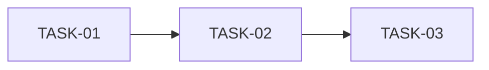

# Implementation plan — <Name>

| Field | Value |
|---|---|
| **Status** | Draft |
| **Version** | 0.1 |
| **Author** | <name> |
| **Last updated** | YYYY-MM-DD |
| **Based on** | FS-NN… · TS-NN… · ADR-NNN… |
| **Timeline** | <start date> → <delivery date> |

---

## 1. Goal

<!-- What is delivered at the end and at what quality level. -->

## 2. Constraints and assumptions

| Type | Detail |
|---|---|
| Deadline | … |
| Minimum scope (Must) | … |
| Desired scope (Should/Could) | … |
| Assumptions | … |

## 3. Build strategy

<!-- Build order and why. Recommended: inside-out
     (domain → application → interfaces/adapters → presentation logic → UI → E2E),
     with a navigable walking skeleton early on. -->

## 4. Milestones

| Milestone | Contents | Exit criteria | Target date | Status |
|---|---|---|---|---|
| M0 | Project scaffolding and tooling | Build, run, test and static-analysis commands all work | … | Pending |
| M1 | … | … | … | … |

## 5. Task breakdown

| ID | Task | Covers (FR/BR/TS) | Depends on | Estimate | Actual | Status |
|---|---|---|---|---|---|---|
| TASK-01 | … | TS-00 | — | 1 h | — | Pending |
| TASK-02 | … | BR-01, BR-02 | TASK-01 | … | — | Pending |

## 6. Critical path

## 7. Scope cuts (if time runs out)

<!-- Decided upfront, in order: what gets sacrificed first without breaking any Must. -->
1. …
2. …

## 8. Version control workflow

- Main line: always releasable; every change goes through review.
- Branch naming: `<type>/<task-id>-<short-name>` (types: feat, fix, docs, test, chore).
- Commit messages: `<type>(<scope>): 
 [TASK-NN]` (Conventional Commits style).
- Before merging: static analysis and all tests pass.

## 9. Definition of Ready / Done

See [specs README §5](../README.md#5-quality-gates).

## 10. Plan risks

| Risk | Impact | Mitigation | Trigger |
|---|---|---|---|
| … | … | … | … |

## 11. Time log

<!-- Fill in daily; the total is reported in the project README. -->

| Date | Activity | Phase / TASK | Hours |
|---|---|---|---|
| … | … | … | … |
| | | **Total** | **0 h** |

## 12. Change history

| Version | Date | Author | Change |
|---|---|---|---|
| 0.1 | YYYY-MM-DD | … | Created |
