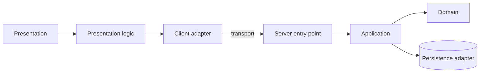

# TS-NN — <Module name>

| Field | Value |
|---|---|
| **ID** | TS-NN |
| **Module** | <MODULE> |
| **Status** | Draft |
| **Version** | 0.1 |
| **Author** | <name> |
| **Reviewer** | <name> |
| **Last updated** | YYYY-MM-DD |
| **Implements** | [FS-NN](../01-functional/) |
| **Related decisions** | [ADR-NNN](./adr/) |

<!-- Guidance: a TS describes HOW the FS gets built, in architectural terms.
     Keep it technology-agnostic: name concepts (presentation layer, server entry point, client store),
     not frameworks or libraries. Concrete technologies are chosen in ADRs and mapped to these
     concepts once, in TS-00 "Technology bindings". If a section does not apply,
     write "N/A — <reason>" instead of deleting it, so it is clear it was considered. -->

---

## 1. Context and technical goal

<!-- Which part of the FS this module covers and which technical constraints matter
     (expected load, data sensitivity, external dependencies, deadlines). -->

## 2. Technical scope

**In scope:** …
**Out of scope:** …

## 3. Module architecture

### 3.1 Layers and responsibilities

| Layer | Responsibility | Location | May depend on |
|---|---|---|---|
| Presentation (UI) | Render state, capture input; no business logic | `<path>` | Presentation logic, shared types |
| Presentation logic | Screen state, orchestration of use cases, UI-level validation | `<path>` | Application, domain |
| Application (use cases) | Coordinate a user intent end to end; transport-agnostic | `<path>` | Domain, ports |
| Domain | Entities, value objects, pure business rules | `<path>` | Nothing (framework-free) |
| Interface (server entry points) | Expose operations to clients; authenticate, validate, map errors | `<path>` | Application |
| Infrastructure (adapters) | Persistence, external services, mocks; implement ports | `<path>` | Domain (ports) |

### 3.2 Diagram



### 3.3 Module structure

```
<module>/
  …
```

### 3.4 Technology bindings

<!-- Do not restate global bindings: they live in TS-00. List only deviations or
     module-specific bindings, each backed by an ADR. -->

| Concept | Binding | ADR |
|---|---|---|
| See TS-00 §Technology bindings | — | — |

## 4. Domain model and types

<!-- Describe types with intent, in neutral notation: explicit contracts, no untyped values,
     tagged unions for states and outcomes, dedicated value types where a primitive is not enough. -->

| Type | Kind | Shape | Invariants |
|---|---|---|---|
| `Money` | Value object | `{ amountMinor: integer, currency: ISO-4217 }` | `amountMinor` is an integer; never floating point |
| `Result<T, E>` | Tagged union | `Success(value: T) \| Failure(error: E)` | Exactly one variant |
| `<Entity>` | Entity | `{ id, … }` | … |

## 5. Interface contracts

### Operation: `<operationName>`

| | Detail |
|---|---|
| **Purpose** | … |
| **Transport / endpoint** | e.g. `POST /<resource>` · RPC `<name>` · server-side mutation |
| **Authentication** | Requires session / public |
| **Correlation ID** | Accepted if provided, generated otherwise, always returned (see TS-05) |
| **Idempotency** | Yes / No — key source, scope and retention |
| **Expected client timeout** | … ms |

**Request**

| Field | Type | Required | Constraints |
|---|---|---|---|
| … | … | Yes | … |

**Success response**

| Field | Type | Notes |
|---|---|---|
| … | … | … |

**Errors**

| Transport status (e.g. HTTP) | `code` | When | Retryable? |
|---|---|---|---|
| 400 | `VALIDATION_ERROR` | … | No |
| 401 | `UNAUTHENTICATED` | … | No |
| 422 | `<BUSINESS_RULE>` | … | No |
| 5xx | `INTERNAL_ERROR` | … | Yes |

**Common error shape**

| Field | Type | Notes |
|---|---|---|
| `code` | `ErrorCode` (closed set) | Stable, machine-readable |
| `message` | string | Safe to display; no internals |
| `correlationId` | string | Same as the correlation ID of the request |
| `details` | optional | Field-level validation info |

## 6. Rules: where they are enforced

<!-- Rule of thumb: the domain is the source of truth, the server always validates,
     the client validates only for user experience. UI rules live only in the presentation layer. -->

| Rule | Type | Domain (pure function) | Client (presentation) | Server (authority) | Notes |
|---|---|---|---|---|---|
| BR-NN … | Business | `validateX` | Yes — feedback on input | Yes — on submit | … |
| BR-NN … | Input validation | Value type `X` | Yes — feedback on blur | Yes — on submit | … |
| UIR-<MOD>-NN … | UI | — | Yes — `<component / presentation logic>` | N/A | … |

## 7. Rendering and data loading

| View | Strategy (server-rendered · client-rendered · pre-rendered · streamed) | Mutations (client call · server-side mutation) | Reason | Cache policy |
|---|---|---|---|---|
| `<view>` | … | … | … | No cache / revalidate every N / static |

<!-- Justify based on: data sensitivity (per-user data is never shared-cached),
     interactivity, time to first content, server cost under load. Reference the ADR. -->

## 8. State management

| State | Kind | Where it lives | Lifecycle |
|---|---|---|---|
| Session | Server-owned | `<secure storage mechanism>` | … |
| Remote data | Server-owned, client-cached | `<cache>` | Invalidation rules |
| Multi-step flow draft | Client, shared across views | `<client store>` | Cleared on completion / exit |
| Form | Client, local to view | `<view state>` | … |
| Navigation / filters | URL | Path / query parameters | Shareable, survives reload |

## 9. Error handling

| Code | Origin | Transport status | User message | UI action | Retryable | Log event |
|---|---|---|---|---|---|---|
| `NETWORK_ERROR` | Client | — | "…" | Retry | Yes | `EVT-…` |
| `TIMEOUT` | Client | — | "…" | … | Yes (same idempotency key) | `EVT-…` |
| `UNKNOWN` | Any | 500 | Generic fallback | … | … | `EVT-…` |

**Error containment:** where unhandled errors are caught at the UI level (per view, per section, global) and what fallback is shown.

## 10. Security, session and permissions

- Protected views/operations and the layer that enforces protection (before rendering, at the entry point).
- Behavior with a missing, invalid or expired session.
- Sensitive data: what is never sent to the client nor kept in client-side persistent storage.
- Server-side input validation (never trust the client).

## 11. Observability

<!-- Follows the TS-05 standard. List only THIS module's events. -->

| Event | Level | Emitted from | Fields | Masked data |
|---|---|---|---|---|
| `EVT-<mod>.<action>.<outcome>` | info / warn / error | `<entry point / client>` | `correlationId`, `userId`, `durationMs`, `code` | email, phone |

- **Correlation ID propagation:** how it reaches this module and how it is returned to the client.
- **User-visible reference code:** yes/no, in which states.

## 12. Performance and scalability

- Payload size / list pagination.
- What is computed on the server vs. the client; client bundle impact; deferred loading.
- Caching, and what must NEVER be shared-cached (per-user data).
- Behavior under high latency / retries (backoff, jitter, avoiding retry storms).

## 13. Accessibility

- …

## 14. Module test strategy

| What | Level | TC |
|---|---|---|
| Domain rules | Unit | TC-UNIT-NN |
| Presentation logic | Presentation logic | TC-PL-NN |
| Critical UI component | Component | TC-COMP-NN |
| Server entry point | Integration | TC-INT-NN |
| Full flow | E2E | TC-E2E-NN |

<!-- Tools are defined once in the test plan / testing ADR, not here. -->

## 15. Risks and mitigations

| Risk | Likelihood | Impact | Mitigation |
|---|---|---|---|
| … | Low/Medium/High | … | … |

## 16. Known limitations and technical debt

<!-- What is simplified (mocks, deadline). Feeds "known limitations" and "with more time" in project docs. -->
- …

## 17. Traceability

| Requirement / AC | Section of this TS | Tasks | Test cases |
|---|---|---|---|
| FR-… | §… | TASK-NN | TC-… |

## 18. Change history

| Version | Date | Author | Change |
|---|---|---|---|
| 0.1 | YYYY-MM-DD | … | Created |
